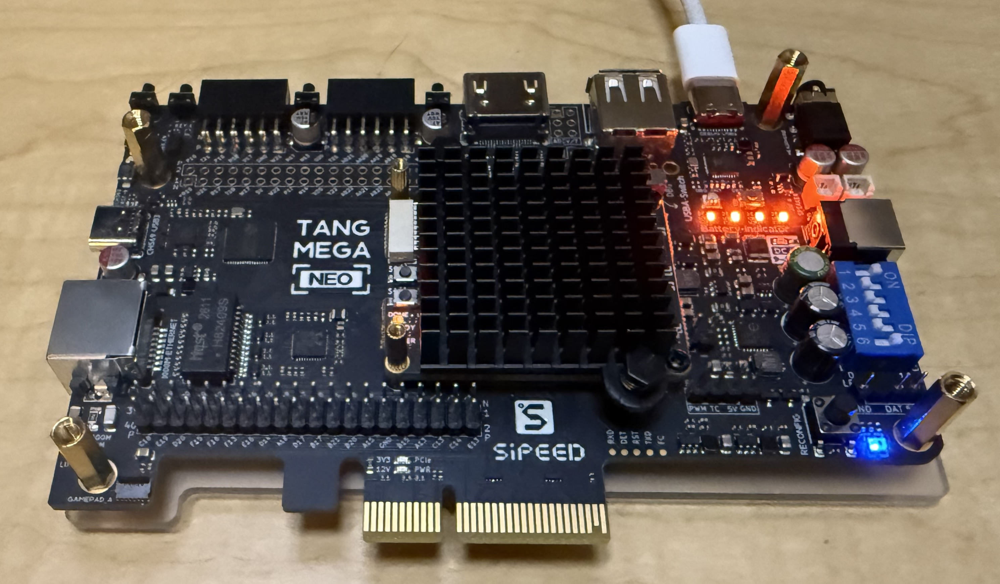

# Inference-only FPGA demonstrations

The paper *The Feasibility of a Hardwired Pause of Frontier AI Training*
([hardwired-pause.ai](https://hardwired-pause.ai)) introduces inference-only
chips in both an idealized sense and a practical, operational sense.
**This project builds physical FPGA demonstrations of that idea:** fixed
language models behind a restricted hardware interface, rather than a
general-purpose accelerator whose restrictions depend on its host software.

The paper distinguishes two approaches in Section 4.3:

- **Authenticated-Weight Inference-Only Chips (AWICs)** fix the model architecture and inference function in hardware and authenticate weights stored in memory against fixed cryptographic digests.
- **Hardwired-Weight Inference-Only Chips (HWICs)** encode both the model architecture and its weights directly in the circuit.

**All designs documented in this repository are AWIC designs implemented on FPGAs. HWIC designs are in progress.**

*Inference* uses an already-trained model to produce outputs without changing
its learned weights. The idealized machine permits models from a fixed set
and only three user operations: add input tokens to a model's tape, generate
another token, and clear the tape. Each demonstration here permits just one
model, so model selection is implicit.

| Inference command | Effect |
| --- | --- |
| `APPEND(token)` | Add one input token to the tape. |
| `STEP` | Generate a token, append it to the tape, and return it. |
| `CLEAR` | Empty the logical tape and invalidate cached inference state. |

Tokens are the pieces of text a language model reads and generates. The
hardware provides no application command to change model weights, submit a
matrix multiplication, or read and write intermediate tensors. Hardware
controllers own the inference schedule and memory addresses; the user supplies
tokens, not tensor pointers. Startup loaders, status and transport handling
are described separately in each model's guide.

The [seeded-sampling configuration](demos/simplestories-v2-5m/STOCHASTIC-GENERATION.md) runs SimpleStories-V2-5M on Tang Mega with authenticated weights and without K/V integrity protection. Temperature and a public seed can be configured while its tape is empty and idle. Its current evidence and qualification limits are stated
in [CURRENT-QUALIFICATION.md](demos/simplestories-v2-5m/CURRENT-QUALIFICATION.md). Each hardware configuration has its own validation record.

## The demonstrated designs and measurements

The table lists **Authenticated-Weight Inference-Only Chip (AWIC) designs**, all implemented on FPGAs.

<!-- COMMON-FPGA-SPEED:START -->
| Model and platform | Common cached generation | Package status |
| --- | --- | --- |
| **SimpleStories-V2-5M — Tang Mega**, authenticated weights | About **10.0 tokens/s** | Runnable release |
| Same model, **K/V-protected** | About **7.0 tokens/s** | Runnable release |
| Same model, **K/V protection + encrypted memory** | About **6.0 tokens/s** | Runnable release; public demonstration keys |
| Same model, **seeded-sampling image at temperature 0**, without K/V integrity | About **10.0 tokens/s** | Runnable release |
| **Qwen3-1.7B — AWS F2**, authenticated weights | About **9.0 tokens/s** | Runnable release; public AWS FPGA image |
| **Qwen3-8B — AWS F2**, authenticated weights | About **1.1 tokens/s** | Runnable prototype; speed optimization in progress; public AWS FPGA image |
<!-- COMMON-FPGA-SPEED:END -->

The encrypted-memory version retains K/V integrity and replay protection and
also encrypts both weights and K/V; its supplied keys are public demonstration
keys. Seeded sampling uses the baseline's authenticated weights, without K/V
integrity or encryption.

The common benchmark uses **one input token, 128 outputs, greedy decoding and two repetitions** for every design. Its cached rate is **254 divided by the sum of the two first-to-last reply durations**, measured on the local control host after validated replies return to the generation loop. It includes gaps between replies and excludes the first output. First-STEP latency and command-only timing are separate measurements.

A dash means that a complete paired record satisfying this protocol is unavailable. Model-specific validation measurements are linked from each guide. The [benchmark protocol and reproducible calculations](docs/benchmarks/FPGA-SPEED-BENCHMARK.md) specify the observation boundary, source identities and eligibility checks. These are workload-specific host-observed rates, not peak ratings.

“Runnable release” means the image, model, app and installation instructions
are available. Each model's guide states its completed functional checks and
its timing, security and proof limits. Availability does not guarantee every
workload or independently attest a loaded device. No Tang version has complete
vendor-DDR timing or physical-security certification.

At temperature 1, the seeded image's **command-only cached rate** is **9.94 tokens/s**, measured with a one-token prompt and two 128-output trials. This sampled-generation diagnostic excludes inter-command gaps and is separate from the greedy host-loop benchmark. The [qualification record](demos/simplestories-v2-5m/CURRENT-QUALIFICATION.md#recorded-timing) gives its workload and timing details.

- **[SimpleStories-V2-5M / Tang Mega guide](demos/simplestories-v2-5m/README.md):** board selection,
  the three greedy versions, optional seeded sampling, browser app,
  installation, measured prompt/decode speeds,
  and links to source, proofs and reproduction instructions.
- **[Qwen3-1.7B / AWS F2 guide](demos/qwen3-1.7b/README.md):** the billion-parameter
  hardware result, measured prompt/decode speeds, frozen-model boundary,
  installation, browser app, hardware sources and numerical reference.
- **[Qwen3-8B / AWS F2 guide](demos/qwen3-8b/README.md):** the eight-billion-parameter
  prototype, measured prompt/decode speeds, installation with a token-ID client,
  hardware sources and numerical reference. A browser app is not yet included.

*The physical Tang Mega board used for the small-model demo. We used the
[138K Basic Package](https://www.aliexpress.us/item/3256807078990410.html).
Board compatibility and installation details are in its guide.*

## In what sense is it inference-only?

An FPGA is configurable digital circuitry. Here it lets us test a proposed
circuit without manufacturing a custom chip. We assess each design **as if
its configuration were permanently frozen**, or implemented as a fixed
application-specific integrated circuit (ASIC). Reprogramming the development
FPGA is outside that assessment; resistance to other physical tampering is
not established by this assumption.

The AWIC implementations authenticate weights read from memory against fixed
cryptographic digests. The checked on-chip copies, not unchecked later reads
from external memory, supply arithmetic. No signing secret or manufacturer
weight-update command is needed.

Internal multiplication is not an exposed general-purpose service. Attention
uses internally produced queries and probabilities, and sends its results to
later model operations. Fixed hardware, not host software, manages the
intermediate memory layout. This avoids exposing a direct matrix-multiplication
interface; it does not establish that every physical or indirect attack is
impossible.

The practical standard concerns **low residual training capacity even against
an adversary with physical possession**. Demonstrating the restricted
architecture is not the same as certifying that standard. External memory,
test/debug/scan paths and any future inter-chip links require their own
assessment. The Qwen experiments also have AWS management and diagnostic
facilities outside its token application interface; the whole cloud platform
is not claimed to be inference-only.

The [detailed inference-only assessment](demos/simplestories-v2-5m/INFERENCE-ONLY.md) explains these
distinctions using the Tang Mega designs. Its [formal-verification report](demos/simplestories-v2-5m/FORMAL-STATUS.md)
covers specific properties of the baseline and K/V-protected RTL and a
separate source-bound extension for seeded sampling. These are scoped
control/component proofs, without whole-machine refinement or a Qwen proof.
The [conditional training-capacity analysis](demos/simplestories-v2-5m/TRAINING-CAPACITY.md)
and [architecture-dependent analysis](docs/analysis/ARCHITECTURE-DEPENDENT-CAPACITY.md)
make their assumptions explicit; their Tang Mega numerical factors are not
Qwen measurements. **None of these demonstrations has a certified, nation-state-resistant
residual training fraction.** Small model size or modest speed is not what
makes the architectural restriction inference-only.

## Run a demonstration

For the Tang Mega, follow [its installation guide](demos/simplestories-v2-5m/README.md#run-it-on-your-board).
The prebuilt configurations, model, tokenizer and browser app are included;
running them requires neither hardware compilation nor a paid FPGA design
license. Installing the model erases flash, so preserve the factory backup
first. The tested host workflow uses Apple Silicon macOS.

For Qwen, follow the AWS F2 installation guide for
[Qwen3-1.7B](demos/qwen3-1.7b/INSTALL.md) or [Qwen3-8B](demos/qwen3-8b/INSTALL.md).
Load the publicly available tested FPGA image, reconstruct the fixed model
from the pinned upstream checkpoint, and build the included host client.
No FPGA compilation is needed for that path. You provide your own AWS account
and rental; the 1.7B browser app can run on your Mac and connect to the F2 host
over SSH. Hardware sources, build instructions and numerical-reference tools
are also included.

## AI design experiment and attribution

A secondary goal is an experiment in AI capabilities in chip design.
**GPT 5.6 Sol and GPT 6 Astra wrote the custom RTL, implementation code,
verification and host tools, and the documentation**, under the project owner's
direction. Incorporated review feedback for the Tang Mega work came from
**Fable 5.1 and Opus 5.5**, including Fable's suggestion to separate fast DDR
transport from slower inference control.

Hardware is primarily SystemVerilog/Verilog; numerical references and tests
use Python and C++; host software uses Python and C++; implementation flows
use Tcl and constraints. This attribution excludes the FPGA silicon, boards,
vendor IP and tools, pretrained models, and third-party libraries. It is an
engineering experiment with human oversight, not a controlled comparison of
AI and human engineering ability.
The custom implementation builds on established algorithms and hardware
techniques; [design references and prior work](docs/REFERENCES.md) distinguish
those antecedents from directly reused components.

## Technical documentation and licenses

Start with the guide for [SimpleStories on Tang Mega](demos/simplestories-v2-5m/README.md), [Qwen3-1.7B on AWS F2](demos/qwen3-1.7b/README.md), or [Qwen3-8B on AWS F2](demos/qwen3-8b/README.md). Each guide links to its implementation, installation and evidence.

| Shared subject | Documentation |
| --- | --- |
| Residual training assessment and model comparison | [Overview](TRAINING-CAPACITY.md), [methodology](docs/analysis/RESIDUAL-TRAINING-METHODOLOGY.md), [architecture and workload analysis](docs/analysis/ARCHITECTURE-DEPENDENT-CAPACITY.md) |
| FPGA speed comparison | [Common workload, timing and recorded results](docs/benchmarks/FPGA-SPEED-BENCHMARK.md) |
| GPU reference measurements | [H100 benchmarks and reproduction](docs/benchmarks/H100-BENCHMARK.md) |
| Design references and prior work | [References](docs/REFERENCES.md) |

| Model | Run and install | Hardware | Evidence and reproduction |
| --- | --- | --- | --- |
| SimpleStories-V2-5M / Tang Mega | [Guide](demos/simplestories-v2-5m/README.md), [installation](PROGRAMMING.md) | [Hardware](demos/simplestories-v2-5m/HARDWARE.md) | [Validation](demos/simplestories-v2-5m/VALIDATION.md), [formal scope](demos/simplestories-v2-5m/FORMAL-STATUS.md), [reproduction](demos/simplestories-v2-5m/REPRODUCE.md) |
| Qwen3-1.7B / AWS F2 | [Guide](demos/qwen3-1.7b/README.md), [installation](demos/qwen3-1.7b/INSTALL.md) | [Hardware](demos/qwen3-1.7b/HARDWARE.md) | [Numerical reference](demos/qwen3-1.7b/reference/README.md), [training-capacity assessment](demos/qwen3-1.7b/TRAINING-CAPACITY.md) |
| Qwen3-8B / AWS F2 | [Guide](demos/qwen3-8b/README.md), [installation](demos/qwen3-8b/INSTALL.md) | [Hardware](demos/qwen3-8b/HARDWARE.md) | [Numerical reference](demos/qwen3-8b/reference/), [recorded measurements](demos/qwen3-8b/measurements.json) |

Each model's guide links to its configurations, recorded checks and limitations. Proofs and measurements apply only to their named circuits and assumptions.

Project-owned code, documentation and the photograph are Apache-2.0; the
packaged SimpleStories model assets use the upstream MIT declaration.
See [LICENSE](LICENSE), [NOTICE](NOTICE), [LICENSING.md](LICENSING.md) and
[third-party notices](THIRD-PARTY-NOTICES.md). Qwen's upstream model is Apache-2.0;
its [dependency notices](demos/qwen3-1.7b/NOTICES.md) distinguish project-owned
code from AWS, FPGA-vendor and other third-party components. The
[8B dependency notices](demos/qwen3-8b/NOTICES.md) identify its corresponding
sources. The project license
does not replace those components' terms.
