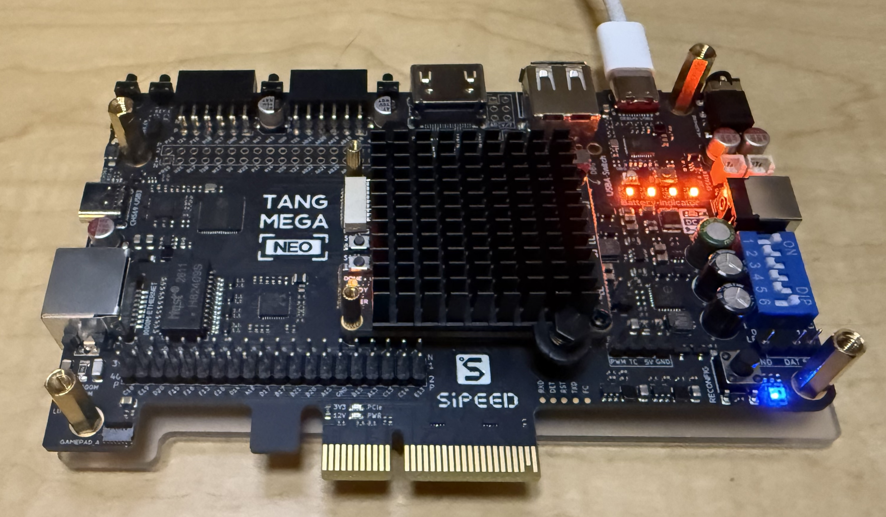

# Inference-only hardware demonstrations and research

These FPGAs run fixed language models behind a restricted token interface.
SimpleStories-V2-5M runs on a Sipeed Tang Mega 138K board. Qwen3-1.7B and
Qwen3-8B run on Amazon EC2 F2 FPGA instances. The host
supplies tokens and requests the next one. The circuit schedules the model,
chooses the tensor addresses and checks weights fetched from external memory.

The [FPGA measurements](#the-demonstrated-designs-and-measurements) give
host-observed generation rates. The [architecture and evidence map](docs/ARCHITECTURE.md)
connects each implementation to its source, tests and proof obligations.

Section 4.3 of
[*The Feasibility of a Hardwired Pause of Frontier AI Training*](https://hardwired-pause.ai) distinguishes two approaches to inference-only hardware.

- **Authenticated-Weight Inference-Only Chips (AWICs)** fix the model architecture and inference circuitry in hardware and authenticate weights loaded from memory under a hardware-enforced approval policy.
- **Hardwired-Weight Inference-Only Chips (HWICs)** encode both the model architecture and its weights directly in the circuit.

Within the AWIC family, **Fixed-Commitment AWICs (F-AWICs)** accept weights
matching a model commitment fixed in hardware. **Signed-Update AWICs (S-AWICs)**
permit new model commitments authorized by signatures from designated
signing authorities.

The FPGA demonstrations are **AWICs**. The [preliminary HWIC research](#experimental-hwic-research) implements a SimpleStories design with fixed weights in RTL.

*F-AWIC, S-AWIC and HWIC schematics. The illustrated S-AWIC policy requires
at least k of n authorities to authorize a model commitment at boot. The
SimpleStories demonstration uses 2 of 3. Weight checks enforce the approved
commitment; private signing keys stay off-chip. The layer boxes are
schematic; arithmetic may be shared across layers.*

## Token interface

*Inference* uses an already-trained model to produce outputs without changing
its learned weights. The idealized machine permits models from a fixed set
and only three user operations: add input tokens to a model's tape, generate
another token, and clear the tape. Each demonstration runs one admitted model
at a time, so model selection is implicit.

| Inference command | Effect |
| --- | --- |
| `APPEND(token)` | Add one input token to the tape. |
| `STEP` | Generate a token, append it to the tape, and return it. |
| `CLEAR` | Empty the logical tape and invalidate cached inference state. |

Tokens are the pieces of text a language model reads and generates. The
hardware provides no application command to change model weights, submit a
matrix multiplication, or read and write intermediate tensors. Hardware
controllers own the inference schedule and memory addresses; the user supplies
tokens, not tensor pointers. Startup loaders, status and transport handling
are described separately in each model's guide.

The [seeded-sampling configuration](demos/simplestories-v2-5m/STOCHASTIC-GENERATION.md) runs SimpleStories-V2-5M on Tang Mega with authenticated weights and without K/V integrity protection. Temperature and a public seed can be configured while its tape is empty and idle. Its current evidence and qualification limits are stated
in [CURRENT-QUALIFICATION.md](demos/simplestories-v2-5m/CURRENT-QUALIFICATION.md). Each hardware configuration has its own validation record.

## The demonstrated designs and measurements

Three models run on FPGA implementations of the **Authenticated-Weight Inference-Only Chip (AWIC)**. The table shows cached generation on the baseline F-AWIC for each model. Expand the SimpleStories comparison to see how its rate changes with the security and sampling options.

<!-- COMMON-FPGA-SPEED:START -->
| Model and FPGA | Core clock (MHz) | Cached tokens/s | Release |
| --- | ---: | ---: | --- |
| **SimpleStories-V2-5M — Tang Mega**, **F-AWIC** | 25 | 10.0 | Runnable release |
| **Qwen3-1.7B — AWS F2**, **F-AWIC** | 100 | 9.0 | Runnable release · public AWS FPGA image |
| **Qwen3-8B — AWS F2**, **F-AWIC** | 100 | 1.1 | Runnable prototype · speed optimization in progress · public AWS FPGA image |

Additional SimpleStories configurations on Tang Mega

| SimpleStories configuration | Core clock (MHz) | Cached tokens/s | Release |
| --- | ---: | ---: | --- |
| **F-AWIC with K/V protection** | 25 | 7.0 | Runnable release |
| **F-AWIC with K/V protection + encrypted memory** | 25 | 6.0 | Runnable release · public demonstration keys |
| **F-AWIC with seeded sampling at temperature 1**, without K/V integrity | 25 | 9.9 | Runnable release |
| **S-AWIC**, without K/V integrity | 25 | 10.1 | Runnable release · public demonstration keys |
| **S-AWIC with periodic reauthorization**, without K/V integrity | 25 | 7.6 | Runnable token-ID demonstration · public demonstration keys |

<!-- COMMON-FPGA-SPEED:END -->

The clock column gives each image’s configured inference/core clock. Memory and interface blocks use other clock domains.

The Qwen3-8B image returns a cached token in 0.89 seconds on average. Its fixed schedule streams 7.57 GB of 8-bit projection weights per token through a bank that accepts up to 256 bytes per core clock. Even with every needed weight ready on time, accepting those weights takes at least 0.30 seconds at the configured 100 MHz. The measured interval also covers fetching and checking weights, attention, other model operations, and returning the token. A matched timing comparison is needed to isolate the cost of weight authentication. [8B arithmetic inventory](demos/qwen3-8b/TRAINING-CAPACITY.md) · [Board timings](demos/qwen3-8b/README.md#additional-validation-workloads)

The encrypted-memory version retains K/V integrity and replay protection and
also encrypts both weights and K/V; its supplied keys are public demonstration
keys. Seeded sampling uses the baseline's authenticated weights, without K/V
integrity or encryption.

The common benchmark uses **one input token, 128 outputs and two repetitions** for every design. The seeded-sampling row uses its stated temperature; the other rows use greedy decoding.

The cached rate is **254 divided by the sum of the two first-to-last reply durations**, measured on the local control host after validated replies return to the generation loop. It includes gaps between replies and excludes the first output. First-STEP latency and command-only timing are separate measurements.

A dash means that a complete paired record satisfying this protocol is unavailable. Model-specific validation measurements are linked from each guide. The [benchmark protocol and reproducible calculations](docs/benchmarks/FPGA-SPEED-BENCHMARK.md) specify the observation boundary, source identities and eligibility checks. These are workload-specific host-observed rates, not peak ratings.

“Runnable release” means the image, model, app and installation instructions
are available. Each model's guide states its completed functional checks and
its timing, security and proof limits. Availability does not guarantee every
workload or independently attest a loaded device. No Tang version has complete
vendor-DDR timing or physical-security certification.

- **[SimpleStories-V2-5M / Tang Mega guide](demos/simplestories-v2-5m/README.md):** six hardware
  configurations, board selection, browser and token-client workflows, measured
  prompt/decode speeds, source, proofs and reproduction instructions.
- **[Qwen3-1.7B / AWS F2 guide](demos/qwen3-1.7b/README.md):** the billion-parameter
  hardware result, measured prompt/decode speeds, frozen-model boundary,
  installation, browser app, hardware sources and numerical reference.
- **[Qwen3-8B / AWS F2 guide](demos/qwen3-8b/README.md):** the eight-billion-parameter
  prototype, measured prompt/decode speeds, installation with a token-ID client,
  hardware sources and numerical reference. A browser app is not yet included.

*The physical Tang Mega board used for the small-model demo. We used the
[138K Basic Package](https://www.aliexpress.us/item/3256807078990410.html).
Board compatibility and installation details are in its guide.*

## In what sense is it inference-only?

An FPGA is configurable digital circuitry. Here it lets us test a proposed
circuit without manufacturing a custom chip. We assess each design **as if
its configuration were permanently frozen**, or implemented as a fixed
application-specific integrated circuit (ASIC). Reprogramming the development
FPGA is outside that assessment; resistance to other physical tampering is
not established by this assumption.

The F-AWIC implementations authenticate weights read from memory against
cryptographic digests fixed in hardware. The checked on-chip copies, not unchecked later reads
from external memory, supply arithmetic. No signing secret or manufacturer
weight-update command is needed.

Internal multiplication is not an exposed general-purpose service. Attention
uses internally produced queries and probabilities, and sends its results to
later model operations. Fixed hardware, not host software, manages the
intermediate memory layout. This avoids exposing a direct matrix-multiplication
interface; it does not establish that every physical or indirect attack is
impossible.

The practical standard concerns **low residual training capacity even against
an adversary with physical possession**. Demonstrating the restricted
architecture is not the same as certifying that standard. External memory,
test/debug/scan paths and any future inter-chip links require their own
assessment. The Qwen experiments also have AWS management and diagnostic
facilities outside its token application interface; the whole cloud platform
is not claimed to be inference-only.

The [detailed inference-only assessment](demos/simplestories-v2-5m/INFERENCE-ONLY.md) explains these
distinctions using the Tang Mega designs. Its [formal-verification report](demos/simplestories-v2-5m/FORMAL-STATUS.md)
covers source-bound control, authentication, state-ownership and numerical
results for its named configurations. [Qwen3-1.7B has separate component
results](demos/qwen3-1.7b/FORMAL-STATUS.md), whose complete development solver
bundle is not supplied; [Qwen3-8B has no supplied proof suite](demos/qwen3-8b/FORMAL-STATUS.md).
Whole-machine refinement remains open for all designs.
The [conditional training-capacity analysis](demos/simplestories-v2-5m/TRAINING-CAPACITY.md)
and [architecture-dependent analysis](docs/analysis/ARCHITECTURE-DEPENDENT-CAPACITY.md)
make their assumptions explicit; their Tang Mega numerical factors are not
Qwen measurements. **None of these demonstrations has a certified, nation-state-resistant
residual training fraction.** Small model size or modest speed is not what
makes the architectural restriction inference-only.

### Optional periodic reauthorization

An S-AWIC can require **periodic reauthorization**: model-specific approval
from a remote authority at startup and periodically during operation.
Authorities can withdraw approval for old weights and authorize a signed
replacement, supporting patches and fine-tunes within the fixed architecture.

The deployment host installs the replacement. The chip verifies its signatures
and weights, then obtains permission for that exact model. Withholding renewal
stops inference with the old weights by the current approval deadline.

Remote revocation requires a fresh challenge for each authorization. The
demonstration's [nonce freshness boundary](demos/simplestories-v2-5m/variants/home-authorization/HARDWARE.md#nonce-freshness)
explains its volatile repeat check and the outstanding physical entropy assumption.

The [SimpleStories periodic-reauthorization demonstration](demos/simplestories-v2-5m/variants/home-authorization/README.md)
implements these separate admission and permission checks. Replacement starts a
fresh session through the documented host installation workflow; the chip does
not install remote updates itself.

The [physical replacement record](demos/simplestories-v2-5m/variants/home-authorization/VALIDATION.md#physical-model-replacement)
checks revocation, a signed synthetic replacement and withdrawn-model rejection
for its identified image. The complete replacement test for the selected
repaired controller remains open; its completed approval, renewal and
revocation tests are recorded separately.

## Run a demonstration

For the Tang Mega, follow [its installation guide](demos/simplestories-v2-5m/README.md#run-the-web-demonstration).
The prebuilt configurations, model, tokenizer and browser app are included;
running them requires neither hardware compilation nor a paid FPGA design
license. Installing the model erases flash, so preserve the factory backup
first. The tested host workflow uses Apple Silicon macOS.

For Qwen, follow the AWS F2 installation guide for
[Qwen3-1.7B](demos/qwen3-1.7b/INSTALL.md) or [Qwen3-8B](demos/qwen3-8b/INSTALL.md).
Load the publicly available tested FPGA image, reconstruct the fixed model
from the pinned upstream checkpoint, and build the included host client.
No FPGA compilation is needed for that path. You provide your own AWS account
and rental; the 1.7B browser app can run on your Mac and connect to the F2 host
over SSH. Hardware sources, build instructions and numerical-reference tools
are also included.

A separate [combined SimpleStories simulation](demos/simplestories-v2-5m/variants/combined-security-simulation/README.md) joins signed model updates, periodic reauthorization and encrypted authenticated weights/K/V. It supplies model-replacement, replay and expiry checks with modeled private services; the board configurations and speed table have separate evidence.

Qwen3-1.7B also has a separate [protected K/V simulation target](demos/qwen3-1.7b/variants/protected-kv-simulation/README.md)
with authenticated retained K/V and directed operand checks. Its simulation
records have their own scope; the public FPGA image and speed table use the
plain K/V configuration.

## Experimental HWIC research

The [SimpleStories-V2-5M HWIC checkpoint](research/hwic/simplestories-2026-10-27/README.md)
uses fixed ROM feeding shared arithmetic and reuses the AWIC token core. It
includes the complete RTL, reproduction tools and compact validation evidence.
Its seven complete-model numerical cases cover **53 token outputs and
2,605,355 selected tensor/logit comparisons**; the independent checker also
rejects a deliberately changed weight.

Later work explores spatial arithmetic, banked K/V memory and attention reuse.
The [configuration and evidence map](research/hwic/simplestories-2026-10-27/README.md#configuration-and-evidence)
distinguishes the public ROM checkpoint from those newer source selections.
The [integrated regression](research/hwic/PROGRESS-2026-11-04.md) records the
completed numerical and fault tests for its spatial implementation.

The next engineering decision is the memory system. The
[memory feasibility assessment](research/hwic/PROGRESS-2026-11-05-FEASIBILITY.md)
and [attention profile](research/hwic/PROGRESS-2026-11-05-ATTENTION.md) connect
storage and bandwidth requirements to candidate memory processes. Further
physical optimization awaits compatible ROM, SRAM and logic implementations
and a complete-model performance budget. The
[query-block comparison](research/hwic/PROGRESS-2026-11-04-PHYSICAL.md) and
[mapped-ROM16 results](research/hwic/PROGRESS-2026-11-03.md) are block studies.

**This is RTL research. The project has not fabricated or physically qualified
a complete HWIC.** [HNLPU](https://arxiv.org/abs/2508.16151v2) informs the research
direction, but its custom physical weight-routing implementation has not been
reproduced here. The ROM baseline has no established speed or area advantage.
HWIC simulation results and the FPGA measurements above have separate scopes.

## AI design experiment and attribution

A secondary goal is an experiment in AI capabilities in chip design.
**GPT 5.6 Sol, GPT 6 Astra, and GPT 6.1 Sol wrote the custom RTL, implementation code,
verification and host tools, and the documentation**, under the project owner's
direction. Incorporated review feedback came from **Fable 5.1 and Opus 5.5**.

Hardware is primarily SystemVerilog/Verilog; numerical references and tests
use Python and C++; host software uses Python and C++; implementation flows
use Tcl and constraints. This attribution excludes the FPGA silicon, boards,
vendor IP and tools, pretrained models, and third-party libraries. It is an
engineering experiment with human oversight, not a controlled comparison of
AI and human engineering ability.
The custom implementation builds on established algorithms and hardware
techniques; [design references and prior work](docs/REFERENCES.md) distinguish
those antecedents from directly reused components.

## Technical documentation and licenses

Start with the guide for [SimpleStories on Tang Mega](demos/simplestories-v2-5m/README.md), [Qwen3-1.7B on AWS F2](demos/qwen3-1.7b/README.md), or [Qwen3-8B on AWS F2](demos/qwen3-8b/README.md). Each guide links to its implementation, installation and evidence.

### Analysis

| Subject | Documentation |
| --- | --- |
| Residual training assessment and model comparison | [Overview](TRAINING-CAPACITY.md), [methodology](docs/analysis/RESIDUAL-TRAINING-METHODOLOGY.md), [architecture and workload analysis](docs/analysis/ARCHITECTURE-DEPENDENT-CAPACITY.md) |
| Model training-capacity assessments | [SimpleStories](demos/simplestories-v2-5m/TRAINING-CAPACITY.md), [Qwen3-1.7B](demos/qwen3-1.7b/TRAINING-CAPACITY.md), [Qwen3-8B conditional accounting](demos/qwen3-8b/TRAINING-CAPACITY.md) |
| FPGA speed comparison | [Common workload, timing and recorded results](docs/benchmarks/FPGA-SPEED-BENCHMARK.md) |
| GPU reference measurements | [H100 benchmarks and reproduction](docs/benchmarks/H100-BENCHMARK.md) |

### Demonstrations

| Model | Run and install | Hardware | Evidence and reproduction |
| --- | --- | --- | --- |
| SimpleStories-V2-5M / Tang Mega | [Guide](demos/simplestories-v2-5m/README.md), [installation](demos/simplestories-v2-5m/PROGRAMMING.md) | [Hardware](demos/simplestories-v2-5m/HARDWARE.md) | [Validation](demos/simplestories-v2-5m/VALIDATION.md), [formal scope](demos/simplestories-v2-5m/FORMAL-STATUS.md), [reproduction](demos/simplestories-v2-5m/REPRODUCE.md) |
| Qwen3-1.7B / AWS F2 | [Guide](demos/qwen3-1.7b/README.md), [installation](demos/qwen3-1.7b/INSTALL.md) | [Hardware](demos/qwen3-1.7b/HARDWARE.md) | [Validation](demos/qwen3-1.7b/VALIDATION.md), [formal scope](demos/qwen3-1.7b/FORMAL-STATUS.md), [reproduction](demos/qwen3-1.7b/REPRODUCE.md) |
| Qwen3-8B / AWS F2 | [Guide](demos/qwen3-8b/README.md), [installation](demos/qwen3-8b/INSTALL.md) | [Hardware](demos/qwen3-8b/HARDWARE.md) | [Validation](demos/qwen3-8b/VALIDATION.md), [formal scope](demos/qwen3-8b/FORMAL-STATUS.md), [reproduction](demos/qwen3-8b/REPRODUCE.md) |

Use each model's formal-status page for the supplied proofs, assumptions and
open obligations, and its validation page for the circuit and workload behind
each measurement.

[Design references and prior work](docs/REFERENCES.md) credit the algorithms, arithmetic library and hardware antecedents.

Project-owned code, documentation and the photograph are Apache-2.0; the
packaged SimpleStories model assets use the upstream MIT declaration.
See [LICENSE](LICENSE), [NOTICE](NOTICE), [LICENSING.md](LICENSING.md) and
[third-party notices](THIRD-PARTY-NOTICES.md). Qwen's upstream model is Apache-2.0;
its [dependency notices](demos/qwen3-1.7b/NOTICES.md) distinguish project-owned
code from AWS, FPGA-vendor and other third-party components. The
[8B dependency notices](demos/qwen3-8b/NOTICES.md) identify its corresponding
sources. The project license
does not replace those components' terms.
