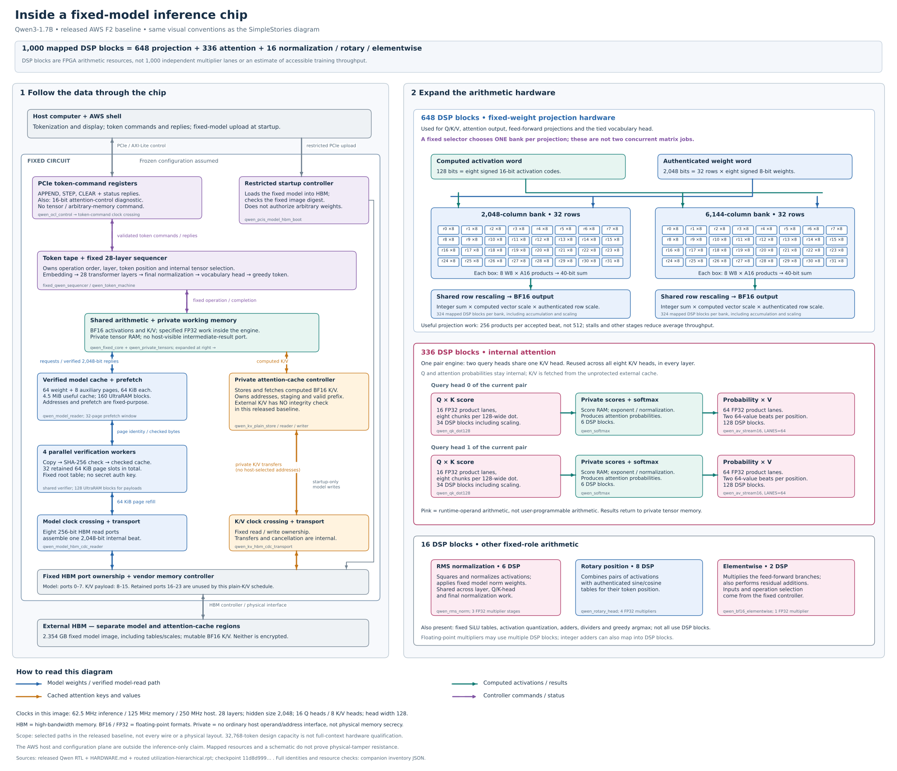

# Qwen hardware and source build

[Qwen guide](README.md) · [Run the prebuilt design](INSTALL.md) · [Licenses](NOTICES.md)

The [design references](../../REFERENCES.md) credit the model's algorithmic
antecedents, reused arithmetic library and relevant hardware prior work.

## Circuit organization

The custom SystemVerilog circuit implements a fixed 28-layer Qwen3-1.7B
schedule. It uses signed 8-bit weights, per-vector signed 16-bit projection
inputs, integer dot-product accumulation, and specified FP32/BF16 operations
and tables elsewhere. The parallel projection datapath processes 32 rows of
eight weights per accepted beat. Attention remains an internal operation;
the host cannot supply its tensor addresses, shapes or operands.

The design uses AWS F2's UltraScale+ VU47P FPGA and HBM. The measured image
uses AWS clock recipes A0/B0/C2/H1: **100 MHz inference**, **125 MHz memory**,
and the **250 MHz host clock**. Weights and K/V are in HBM, not host DRAM or
DDR4. Four private weight-verification workers authenticate pages before
the inference engine can consume their checked on-chip copies. The mapped
payload storage occupies 128 UltraRAM blocks across 16 private banks.

The startup path accepts only the selected model image. The C++ host serializes
APPEND, STEP and CLEAR, with an exclusive slot lock; it performs tokenization
and presentation, not inference. Host-side end-marker stopping changes the
number of STEPs issued, not the circuit's greedy numerical rule.
The [interface assessment](README.md#interface-and-inference-only-scope)
also discloses status registers and the 16-bit attention-state diagnostic.

### Detailed hardware diagram

This diagram expands the released 100 MHz design, using the same colors and
layout as the [SimpleStories diagram](../../ARCHITECTURE.md#detailed-baseline-diagram).
Both circuits own the inference schedule, tensor addresses and checked-weight
path. Qwen uses HBM and substantially more parallel arithmetic. Its released
baseline does not include K/V integrity protection or weight encryption.



[Open the full-size SVG](../../diagrams/qwen-hardware-architecture.svg) ·
[PNG](../../diagrams/qwen-hardware-architecture.png) ·
[Sources and regeneration](../../diagrams/README.md)

The 1,000 DSP blocks are mapped FPGA resources, not 1,000 independently usable
multipliers. Floating-point arithmetic can consume several blocks; some blocks
implement additions. Only one of the two projection banks is selected at a time.
The diagram summarizes functional connections, not physical placement or a
security proof.

### Parallel memory paths and remaining throughput limits

Weights arrive over eight 256-bit HBM AXI read ports, which assemble a
2,048-bit (256-byte) word. At the 125 MHz memory-side clock, their ideal
combined payload ceiling is 32 GB/s. This describes these particular wires,
not measured sustained bandwidth or the full HBM subsystem's rating.
Separate ports serve K/V. Four verification workers, prefetching, private
buffers and pipelined arithmetic overlap some of the work; they do not make
every inference stage run continuously or every HBM port fully utilized.

The selected projection bank accepts at most one 256-byte weight beat per
inference cycle, performing 256 integer products. Increasing external-memory
bandwidth alone cannot increase that acceptance rate. A wider design would
need matching throughput through the memory transport, authentication,
checked-weight buffers and arithmetic, while preserving hardware ownership
of all intermediate data and addresses. Such changes are engineering
opportunities, not speedups credited to this release.

## Source identity and measured implementation

`SOURCE-INPUTS.json` identifies the byte-identical selected RTL, build inputs,
tables, tokenizer and original qualification client. `host/` contains the
runnable client with end-marker stopping; `hardware/qualification-host/`
preserves the client used for the published sustained measurements.
`hardware/IMPLEMENTATION-INPUTS.json` identifies the actual placement/reset/
routing scripts and separately installed vendor dependencies:

| Dependency | Tested identity |
| --- | --- |
| Vivado | 2025.2 |
| AWS HDK | `b603a81f65666e0cf7a67ee5cf18b148eb6b08c3` |
| Version-specific AWS IP | `6d32be972e6da854e61a8d3d6ec0466ab491c1b3` |
| AWS runtime shell | `0x10212415` |
| Routed checkpoint SHA-256 | `e8a1143e44bdc65fd1da76d7faeac236e59c49ccd4d5ce004a3b962ce6b5c98d` |

The complete [timing report](evidence/implementation/timing-summary.rpt) shows
setup slack **+0.011 ns** and hold slack **+0.007 ns** under the declared
constraints. The [routing report](evidence/implementation/route-status.rpt)
shows 1,057,236 routable nets fully routed and zero routing errors.
The [report inventory](evidence/implementation/REPORTS.json) binds the
checkpoint to the preserved reports. Only build-host identifiers and private
filesystem prefixes were removed; warnings and report rows were retained.

Passing these timing checks does not mean the design has no warnings. The
[CDC](evidence/implementation/cdc.rpt), [DRC](evidence/implementation/drc.rpt)
and [exception](evidence/implementation/exceptions.rpt) reports remain available
for inspection. The reset contract excludes exactly 154 raw asynchronous-clear
inputs in 48 structurally checked release chains, while retaining interstage
and functional reset timing. The
[retained reset timing](evidence/implementation/reset-retained-timing.tsv) and
[payload memory timing](evidence/implementation/payload-retained-timing.tsv)
reports document those checks. This is not production ASIC signoff or a
whole-machine formal proof.

## Rebuild from source

Running the prebuilt demonstration does not require rebuilding it. A rebuild
needs Linux x86-64, the pinned AWS HDK/IP, and Vivado 2025.2. Follow
[AWS's HDK setup guide](https://awsdocs-fpga-f2.readthedocs-hosted.com/latest/hdk/README.html)
to obtain the tools, version-specific IP and shell. A different vendor revision
is a new implementation requiring its own timing and hardware validation.

After sourcing Vivado's `settings64.sh` and the HDK's `hdk_setup.sh -s`, run
from `demos/qwen3-1.7b`:

```sh
python3.12 tools/prepare_hardware.py --hdk /path/to/aws-fpga \
  --output /data/qwen-build
export QWEN_BUILD=/data/qwen-build
export CL_DIR="$QWEN_BUILD/cl_qwen"
cd "$CL_DIR/build/scripts"
python3 aws_build_dcp_from_cl.py --cl cl_qwen --mode small_shell \
  --flow SynthCL --aws_clk_gen --clock_recipe_a A0 --clock_recipe_b B0 \
  --clock_recipe_c C2 --clock_recipe_hbm H1 --no-encrypt \
  --tag private_supported_c2_100
```

The historical build tag is retained because the frozen implementation scripts
check it; it is not an AWS account or a private image identifier. The preparer
requires a fresh directory and does not modify the released source tree.
It verifies the HDK, IP and shell identity before copying sources.

Next run the exact placement and routing scripts:

```sh
export CL=cl_qwen SHELL_MODE=small_shell BUILD_FLOW=ImplCL
export BUILD_TAG=private_supported_c2_100 ENCRYPT=0
vivado -mode batch -source "$QWEN_BUILD/build_all_placement.tcl" \
  -log "$QWEN_BUILD/placement.log" -journal "$QWEN_BUILD/placement.jou" \
  -tclargs SSI_SpreadLogic_high Default AggressiveExplore A0 B0 C2 H1
export QWEN_ROUTE_INPUT="$QWEN_BUILD/output/payload.reset-contract.post_phys_opt.dcp"
export QWEN_ROUTE_SHA=$(sha256sum "$QWEN_ROUTE_INPUT" | cut -d ' ' -f 1)
vivado -mode batch -source "$QWEN_BUILD/route_supported_c2_100.tcl" \
  -log "$QWEN_BUILD/route.log" -journal "$QWEN_BUILD/route.jou" \
  -tclargs "$QWEN_ROUTE_INPUT" "$QWEN_ROUTE_SHA" "$QWEN_BUILD/route"
```

The tested route uses `AggressiveExplore` with the internal parameter
`route.optimizeLeafClkProgDlys` disabled. Leaf-clock timing modeling remains
enabled; this is not a timing waiver or a vendor-endorsed workaround. The scripts
verify the real clock periods and the startup RAM output-register mapping.

From the Qwen directory, run:

```sh
python3.12 tools/check_routed_reports.py /data/qwen-build/route
```

This checks basic timing, routing and severe DRC status only. Review the full
CDC/reset/exception reports as well. A successful process exit alone is not
evidence of timing closure. Rebuilt placement may differ, and the supplied
measurements apply to the identified prebuilt image, not any new rebuild.

For a rebuild that passes review, place its routed checkpoint in the CL build's
`checkpoints` directory under a new timestamp tag and use the pinned AWS
builder's `--package-only` operation with all four clock recipes explicitly
specified. Then follow the
[AWS AFI creation instructions](https://awsdocs-fpga-f2.readthedocs-hosted.com/latest/hdk/docs/Amazon-FPGA-Images-Afis-Guide.html).
Image creation performs AWS platform validation; it does not replace numerical
tests. Load the new image only into a slot you control, then repeat the
known-answer and sustained tests before reporting its speed.
