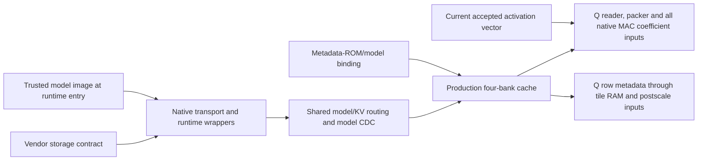
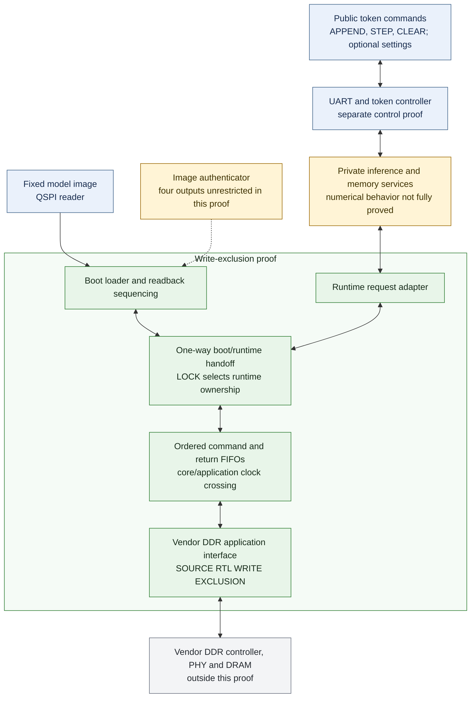

# What the SimpleStories proofs establish

The first whole-device proof targets one protected, four-bank SimpleStories-V2-5M
circuit with greedy token selection. The goal is to connect what a host asks
for, what the circuit computes and what the host receives. The evidence below
comes from three sources. ACL2 books establish specific mathematical and RTL
claims. Earlier RTL solver proofs establish properties of named hardware
components. Simulations and board tests give examples of complete executions.
The [project proof strategy](../../docs/FORMAL-ARGUMENT.md#how-the-component-proofs-fit-together)
explains how these results can contribute to one theorem.

## Verification objective

For every allowed history of host inputs on the fixed circuit, we want to prove
two claims together.

1. **The host gets the model's answer.** An accepted `APPEND` adds a token to
   the tape. A successful `STEP` computes the fixed model's next token for that
   tape, appends it and returns it. A `CLEAR` revokes the previous context.
   A reply has to belong to the same accepted request as the computation.
2. **The host can use the circuit only in the permitted ways.** Every arithmetic
   operation, operand and private memory access has to belong to the specified
   inference or a permitted supporting operation. Cancellation, stalls,
   malformed commands and faults are in scope, including when no token returns.
   The specified fault conditions must justify a reported fault.

The end-to-end ACL2 theorem remains open. The [ACL2 results](#acl2-results)
state what is already certified. The sections on the [attention query](#how-the-baseline-circuit-computes-the-attention-query)
and the [protection of model weights](#how-runtime-lock-protects-the-model-weights)
illustrate what the earlier solver work can supply. The [implementation results](#detailed-implementation-proof-results)
give the precise scope by component. Signed model updates and renewable
permission have additional policies and their own proof records.
[Signed updates](variants/signed-update/FORMAL-STATUS.md) · [Reauthorization](variants/home-authorization/FORMAL-STATUS.md)

## ACL2 results

ACL2 8.7 checks the following published results. The RTL books use Centaur's
SystemVerilog semantics. The numerical reference uses the SimpleStories model
image and the chip's specified fixed-point arithmetic.

- **What a K/V store writes.** On the reconstructed behavioral RTL, a reported
  completion entails nine accepted key writes followed by nine value writes
  at the internal memory interface. Their addresses and data match the layer,
  position and staged values of the same store. The book states its clock,
  reset and interface assumptions. The numerical origin of the staged data,
  external DDR persistence and the value that attention later consumes have
  separate obligations. [18-write record theorem](../../evidence/simplestories-kv-record/README.md)
- **What fits for every first token.** For all 4,019 possible first tokens,
  the reference model's embedding, RMS normalization and layer-0 value
  projection at position zero satisfy the required fixed-point arithmetic
  ranges. [All-token range theorem](../../evidence/simplestories-first-v-profile/README.md)
- **Which first-token values match the RTL.** On the repaired eight-bank
  behavioral circuit, first tokens 1, 27, 32 and 3258 each produce the
  expected 128 V mantissas and shared exponent. The corresponding
  RTL-to-reference equation for an arbitrary first token remains open.
  [Four certified witnesses](../../evidence/simplestories-first-v-witnesses/README.md)

On the protected **four-bank target**, a separate simulation follows prompt
378 through the vocabulary scores to the digital UART replies. It produced
200, 15, 103 and 157, then repeated 200 and 15 after `CLEAR` and a fresh
append. That is one command history against which to check the proposed
general theorem. Reusing an eight-bank theorem on this target requires
establishing the correspondence between the relevant circuit states and
interfaces. [Four-bank replay](../../evidence/simplestories-protected-prompt378-uart/README.md)

## How the baseline circuit computes the attention query

**Q is the query vector** for a token at a particular layer. Attention uses
the position-adjusted query and the keys to calculate how much weight to give
each value vector. The baseline RTL proofs below establish a numerical segment
of that calculation. They begin with the hidden vector actually presented to
RMS normalization and end with reads of the unrotated Q vector from query RAM.

| Part of the calculation | What the earlier RTL proof establishes |
| --- | --- |
| Read the inputs | The custom memory transport and four-bank cache deliver the model word at the accepted address. The proof assumes the vendor's storage behavior, the model image at runtime entry and the corresponding metadata ROM. The RMS unit operates on one accepted vector, role and exponent. [Model-read theorem](formal/upstream-model-values/THEOREM.md) · [RMSNorm invocation](formal/native-component-values/README.md) |
| Feed the Q multipliers | Fixed-model coefficients and the matching current activations reach all 64 Q multiply-accumulate lanes. Row metadata reaches the scaling inputs. The scope covers six layers, four groups and 256 columns. [Q operand theorem](formal/q-operand-provenance/THEOREM.md) |
| Produce and store Q | The dot products, scaling, normalization, ordered writes of 256 coordinates and final exponent implement the specified Q operation. A completed operation belongs to the current invocation. [Q operator theorem](formal/q-operator/THEOREM.md) |
| Read Q back | The joined proof carries the numerical meaning through hidden, RMS and query RAM and through a tagged read before overwrite. It accounts for cancellation and replacement. [RMSNorm-to-Q theorem](formal/rms-q-segment/THEOREM.md) |

For the whole-device ACL2 theorem, we still need to establish that the starting
hidden vector is the one prescribed by the accepted tape on the selected
circuit. We must also carry Q through its position-dependent rotation and into
the matching attention computation. The published Q proofs are source-bound
RTL/SMT results. Their statements, register correspondences and numerical
specifications can be reused when establishing these connections in ACL2.

The original packages retain their executable obligations, assumptions and
reproduction instructions. [Model reads](formal/upstream-model-values/README.md) ·
[Q operands](formal/q-operand-provenance/README.md) · [Operand statement](formal/q-operand-provenance/THEOREM.smt2) ·
[Q arithmetic](formal/q-operator/README.md) · [Normalization and proof method](formal/q-operator/DOCUMENTATION.md) ·
[RMSNorm-to-Q replay](formal/rms-q-segment/README.md) · [Segment statement](formal/rms-q-segment/STATEMENT.smt2)

## How runtime LOCK protects the model weights

**After runtime LOCK, the custom circuit can issue writes only to the permitted
K/V region until the common hard reset.** Inference can therefore update
session state while the fixed model is protected against writes through this
path. A boot write already in a queue is covered too. The guarantee ends at
the commands issued to the vendor DDR interface. Physical storage behavior
and authentication of the model loaded at startup have their own assumptions
and proofs. [Implementation-assurance theorem and source bindings](formal/implementation-assurance/README.md)

The green part of the diagram is the hardware covered by the write restriction.
The proof permits arbitrary runtime requests and arbitrary outputs on four
authenticator signals, so it gives a useful restriction even with those
producers left unspecified.

### Why queued boot writes cannot bypass LOCK

1. Once the source issues a read, every subsequent write targets the K/V region.
2. Runtime LOCK requires an earlier source read and its reply.
3. The command FIFO preserves order. By the time that reply arrives, any
   model write queued before its read has left the custom FIFO. The common
   reset proof connects the source and transport histories across clock domains.

For an ACL2 application, the chosen circuit must establish that the same
reset, lock event, queue ordering and address boundary govern its issued
commands. Weight-read authentication adds another obligation. The arithmetic must
consume the checked copy of the requested model word. [Model-read contracts](formal/upstream-model-values/THEOREM.md) ·
[Authentication and checked copies](formal/authentication-access/README.md)

## Which operands the circuit can use

The RTL solver proofs check where the arithmetic gets its inputs. For
immutable weights the relevant chain goes from authenticated model bytes
through sealed RAM to a permitted consumer. For mutable K/V it goes from a
particular forward-pass write through storage to the attention invocation
permitted to use that row. The table identifies where the published proofs
reach actual consumer signals and where that chain still needs a proof.
[Authentication and access records](formal/authentication-access/README.md)

| Checked hardware | What the RTL proofs establish | What remains assumed or open |
| --- | --- | --- |
| Authentication and runtime LOCK | Both solvers check 45 assertions per image on the ordered image bytes, padding and single boot start per hard reset. | Full-size boot reaches LOCK in tests. A formal witness for the full boot remains open. |
| SHA and sealed model RAM | The native SHA compression and chaining logic, fixed digest selection, complete page fill and sealing, and delivery of the checked copy to named consumers are covered. | The proof assumes hash resistance. Its private decryption replies are arbitrary. The encrypted K/V return path has a separate proof below. |
| Operation schedule and operand routing | Both solvers check the six-layer sequence (22 assertions), datapath access (53), group and metadata addressing (23), and lookup addressing (9). | The datapath proof permits arbitrary replies from numerical units. Their arithmetic needs its own proof. |
| Protected K/V guard and attention inputs | Both solvers check the guard/cache (357 assertions), actual hash framing and chaining (43), and separate attention-input scopes (34). K reaches the score lanes. V reaches the alignment request, and the alignment reply reaches its consumer. | Connecting the V reply to its request and the original authorized row to its use remains open. Hash resistance and trusted on-chip state are assumed. |
| Session epoch on CLEAR | In the plaintext protected design, one fresh CLEAR advances the 64-bit epoch once. Holding CLEAR does not advance it again. Exhaustion causes a latched fault. [Epoch theorem](formal/kv-clear-epoch/THEOREM.md) | The counter alone leaves the tag, RAM contents, authenticated data and consumer to be connected. |

For the matching sources, the protected CLEAR-epoch theorem proves that a
session identifier cannot silently wrap and regain authority. Connecting the guard to attention still requires the entire row and the
identity of its writer.
Pending on-chip rows need their own case because they bypass the external
guard read. The historical `formal/kv-integrity` records use a different
source snapshot. [Current CLEAR-epoch theorem and replay](formal/kv-clear-epoch/README.md)

## Working-memory ownership and CLEAR

The RTL session proofs track the last accepted writer of working RAM and
staged K/V data. On the baseline and seeded configurations, the committed
cache requires all nine current data/metadata returns before marking a row
valid. The command proofs also track pending requests while a busy `CLEAR`
drains. Logical cancellation revokes access to the previous session. The
payload bits can remain in memory. The main theorem must show what a future
attention invocation actually consumes, through to the next public token.
[Session-isolation evidence and replay](formal/session-isolation/README.md)

**A known availability issue affects the released baseline.** If `CLEAR`
coincides with a pending write completion, its K/V controller can mistake
cancellation for a failed completion and latch a fault. Decoded-command and
component simulations with substitute arithmetic reproduce the issue.
A theorem about ownership of an accepted request can still hold in that
case. A theorem promising a return to readiness would have to address the
fault. [Released controller](hardware/project/fpga/token_only_model0_ddr_board1/context2048_gowin_portability0/rtl/board1_context2048_atomic_kv_typed_clear_consistent.sv)

### What a protected read returns on the encrypted design

For a normal live read, the encrypted-memory design's integrity guard
returns the complete 256-bit plaintext word that belongs to the actual
accepted request and current committed write, under the stated memory and
primitive contracts. The proof follows storage, capture, caching and output
assembly. It stops at the guard's reply. The caller must establish which
attention invocation receives the word. Confidentiality, physical DDR
behavior and complete session isolation through token output each need
additional evidence. [Normal K/V return theorem and replay](formal/kv-return/README.md)

## Which STEP owns the published token?

The baseline controller proof starts with the candidate token supplied by
the numerical core. An accepted `STEP` owns its successful commit and at
most one reply capture. In a recorded example, a `CLEAR` after commit and
before capture cancels candidate 23. A fresh request supplies candidate 17
and the bridge holds the captured frame even through a later fault. The
control theorem applies to arbitrary candidate values. The numerical proof
must establish that the candidate equals the model's greedy winner for the
same request. [Control theorem](formal/public-control-ownership/THEOREM.md) ·
[Example and replay](formal/public-control-ownership/README.md)

## Detailed implementation proof results

The following are **RTL solver results** for the source configurations named
in the implementation-assurance package. The boot and flash-reader rows describe the permitted startup traffic.
The reset and FIFO proofs help carry the write restriction through to commands
issued after LOCK. The UART/core/shell proof relates public commands to their
replies while treating the numerical outputs as arbitrary. A whole-device
ACL2 book needs both memory protection and reply ownership. For each fact used there, the book must
establish the matching hardware and hypotheses. The counts below describe
the original solver runs and overlap across rows.
[Detailed statements, sources and replay](formal/implementation-assurance/README.md)

| Checked hardware | Published solver result | Qualification |
| --- | --- | --- |
| Boot and memory source path | 113 overlapping assertions pass Z3 and cvc5 on each distinct path, with all 227,062 native words retained. | Four authenticator outputs are arbitrary. SHA arithmetic has a separate proof. |
| Reset and top-level wiring | Eleven reset assertions pass both solvers. The wiring audit checks 63 top-level connections per image. | Vendor reset generation and the physical clock crossings require separate evidence. |
| QSPI model reader | Both solvers check 24 assertions, including the fixed READ03 command and address range. | Physical flash protection and vendor I/O lie outside the model. |
| Command and return FIFOs | Z3 checks 28 assertions per channel. cvc5 also completes induction for four of the six distinct configurations. | Two encrypted configurations have unresolved secondary inductions. |
| Commands issued to vendor memory | Z3 checks 105 assertions per distinct transport. cvc5 passes the base checks. | Secondary induction and coverage are incomplete, including two retained coverage tool errors. Vendor persistence and read ordering remain assumptions. |
| Greedy UART, core and command shell | Z3 checks 134 assertions per greedy design. | The proof permits arbitrary values on 37 private numerical and service outputs. Secondary induction is incomplete. |

The package retains 59 selected positive and mutation runs, with their
queries, replies and source audits. Readers can check the saved results or
follow the instructions for a fresh solver run. The incomplete secondary
checks in the table retain their original outcomes.

## Which greedy configurations do the results cover?

Each image has its own source, parameter and implementation record. The
baseline assumes external K/V storage behaves as specified. The two protected
designs add integrity and replay checks. The encrypted design also encrypts
external memory. The numerical model is shared, so comparisons are possible,
but a proof carries over only for matching circuit behavior and assumptions.
[Greedy qualification guide](GREEDY-QUALIFICATION.md)

| Design | Published scope | Remaining obligation |
| --- | --- | --- |
| Baseline | 34 attention-controller assertions and 72 recorded query checks. | Child arithmetic and memory replies are arbitrary at the listed outputs. Their behavior must be connected to attention. |
| Protected K/V | 357 guard/cache assertions, actual hash framing and separate 34-assertion attention-input checks. | Connect the verified row to its matching attention invocation, including value alignment. Hash resistance and trusted on-chip state are assumptions. |
| Protected K/V and encrypted memory | The encrypted guard and cache have 357 assertions, with hash framing and separate 34-assertion attention checks. The normal-return proof covers plaintext data under its contracts. | Value alignment, the complete attention computation and confidentiality require separate arguments. The authentication proof abstracts decryption. |

## What is proved for seeded sampling?

The seeded variant has additional commands and uses a sampler. The following
RTL results cover settings, seed ownership, score storage, control and
publication for image `d271626a7fb9ce1debdf7a9cd847125ec7eb4c907fa9d06af9d5f8146cecc725`.
The first whole-device ACL2 target uses greedy selection. For a whole-device
theorem about the seeded image, the sampler would also need a numerical
correctness proof. [Seeded replay](formal/current-seeded-sampling/README.md) ·
[Completion record](formal/current-seeded-sampling/CURRENT-REPLAY.json)

| Checked hardware | Published solver result | What the scope includes |
| --- | --- | --- |
| Selector lifecycle | Both solvers check 35 assertions. | Settings and seed commitment, result ownership, stalls, CLEAR rewind and sticky faults. Numerical correctness of the sampling distribution remains open. |
| Selector buffer | Both solvers check 57 assertions, including the 35 above. | Three sampler memories, acceptance of all 4,019 rows and ownership of the selected logit and mass. The connected model has a separate proof. |
| UART and frontend | Both solvers check 63 assertions. | Actual UART at 217 clocks per bit, bridge, adapter, admitted bytes and CRC history. Downstream readiness and service replies remain arbitrary. |
| Seeded token shell | Both solvers check 94 assertions. | Controller, tape, settings, selector and 20 memories. Model, layer and output-head replies remain arbitrary inputs. |
| Connected UART, core and seeded shell | Z3 checks all 196 assertions. cvc5 passes the base and 194 of the 196 induction conclusions. | The proof retains 37 unrestricted private outputs. The cvc5 results for request CRC (38) and reply CRC (73) are still unknown. |

The two unresolved cvc5 CRC conclusions are recorded as `unknown`. Z3
establishes both in its connected proof. Reachable fault-injection controls
and the recorded serial scenarios exercise the checks on particular traces.

The seeded **weight-page bank** has a separate 42-assertion proof with both
solvers. The real RAM is retained, while the 258-bit SHA replies remain
arbitrary at that boundary. The authentication package checks native SHA and
its connections separately. The source audit identifies the checked files
and the omitted vendor digests. [SHA and checked-copy proof](formal/authentication-access/README.md) ·
[Source inventory](reference/baseline-formal-354/REFERENCE-SOURCES.json)

## Limits

A whole-device proof must still connect accepted token history, all model
arithmetic and private accesses, and public observations on the same circuit
execution. Completion also requires assumptions about the services on which
the circuit waits. The source proofs assume a frozen circuit and digital
clock/reset semantics. Hash resistance, physical access, vendor DDR behavior,
timing and equivalence between source and the programmed FPGA have their own
evidence or assumptions. The separate residual-training analysis states
which additional assumptions about access to the chip enter its rating.
[Inference-only assessment](INFERENCE-ONLY.md) · [Training-capacity assessment](TRAINING-CAPACITY.md)
