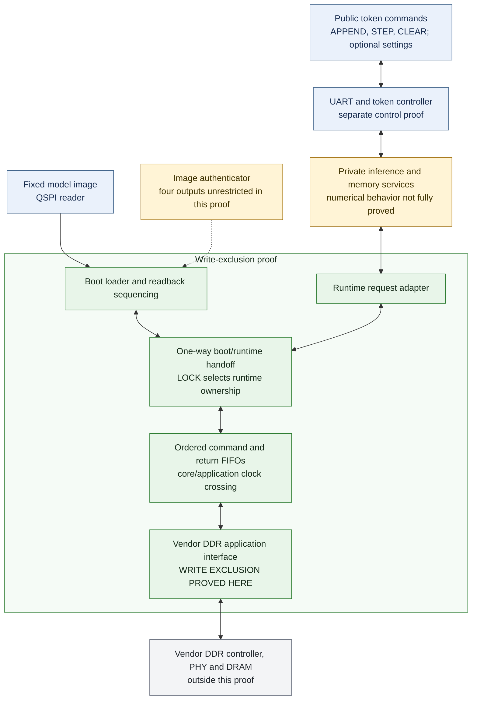

# What the RTL proofs establish

This page covers the four current SimpleStories-V2-5M configurations. Qwen has
separate implementation and test evidence; no Qwen theorem is claimed here.

**The source proofs establish restricted model writes, authentication through
use, and fixed private access paths.** The [authentication/access package](formal/authentication-access/README.md)
connects the actual SHA engines, checked model RAM, fixed six-layer schedule,
operand/address routing and protected K/V capture/use. These are source-bound
component compositions, with explicit cryptographic and physical assumptions.

**After runtime LOCK, the custom RTL
cannot issue a write to the model region through the vendor DDR application
interface until the common hard reset. Writes must stay in the permitted runtime
K/V region, including its protection metadata where present.** This includes
model writes that were previously queued in the custom transport during boot.

Z3 establishes this safety property by bounded base checks and unbounded
induction: it holds for arbitrarily long executions of the checked digital
model, under its reset conditions. cvc5 passes the transport's bounded base
checks; its unbounded transport proof remains incomplete. This is a proved
restriction on issued commands, not a proof of the contents or physical behavior
of DRAM.

## How this supports the inference-only claim

An inference-only machine serves a fixed permitted model while allowing the
temporary state needed for inference to change. Training normally changes learned
parameters; inference changes the token tape, activations and K/V cache. This
result supports the **fixed-model requirement**: after LOCK, the checked RTL
cannot issue writes that update stored model weights through this interface,
while permitting the K/V state needed for inference to evolve. Checking the
underlying write path establishes hardware enforcement of that restriction.

The authentication/access proofs supply further parts of that argument: they
check the actual SHA engines and accepted byte streams, preserve the checked
model copy through consumption, restrict arithmetic to fixed private scheduling
and operand/address paths, and join protected K/V verification to attention use.
They remove ordinary mechanisms for changing model parameters or directly
programming internal tensor computation through the token interface.

These facts do not establish that every token-only algorithm has negligible
training utility. Cryptographic resistance and trusted on-chip state remain
explicit assumptions, and physical enforcement needs separate evidence. See the
[inference-only assessment](INFERENCE-ONLY.md) and
[training-capacity assessment](TRAINING-CAPACITY.md) for those limits.

## Scope of the memory-write theorem

The diagram adapts the request paths in the actual top-level RTL. The green
region marks the composed memory-write proof. The controller has a separate
control proof; the amber boxes identify behavior that remains abstracted or
only partly verified. The gray box is outside the proof.

Arrows summarize connections and request/reply paths; they do not imply one
numerical-correctness theorem across every box. The memory-write proof permits
arbitrary runtime requests and arbitrary authenticator output flags. Its
write restriction therefore does not depend on those producers behaving
correctly. The actual top-level connections are checked separately.

The proof ends at the custom RTL's **issued command**. It includes the custom
command and return FIFOs, but does not establish when the vendor controller
finishes a write it has already accepted, or what it retains across reset.
Runtime reads of model weights remain allowed, as inference requires them.

## Why queued boot writes cannot bypass LOCK

The composed argument has three steps:

1. **Boot model writes precede readback.** The actual source path proves that,
   once a source READ has been emitted, every later WRITE targets the permitted
   runtime K/V region.
2. **Runtime LOCK requires an earlier READ and reply.** The source path proves
   this even with the four authenticator outputs left unrestricted. It does not
   prove that the digest was computed correctly.
3. **The transport preserves order and reply ownership.** A returned reply
   requires an earlier READ issued at the vendor interface. Model writes queued
   before that READ have already left the custom command FIFO; later writes are
   restricted by step 1.

The reset proof establishes that these histories describe the same reset epoch
across the actual clock domains. All 52 imported FIFO invariants and both source
contracts are independently proved before use; the argument has no circular
dependencies or unproved client protocol promises. It does not simply assume
that the command queue is empty when LOCK arrives.

## Authentication and access through the actual implementation

| Checked boundary | Established result | Main limit |
| --- | --- | --- |
| Authentication to runtime LOCK | 45 assertions per image, both solvers; native ordered byte stream, padding and one BEGIN per hard reset | No formal full native-size successful-boot reachability witness. |
| Native SHA and sealed model RAM through consumption | SHA compression/chaining, fixed digest/metadata selection, complete fill/hash/seal and current service/consumer ownership are source-bound and composed | SHA resistance is assumed. Private decryption replies remain unrestricted; AES/SIV algorithm correctness is separate. |
| Fixed schedule and arithmetic/state access | Six-layer sequence: 22 assertions; actual datapath: 53; group/metadata addresses: 23; lookup: 9. Both solvers complete bases, induction and covers | Numerical-child outputs remain arbitrary in the datapath scope; no whole-transformer numerical theorem. |
| Protected K/V through attention use | Both protected designs: 221-assertion history, 357-assertion current guard/cache, 43-assertion actual hash framing/chaining and separate 34-assertion attention scopes; both solvers | Component scopes overlap. The integrity interpretation assumes SHA resistance and trusted on-chip tags/state; confidentiality and physical tampering are separate. |

The [current authentication/access evidence and reproduction guide](formal/authentication-access/README.md)
states the actual source/image joins, proof boundaries, semantic fault controls
and incomplete secondary results. Actual port, reset, CLEAR, fault, identity and
data connections join these universal component facts. The baseline and seeded
designs do not gain integrity against an external K/V-memory attacker.

## Working-memory ownership and CLEAR

The [working-memory evidence and reproduction guide](formal/session-isolation/README.md)
adds completed current-writer histories and ownership checks for native RAMs,
transient state and K/V staging. The baseline/seeded committed cache requires all
nine current data/metadata returns before validity; its actual typed-write
payloads have current stage-writer provenance. These facts constrain mutable
storage to initialized inference workspace at the checked boundaries.

Connected protocol proofs also retain accepted requests through busy CLEAR.
Both shell classes have a complete model-read core barrier. Separate connected
semantic/model/K/V proofs restore all thirty native cache outputs and show that
healthy active semantic idle owes or presents no model or typed K/V work. The
four current images are source-bound to their applicable native classes.

These are component results with explicit initial tracking, numerical-service
and RAM-history boundaries. **Full device session isolation through subsequent
token publication is not yet established.** The common core/outer transport
epoch join, numerical/reply composition and complete mutable-state signoff
remain open. Logical CLEAR revokes ownership; it does not erase raw payload bits.
The packet retains 82 selected component records and thirteen real corruption
controls, including premature drain release and a skipped K/V RAM writer.
Counts overlap and are not a coverage score.

## Public control and important limits

The separate public-controller proofs check which commands are admitted and
how they own state and replies: `APPEND(token)` records an accepted token,
`STEP` owns a generated result that is stored and returned consistently, and
`CLEAR` cancels the relevant ownership and invalidates the logical tape. The
seeded configuration also checks settings and seed ownership at an empty, idle
tape. These are control guarantees; private numerical services remain
unrestricted at their declared proof boundaries. Logical CLEAR does not promise
physical erasure of every memory cell.

The following stronger claims **are not established by these formal proofs**:

| Stronger claim | Current evidence boundary |
| --- | --- |
| Runtime LOCK is formally reachable after a full native-size boot | Board and simulation campaigns exercise completed boot. No formal native-size full-boot LOCK reachability witness is supplied; transport covers use the separately contracted LOCK input. |
| Hash resistance and unconditional physical image equality | Actual SHA arithmetic, fixed-digest admission and checked-copy use are verified separately. Collision/second-preimage resistance, trusted on-chip state and vendor memory behavior remain assumptions; source proofs do not attest persistent physical DRAM bytes. |
| Every STEP computes exactly the fixed model's numerical next-token function | Controller proofs leave private numerical outputs unrestricted. Numerical comparisons and board tests cover particular executions. |
| The programmed FPGA and external memory satisfy the RTL theorem physically | Source and image hashes record provenance. RTL-to-mapped-image equivalence, vendor DDR behavior, physical CDC/reset timing and FPGA power-on behavior remain outside the proof. |
| Every possible use of the machine is incapable of learning | These scoped proofs supply no certified residual training-capacity bound. See [INFERENCE-ONLY.md](INFERENCE-ONLY.md) and [TRAINING-CAPACITY.md](TRAINING-CAPACITY.md). |

The current [implementation-assurance package](formal/implementation-assurance/README.md)
provides the exact models, source bindings, proof receipts, known limitations,
and commands for checking recorded evidence or running fresh solver phases.
The detailed inventories below state which component claims are established
by which solver; assertion counts overlap and are not a coverage score.

## Detailed implementation proof results

| Checked boundary | Current result | Main limit |
| --- | --- | --- |
| Complete boot/memory source path | 113 overlapping assertions pass Z3 and cvc5 for each distinct path; all 227,062 native words remain | Four scalar authenticator outputs are unrestricted; no SHA arithmetic theorem. |
| Native reset correspondence and wiring | 11 reset assertions pass both solvers; 63 top-level connections are checked per image | Digital reset/wiring only; vendor reset generation and physical CDC remain outside. |
| QSPI model reader | 24 assertions pass both solvers; fixed READ03 command and range | Vendor I/O and physical flash protection are outside the theorem. |
| Full-size command and return FIFOs | 28 assertions per channel pass Z3; four of six distinct configurations also pass cvc5 induction | Two encrypted secondary inductions remain unresolved. |
| Source-to-vendor command write epoch | 105 transport assertions pass Z3 for each distinct transport; cvc5 base checks pass | Secondary induction/coverage remains incomplete, including two retained coverage tool errors. Vendor persistence/read ordering is not proved. |
| Connected greedy UART/core/shell | 134 assertions pass Z3 per greedy design | 37 private semantic-layer outputs remain arbitrary; secondary induction is incomplete. Seeded control has its separate result below. |

The 59 selected positive and mutation runs retain their original outcomes,
queries, replies, semantic controls and source audits. Counts overlap and are not
additive. A portable recorded check uses no vendor/compiler/solver tools;
separate commands perform exact source/query reproduction or fresh solver work.
Hardware images, model, host and benchmark records are unchanged. This command-
trace result strengthens the inference-only argument without establishing
whole-machine numerical, cryptographic, physical DDR or RTL-to-bitstream claims.

## Current seeded RTL replay

The seeded-sampling image is
`d271626a7fb9ce1debdf7a9cd847125ec7eb4c907fa9d06af9d5f8146cecc725`.
Its [current replay](formal/current-seeded-sampling/README.md) and named
[completion record](formal/current-seeded-sampling/CURRENT-REPLAY.json) identify
the exact checked models, queries, tools and outcomes. The completion uses
schema `current-seeded-rtl-formal-replay-completion-v2` and records the actual
fresh RTL-only campaign; registering it does not execute a solver again.

| Checked model | Recorded result | Boundary |
| --- | --- | --- |
| Selector lifecycle | **35 assertions**, complete primary and secondary checks | Real fixed-dimension sampler and greedy child; settings admission, seed/PRNG commitment, result ownership, stalls, CLEAR rewind and sticky faults. Not numerical CDF equivalence. |
| Selector buffer ownership | **57 assertions**, complete primary and secondary checks, including the selector's 35 | All three sampler memories retained; complete 4,019-row acceptance, selected-slot current logits/mass and captured-payload ownership. Read-only observers do not drive production. This component is separate from the connected model. |
| UART/frontend | **63 assertions**, complete primary and secondary checks | Real RX/TX at 217 clocks per bit, bridge and adapter; independent admitted-byte/CRC history. Downstream readiness, model and settings replies remain arbitrary. |
| Seeded token shell | **94 assertions**, complete primary and secondary checks | Original 48 controller/tape statements, 11 settings statements and 35 selector statements; actual shell/arithmetic/sampler and 20 memories. Private model/layer/head services remain arbitrary inputs. |
| Connected UART/core/seeded shell | **196 assertions** pass primary Z3 base and induction. Secondary cvc5 passes the base and **194 of 196 conclusions**. | Same whole external boundary and **37 unrestricted private semantic-layer output cuts**. Actual queues, gates, shell, sampler and 20 memories remain. Request CRC conclusion **38** and reply CRC conclusion **73** remain `unknown` for cvc5. |

The connected primary result covers all 196 assertions. Its two unresolved
secondary conclusions are not counterexamples and are not counted as proved by
that solver. Each secondary conclusion uses the same joint prior invariants.
These counts overlap and must not be added. The 57-assertion component is not
inserted into the connected theorem. The connected model has no RTL assumption
cells; reset initializes its base states and is not imposed during induction.

The replay also records seven reset-reachable selector mutants, two buffer
mutants, five serial mutants and 284 actual serial scenarios. These sensitivity
and scenario checks have their stated finite scope; they are not additional
whole-machine assertions.

### Sealed weight-page bank

The separate current seeded bank proof passes **42 assertions with both
solvers**. It retains the real **32,768-bit RAM**, checks fill-before-read,
sealed-copy admission after a completed matching digest comparison, owned
replies, hash-input correspondence, prefetch sequencing and sticky faults.
Ten directed scenarios and five faulty controls accompany that proof.

The bank's **258-bit SHA replies remain arbitrary**. Production SHA is identified
as source provenance but is not elaborated in the bank theorem. The result does
not prove SHA compression arithmetic, the parent service's digest selection,
private bank/SHA composition or cryptographic security by itself. The
[authentication/access proofs](formal/authentication-access/README.md) separately
retain the native SHA and full bank RAM, check parent digest selection and join
the checked copy through the private service to its consumers. Counts remain
nonadditive.

### Source binding and retained support

The current provider verifies **87 distributed native source files and the
selected seeded image**. The full 91-input inventory additionally records four
omitted vendor digests; those digests are provenance, not verified vendor bytes
or elaborated vendor logic. Source audits check reversal of instrumentation,
local elaboration, initialized ROM words, original ports/cuts and read-only
observer cones. The separate finite model campaign checked 30 cases, 108 heads
and 434,052 raw logit rows with the implemented SHA engine; it does not turn
those executions into a universal arithmetic theorem.

The source association retains seven unchanged modular scopes, separate
154-assertion cache-stage evidence and exp-ROM source evidence. The source-binding
action ran no solver and retains its false replay flag. Its recorded primary
cache-stage evidence does not establish full cache equivalence, unconditional
terminal-failure write drain or physical erasure. The named fresh
completion above records the actual controller and bank replay separately.

The replay audits its [98-member support-source inventory](reference/baseline-formal-354/REFERENCE-SOURCES.json), including the monitor support and boundary derivation inputs. Source regeneration checks 128 model/source members and their complete source/binding map byte for byte. These source checks run no solver and grant no additional proof scope.

## Greedy design scope

The baseline, K/V-protected and encrypted designs have their own exact
source/model/native/mapped and physical qualification records in
[GREEDY-QUALIFICATION.md](GREEDY-QUALIFICATION.md). A changed design does not
inherit an older controller, cache, bank or SHA proof merely because it uses
the same numerical model or public command names. Source associations state
which byte-identical components retain evidence and which changed boundaries
remain outside it. Physical timing and resource observations add no assertions.

The selected greedy-source records retain these scoped results:

| Design | Checked source scope | Boundary |
| --- | --- | --- |
| Baseline | 34 attention-controller assertions; 72 recorded query checks | Child arithmetic and memory replies remain unrestricted at the listed outputs. No numerical-attention or concrete-memory composition theorem. |
| K/V-protected | Current joint guard/cache proof: 357 assertions; actual hash and separate 34-assertion attention use composed through checked source connections | Cryptographic resistance and trusted on-chip state are assumptions. No whole-machine numerical refinement. |
| K/V protection and encrypted memory | Native encrypted guard/current cache: 357 assertions; actual hash and separate 34-assertion attention use composed | Arbitrary decryption replies; no AES/SIV confidentiality/correctness or numerical-attention theorem. |

Counts are nonadditive. The [qualification guide](GREEDY-QUALIFICATION.md)
identifies the exact source associations and recorded solver/audit results.
These byte/query rechecks run no fresh solver and supply no physical attestation.

The encrypted design retains K/V integrity and replay checks, but encryption
and the supplied public demonstration keys do not imply a cryptographic theorem.

## Limits

The monitors prove command authorization, operand preservation, STEP/result
ownership, live-tape correspondence and logical cancellation at their stated
boundaries. Private numerical and memory services remain unrestricted at the
listed cuts. They do not establish eventual completion when readiness stalls
forever, the correctness of every generated token, physical RAM erasure,
whole-machine numerical refinement, source-to-mapped-image equivalence,
complete vendor-DDR timing or physical security. Actual SHA arithmetic and the
named model/K/V checked-copy compositions have their separate verified scopes
in the authentication/access package. A successful model or board test does not attest another loaded FPGA.

The assessment assumes a frozen circuit and synchronous digital behavior.
[INFERENCE-ONLY.md](INFERENCE-ONLY.md) and
[TRAINING-CAPACITY.md](TRAINING-CAPACITY.md) state the separate architectural
and conditional capacity assumptions; these proofs supply no certified residual
training factor.
