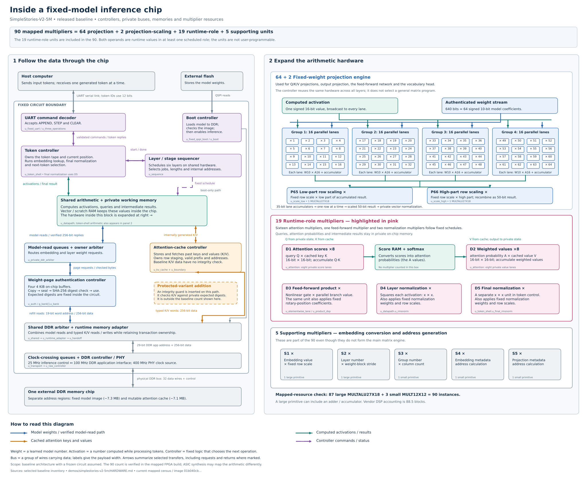

# Hardware architecture and implementation notes

The four supplied configurations run the same fixed SimpleStories-V2-5M
numerical model on Tang Mega 138K. The three greedy designs differ in memory
protection; the seeded design adds a bounded on-chip sampler.

| Configuration | Weight checks | External K/V protection | Host operations |
| --- | --- | --- | --- |
| Baseline | Fixed plaintext page digests | None | APPEND, STEP, CLEAR |
| K/V-protected | Fixed plaintext page digests | Private expected SHA-256 digests | APPEND, STEP, CLEAR |
| K/V protection + encrypted memory | Fixed plaintext page digests after decryption | AES-SIV and private expected SHA-256 digests | APPEND, STEP, CLEAR |
| Seeded sampling | Fixed plaintext page digests | None | APPEND, STEP, CLEAR; settings on an empty, idle tape |

The encrypted design encrypts both weights and K/V with public demonstration
keys; it retains K/V integrity and replay checks. See
[encrypted memory](ENCRYPTED-MEMORY.md),
[K/V protection](KV-PROTECTION.md) and [seeded generation](STOCHASTIC-GENERATION.md).

The source links and detailed diagram below describe the supplied baseline.
Its private attention engine has eight score lanes and eight value lanes.
Synchronous pending-row storage and split canonical exp-ROM storage preserve
the fixed arithmetic contract. The protected design has its own cache guard,
startup/transport implementation and source inventory; the encrypted design
also uses four time-shared projection multiplier lanes and a different K/V
record format. These are separate FPGA images, not host-selectable modes.

[Greedy qualification](GREEDY-QUALIFICATION.md) and
[seeded qualification](CURRENT-QUALIFICATION.md) identify the selected images,
source associations and tested workloads. [Formal status](FORMAL-STATUS.md)
states the scoped properties and remaining boundaries. None of these records
establishes complete vendor-DDR timing signoff or whole-machine numerical
refinement. [Design references](../../docs/REFERENCES.md) identify the algorithms,
cryptographic specifications and architectural antecedents.

## Fixed workload and numerical contract

| Property | Implemented value |
| --- | --- |
| Model | `SimpleStories/SimpleStories-V2-5M`, 5,354,496 parameters |
| Transformer layers | 6, executed through reused hardware |
| Hidden / feed-forward dimensions | 256 / 682 |
| Query / K/V heads | 4 / 2; 64 coordinates per head |
| Vocabulary | 4,019 IDs; fixed lowercase WordPiece tokenizer |
| Context target | 2,048 input positions; a 2,049-slot tape accommodates the final generated token |
| Numerical format | Project block-floating-point v5: W10/A16/KV16 |
| Decoding in the three greedy configurations | Deterministic greedy argmax |

Weights have signed 10-bit mantissas; activations and cached K/V values use
16-bit mantissas with the prescribed shared exponents and scaling metadata.
Intermediate accumulators are wider. Round-to-nearest-even, exponent selection,
range checks, lookup tables and tie handling belong to the numerical contract.
Changing arithmetic order or normalization is not assumed harmless merely
because the underlying real-valued transformer equation is unchanged.

The verification target is the project's pinned integer reference, not equality
with every output of the original floating-point model. The packaged
[reference model](reference/reference/model.py), quantization
code and asset manifests define the reproducible model conversion.

The optional seeded version preserves these model logits, weight checks,
clocks and pins. Temperature 0 uses the unchanged greedy selector; positive
temperatures select from a fixed-point CDF calculated entirely on-chip.
Its public seed initializes a noncryptographic xoroshiro128++ generator.
Settings are admitted only with an empty, idle tape; CLEAR retains them and
rewinds the generator. See the
[numerical and protocol contract](STOCHASTIC-GENERATION.md#fixed-sampling-and-protocol-contract).

## System organization and clock boundaries

The public path is UART receiver/bridge → three-operation adapter → token
shell → fixed six-layer computation and tied output head → token reply.
The Mac performs tokenization and display, not model inference.

The [runtime overview diagram](diagrams/inference-machine.svg) shows these
functional boundaries without clock-domain or transport detail. The
[memory-integrity comparison](diagrams/memory-integrity.svg) distinguishes
fixed-weight verification from the additional K/V checks in the protected
configuration. The two DDR regions in the overview represent address
regions in one external memory, not separate devices.

### Detailed baseline diagram

The diagram below expands the controllers, memory paths and arithmetic units
of the released baseline. Its 90 mapped multiplier instances include 19
units with scheduled runtime-operand roles. These private units follow the fixed
inference schedule; the count does not establish useful attacker access.
The encrypted-memory variant has a different projection engine and is not
represented by this resource count.

[Open the full-size SVG](diagrams/simplestories-hardware-architecture.svg) ·
[PNG](diagrams/simplestories-hardware-architecture.png) ·
[Sources and regeneration](../../diagrams/README.md) ·
[Qwen hardware diagram](../qwen3-1.7b/HARDWARE.md#detailed-hardware-diagram)

The [physical top](hardware/project/top.sv) connects this path
to a flash boot loader, private model/KV memory system, thin DDR transport,
and GOWIN DDR3 controller. Application semantics and memory-access policy
remain in the 25 MHz core domain. The 100 MHz DDR application domain handles
ordered transport and physical-controller handshakes, not model scheduling.

| Clock | Role |
| --- | --- |
| Board 50 MHz | Reference clock and board-reset logic |
| Core 25 MHz | UART, inference controllers, arithmetic, runtime page verification and memory policy |
| DDR application 100 MHz | Thin command/return transport and controller interface |
| Memory PLL 400 MHz | Vendor DDR PHY clock source |
| Trusted/boot 12.5 MHz | Fixed flash source, boot-image SHA-256 readback and associated reset logic |

The clock tree also contains the PLL's 50 MHz output. Signal names
such as `trusted_clk_25mhz_o` are not authoritative frequency specifications:
the selected divider on that path is /4, giving 12.5 MHz. Likewise, some
reused modules have an `app_clk_i` port wired to the core clock. Inspect the
actual top-level connections and [constraints](hardware/project/constraints/product.sdc).
In particular, the boot/runtime DDR adapters and private arbiter use the core
clock despite that port name; the boot-image readback hash uses the trusted clock.

The [thin transport](hardware/project/thin_transport.sv) uses
Gray-pointer asynchronous FIFOs
([established CDC background](../../docs/REFERENCES.md#hardware-and-memory-protection-antecedents)),
a 32-command queue, a 64-entry return FIFO,
and a 32-outstanding-read reservation limit. Write command and data acceptance
are coordinated. Public `CLEAR` does not reset the transport: accepted work
must retain ownership and drain instead of being mistaken for a later request.
Reset asserts across the affected domains and releases through local
synchronizers. These structures do not substitute for physical CDC/timing
qualification.

## Public protocol and token controller

The [UART wrapper](hardware/project/uart_core.sv) selects
217 core clocks per bit, approximately 115,207 baud. Its fixed five-byte
frames carry command/reply information and CRC-8. CRC checks framing integrity,
not adversarial authenticity. There is no public tensor, address, layer/job,
arithmetic-mode, weight-loading or diagnostic-result command.

`APPEND` stores a valid token and advances the tape. `STEP` evaluates positions
not yet covered by the committed prefix, runs final normalization and the
tied vocabulary head, stores the winning token, and returns its ID. It does
not run the vocabulary head after every prompt position. Later `STEP`s reuse
the committed K/V prefix rather than reevaluating the whole prior prompt.

The [token shell](hardware/project/fpga/token_only_model0_ddr_board1/context2048_token_machine2/rtl/board1_context2048_token_shell.sv)
tracks tape length, replay position, committed prefix and held-output state.
`CLEAR` invalidates logical tape/cache state and cancels or drains work according
to ownership. It is not a bulk RAM zeroization operation and does not reopen
the boot loader or clear a terminal integrity fault. A physical reset is a
different event. All three original greedy images have reached
the full 2,048-input window and final output slot in board tests; see
[the results](KV-PROTECTION.md#measured-performance).
These are finite functional tests, not complete timing qualification.

## Arithmetic microarchitecture

The six transformer layers share a fixed semantic sequencer and datapath.
They are not six independently programmable engines. The stage schedule
selects normalization, Q/K/V projections, rotary position operations, K/V
staging, causal attention, output projection, residuals and the gated
feed-forward computation. Layer, job and group descriptors are generated
internally; their presence on module ports is not a host programming interface.

### Weight projections and tied head

The live implementation is the clustered engine in
[cluster-adapter.sv](hardware/project/cluster-adapter.sv) and
[cluster-engine.sv](hardware/project/cluster-engine.sv).
`board1_fixed_group_projection_scale_job` instantiates
`board1_shared_projection_scale_group_adapter`, which instantiates
`board1_clustered_projection_scale2`.

It processes groups of up to 64 output rows. Four
[16-lane tiles](hardware/project/cluster-tile.sv) combine a scalar 16-bit
activation with a 640-bit weight beat (64 × 10 bits). Each lane uses an exact
[W10 × A16 multiplier](hardware/project/cluster-mul.sv), a product register
and a signed 35-bit accumulator. After the last weight beat, rows are read
one per cycle. Two fixed 27 × 18 multipliers separately scale the low 25 and
high 10 bits of the dot product by its 16-bit row multiplier; their results
are recombined into a signed 50-bit value. A four-stage pipeline stalls
globally on output backpressure. There is no arithmetic-mode input.

The tied vocabulary head reuses this engine (job 7: 63 groups, 51 valid rows
in the last group). Source-level multipliers are not the same as the vendor's
post-mapping DSP-block count.

The source inventory also retains five compiled but uninstantiated files:
`board1_asymmetric_private_issue_guard`, `board1_asymmetric_unified_dsp64`,
`board1_fixed_vector_rne_shift_iterative`, `board1_shared_projection_scale_engine`
and `board1_unified_projection_head_mul_exact`. They are not the active
datapath. They remain to preserve the tested build's exact 90-input identity.
Some source comments predate this engine or the current attention lanes; the
live instantiations and this guide describe the released implementation.
Likewise, `*_GW5_DSP` explicit-primitive branches are not selected by the
released defines; their comments about tied-off features are not evidence
about the unselected branch's physical use.

### Attention and private intermediate storage

The actual attention RTL contains eight separate fixed-role score multiplier
instances and eight weighted-value multiplier instances. Each has a fixed
runtime 16 × 16 multiplication role. They process coordinate groups while
preserving each result's required arithmetic order. Query reads are pipelined;
aligned values and synchronous pending-row storage feed the private lanes.
This remains a fixed inference engine, with no host operand or mode input.

`Q × Kᵀ` consumes internally computed queries and privately fetched keys.
Scores enter private workspace RAM, exponentiation/normalization and softmax.
The resulting fixed-point probabilities feed `A × V`; its output enters
private vector RAM and then the fixed output projection. No host command
injects `Q` or `A` or exports either product. Private RAM between these stages
is buffering, not a software-addressable tensor interface.

### Other runtime arithmetic

Attention is not the only multiplication with runtime operands. The
[elementwise lane](hardware/project/fpga/token_only_model0_ddr_board1/fixed_elementwise_product_compact1/rtl/board1_fixed_elementwise_product_compact_lane.sv)
multiplies the internally computed feed-forward gate and up-projection values.
The same multiplier also applies the fixed rotary-position tables in other
scheduled phases.
The [RMSNorm service](hardware/project/fpga/token_only_model0_ddr_board1/fixed_vector_rmsnorm0/rtl/board1_fixed_vector_rmsnorm_service.sv)
uses a shared, mode-selected multiplier: it squares each runtime vector
element, then in other phases multiplies normalized values by fixed ROM
weights and applies fixed row scales. The service has two live instances:
one in the semantic datapath and one in the token shell. Counting the sixteen
attention lanes, there are 19 multiplier instances with a scheduled role
in which both inputs are runtime data, rather than one being a fixed model
coefficient. They are not all dedicated exclusively to that role.

These are private fixed-role operations, not independently callable arithmetic
services. The two operands of each RMSNorm square are tied to the same value.
The [capacity analysis](TRAINING-CAPACITY.md) explicitly distinguishes this
inventory from an attacker having useful general multiplication access.

The [semantic datapath](hardware/project/fpga/token_only_model0_ddr_board1/context2048_token_machine0/rtl/board1_context2048_semantic_datapath.sv)
owns query, key, value, hidden-state and intermediate vector/scratch RAMs.
The [attention engine](hardware/project/fpga/token_only_model0_ddr_board1/context2048_token_machine0/rtl/board1_context2048_attention.sv)
owns its query, score/probability and output workspaces. Memory write ports
are deliberately organized for native block-RAM inference. Payload RAMs need
not be physically reset: validity, overwrite-before-use and outstanding-work
ownership are substantive correctness obligations, not assumptions of zero
initial contents.

## Model storage, authentication and K/V memory

The fixed model payload is read from flash during boot into DDR. Runtime
model reads go through the [verified page service](hardware/project/service.sv).
The selected product instantiates four 4 KiB page banks, not the eight-bank
default visible in some reusable module declarations. Each bank fills its
actual on-chip RAM, seals and hashes that copy, compares against a fixed
page-digest ROM, and only then serves arithmetic reads from the verified copy.
Refill and pending responses are explicitly arbitrated. Raw DDR cannot supply
a new expected digest. Fixed projection scale/exponent metadata is also
held in a compiled on-chip ROM, with 55,872 useful payload bytes.

This avoids checking DDR once and then consuming unchecked mutable copies.
It does not establish cryptographic correctness or physical tamper resistance
by itself. [SHA-256](https://csrc.nist.gov/pubs/fips/180-4/upd1/final)
is used for fixed-content verification, not encryption;
there is no update-signing secret or manufacturer weight-update command.

The runtime arbiter separates the following 256-bit-word address regions:

| Region | Half-open word range | Use |
| --- | --- | --- |
| Model image | `[0, 227062)` | 7,265,984 bytes; runtime model client is read-only |
| Alignment gap | `[227062, 227072)` | Not a legal runtime model/KV request |
| K/V cache | `[227072, 448256)` | 7,077,888 bytes; fixed typed inference reads/writes |

Each persisted layer/position/KV-head row contains four key words, four value
words and an exponent/padding word: 6 layers × 2,048 positions × 2 K/V heads
× 9 words. The typed controller stages the current row, persists it, and
commits prefix validity; pending and committed rows have different paths.
This design selects key-only or value-only reads according to the fixed
attention phase. Each committed-row request transfers five words (four data
words plus exponent metadata), rather than fetching both halves. The selector
is generated by the inference schedule and is not exposed to software.

**K/V payloads are not cryptographically authenticated.** Model-page hashing
must not be described as authentication of all DDR contents. Software lacks
a raw cache-access command, but a physical memory/bus attacker is a separate
threat. Establishing a practical GEMM-laundering throughput bound remains
additional work.

## Prompt processing and time to first token

Private scheduling and storage reduce repeated attention work while preserving
the fixed model's arithmetic order and rounding rules. The designs retain all
weight and applicable K/V checks. Eight score and eight value lanes, private
row reuse and pipelined memory access reduce long-context work; exact model
comparisons and full-context board/browser cases check the selected sources.
These observations are finite functional evidence, not a universal numerical
equivalence theorem.

`APPEND` records tokens; it does not evaluate the transformer in advance.
On the first `STEP`, the controller processes each prompt position through
all six layers before moving to the next position. It streams the relevant
weights again for subsequent positions, and attention visits increasingly
long causal prefixes. The system therefore does not have a layer-major,
batched prompt-evaluation path. With the present traversal, projection work
grows roughly linearly with prompt length while the total causal attention
visits grow quadratically.

Current rates and context-latency records are linked from
[GREEDY-QUALIFICATION.md](GREEDY-QUALIFICATION.md). The common speed workload
uses one prompt token and two 128-output trials. It measures cached generation
between validated replies; prompt processing is reported separately.

The eight attention lanes improve the private datapath, but the position-major
prompt traversal still repeats projection work. A future chunked prompt path
could reuse each verified weight group across several positions while retaining
causal attention. That would require changed scheduling, storage and renewed
numerical/ownership verification. It is not implemented in these images.

## Physical implementation and verification boundaries

The target is the non-Pro Tang Mega 138K, GOWIN
`GW5AST-LV138PG484AC1/I0`. Custom hardware is SystemVerilog/Verilog; Python
provides reference arithmetic, test drivers and host tools; Tcl and constraint
files drive vendor synthesis, placement and routing. The DDR controller/PLL
IP and FPGA silicon are vendor components, not custom AI-authored hardware.

All three greedy images completed native placement/routing and produced
exact-reference outputs in their named CLI and browser campaigns. Their
BUILD.json files and portable native records identify each route. All retain
`timing_qualified: false`: vendor-DDR violations and incomplete external-I/O
constraints remain outside complete signoff. Successful functional tests do not
waive those limitations or attest another loaded FPGA.

The baseline uses 55,232/69,120 CLS, 238/340 BSRAM and 88.5/298 DSP by vendor
accounting. Its mapped census records 87 MULTALU27X18 and three MULT12X12
instances: 64 projection, two projection scaling, 19 scheduled runtime-operand
and five supporting units. Primitive instances and vendor DSP accounting are
different counts. [The current capacity assessment](TRAINING-CAPACITY.md)
keeps these observations separate from usable attacker access or a certified
training bound.

Formal work joins the actual boot/source path, reset logic and full-size
transport to prove that, after runtime LOCK, writes at the vendor DDR application
interface stay in the permitted runtime K/V region until the common hard reset.
Previously queued boot writes are included. [FORMAL-STATUS.md](FORMAL-STATUS.md)
states the exact source, solver and abstraction boundaries. Vendor DDR behavior,
physical epoch isolation, whole-machine numerical refinement, mapped equivalence
and invasive tamper resistance remain separate obligations.

## Reproducibility identities

- Model revision: `c4b3a4bb81297f5316697098e1d4b65c1249daf8`.
- Tokenizer SHA-256: `01b6553da99789d461cec48eed624684a803f259a5177616a67f7391700acf51`.
- Model payload SHA-256: `cad8d015db37a3603e340edfc0009f36d6b12de2bc789d60687011fc700cc3b0`.
- Selected baseline configuration SHA-256: `01b040cb830cd4c5343f0666568213d433442c6937e711751a79847d492b4a57`.
- Selected protected configuration SHA-256: `90ac68150d0c297b666bc1963d05e32d1d2d0d7d69706593e58d48d5ab2e79e2`.
- Selected encrypted configuration SHA-256: `cfc8a3d8832b4a2959606f0e9f01c511357ec68380f521b5f28a4fc737edf1d2`.

See the packaged [input manifest](../../MANIFEST.json) and
[reproduction instructions](REPRODUCE.md). File hashes identify
inputs and outputs; they are not remote attestation of the FPGA or permission
to redistribute vendor files. Each selected image has its own `BUILD.json`
and hardware-input inventory. See [the evidence guide](evidence/README.md)
and [programming guide](PROGRAMMING.md); no board action is performed by this document.
