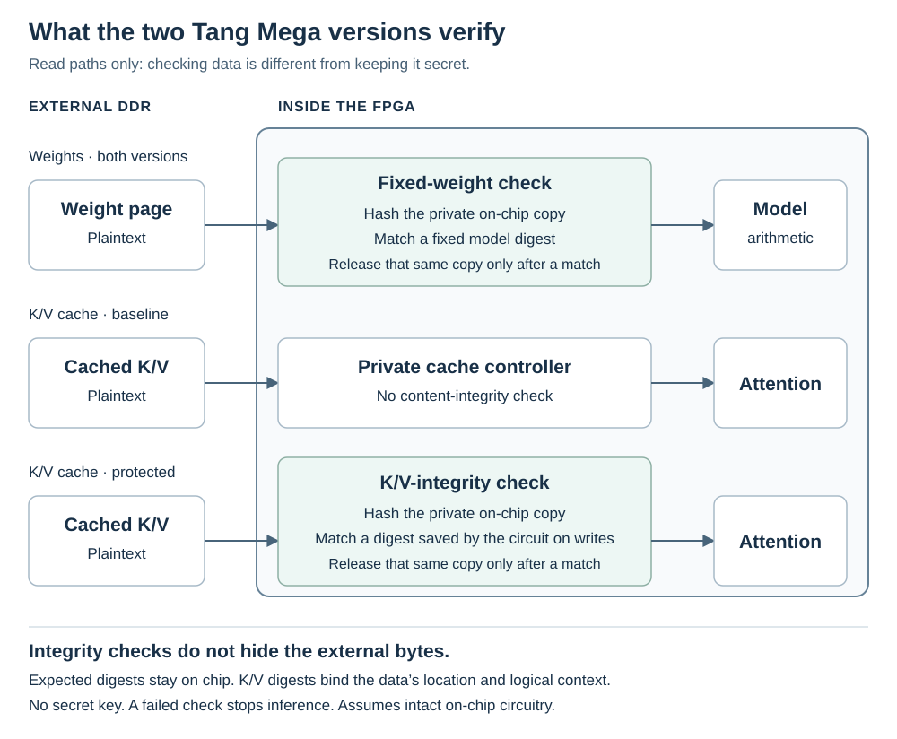

# K/V integrity protection

This comparison covers two plaintext-memory FPGA configurations. **Baseline** is
the design without K/V integrity checks. **K/V-protected** is
the integrity-checking prototype. Both run the same integer approximation of
SimpleStories-V2-5M, authenticate the same fixed model weights, and expose only
`APPEND`, `STEP` and `CLEAR`. Both support 2,048 input positions, with one final
output slot. Changing configurations is a development-board programming step,
not an operation offered by either frozen inference circuit. Both use
private parallel attention and packed storage. Each selected image has its own
source inventory, native route and full-context qualification.
The third [encrypted-memory configuration](../../ENCRYPTED-MEMORY.md)
retains K/V integrity and adds encryption with public test keys.

Checking untrusted external memory against protected on-chip state has a long
history in secure-processor design; see the
[AEGIS comparison](../../docs/REFERENCES.md#hardware-and-memory-protection-antecedents).
The mechanism here specializes integrity checking to this fixed model's K/V
records. It is not a new cryptographic primitive or an implementation of AEGIS.

## Why use the protected version?

For this project's anti-training requirement, memory tampering matters when
it enables practically useful training computation. Deliberately causing
incorrect answers or stopping inference does not, by itself, defeat that
requirement. Cache integrity is a means to restrict possible training uses,
not a separate requirement that every form of tampering be prevented.

The purpose is to strengthen the inference-only design against **physical
tampering with external memory**. Both versions already prevent ordinary host
software from requesting arbitrary memory or matrix operations. But that
restricted interface does not, by itself, stop someone with physical access
from changing bytes in DDR.

Cached keys and values are operands in attention's runtime matrix
multiplications. In the baseline, a physical memory/bus attacker could try
replacing those operands with chosen values and observing later cache writes.
That would not automatically provide general matrix multiplication or useful
training: the other operands, execution schedule and observable results remain
constrained. We have not demonstrated a useful training attack through this
route. Nevertheless, preventing the substitution makes the inference-only
argument stronger.

The protected version is designed to check that cached data match values the
fixed inference circuit previously stored for that location and logical
context. The formal checks trace accepted private writes and verified reads;
they do not prove that those writes are the model's correct mathematical K/V
values. Under the intact-circuit, SHA-implementation and cryptographic
assumptions described below, the design's integrity argument is that changing
DDR alone cannot supply chosen cache operands. An attacker would also have to defeat
the integrity check or its trusted state. This is an additional barrier to
repurposing the arithmetic, not a proof that all training-related misuse or
physical attacks are impossible.

Choose the baseline for faster long continuations in the measured tests, and the protected version
to demonstrate this stronger treatment of external memory. Both implement
the same model; protection does not improve its answers when memory is
unaltered. The cost is more on-chip storage and slower inference, especially
at long contexts, as the measurements below show.

The protected configuration also includes a tested private PLL startup
qualifier and its own transport/reset circuitry. It is not
just a software option in the baseline. Neither configuration has complete
vendor-DDR timing signoff.

## What K/V protection adds

*Read paths, with transport and buffering details simplified. Cache writes
come from the fixed inference circuit, not from host-supplied tensors.
The diagram assumes the on-chip circuit and its private expected digests
remain intact; it does not claim protection against arbitrary circuit editing.*

Attention keeps previously computed keys and values (K/V) in external DDR.
The baseline restricts access to this memory through private hardware
controllers, but does not authenticate its K/V contents. Software cannot
request arbitrary DDR reads or writes through the three-command interface.
A physical memory/bus attacker is a separate concern.

In the protected configuration, the controller records a SHA-256 digest in
private on-chip memory when internally generated K/V data are stored. On a
later external read, it stages the data privately, checks the digest, and
releases only the verified copy. Changing DDR after verification does not
change that sealed on-chip copy. A failed check stops inference rather than
returning the altered data to attention.

The expected digests are **not stored alongside the data in untrusted DDR**.
There is no shared secret or external command for replacing them. This is an
integrity check against private expected values, not encryption: someone
with physical access can still observe the external K/V bytes.

The design assumes that the guard, its private memories, and the rest of the
on-chip control circuit remain intact. Its integrity argument relies on a
correct SHA-256 implementation and cryptographic collision resistance, so
an attacker cannot practically substitute different data with the accepted
digest. SHA computation is independently simulation-tested, not formally
proved here. Tags need protection against writes, not secrecy. It is not protection
against arbitrary modifications to those circuits or a certified bound on
training capacity. A physical attacker can also disrupt operation; integrity
checking does not guarantee availability.

As in the [repository's assessment](../../README.md#in-what-sense-is-it-inference-only),
this argument assumes the protected configuration is permanently frozen.
The digital proofs do not model voltage, clock, electromagnetic or reset
glitches. Build hashes identify the recorded image; they do not attest what
a connected FPGA is running.

## Organization and freshness

The guard groups **16 token positions, one K/V head and one role**
per digest. Key groups contain words 0–3 and the shared exponent/tail word 8;
value groups contain words 4–7 and word 8. This follows the existing attention
access pattern so fewer irrelevant bytes are fetched and hashed.

The hash covers a domain identifier, epoch (the CLEAR counter), layer, position group,
head, role, valid-position count and fixed geometry, as well as the data.
There are 3,072 full 256-bit expected digests, using 96 KiB of private tag
storage. The guard's other private buffers also consume on-chip memory.

Partial groups are built from internally produced data, not by trusting a
reread of old DDR bytes. The final write is acknowledged only after the
associated tags are committed. The existing K/V controller retains its
atomic row-commit rules and internally owned pending-row path.

Freshness depends on the on-chip committed prefix and expected tags, not on
the epoch counter alone. Reads must lie below the prefix; appends replace
all affected tags before making new positions readable; reset and CLEAR
zero the prefix. The epoch increments on a CLEAR edge, but resets to zero
on reset. It is not a persistent counter across power cycles. Old memory
contents therefore remain unauthorized until the relevant positions have
been populated by the circuit again.

`CLEAR` revokes prior prefix, cache and response ownership. An already-issued
transfer must drain before new work starts; old completions cannot populate
the new logical context. Detected integrity faults remain terminal across
`CLEAR`. This is logical invalidation, not physical zeroing or confidential
erasure. Replaying identical bytes after they have legitimately been
repopulated is indistinguishable from the correct data and does not change
the computation.

## Measured performance

The baseline measured **10.04 tokens/s** and the K/V-protected design
**7.03 tokens/s** on the common one-token prompt, two 128-output greedy trials.
All 256 outputs per design matched the fixed numerical reference. The pooled
rate is 254 divided by the two summed intervals from validated output 1 to
validated output 128; it includes host control and inter-command gaps.
Prompt evaluation, upload and the first output are separate timing scopes.

The [common benchmark](../../docs/benchmarks/FPGA-SPEED-BENCHMARK.md) identifies
the selected images and timestamp arrays. [Greedy qualification](GREEDY-QUALIFICATION.md)
links the ten-case CLI campaigns and seven-case browser campaigns for both
designs, including 2,047/2,048-token contexts, boundary refusals, CLEAR races,
Stop during an active STEP and a successful new connection afterward.
The protected browser's full 2,048-token prompt took about 22 minutes to its
first output in that test; full-window checks are latency checks rather than
sustained-throughput estimates.

## Evidence and limits

The current protected source association includes a joint cache proof with
357 assertions including support and a separate 34-assertion attention scope.
Private scheduling and SHA replies remain arbitrary at the declared boundaries.
These counts overlap with component scopes and must not be added. See
[FORMAL-STATUS.md](FORMAL-STATUS.md) for precise properties and cuts.

The [guard simulation](../../simulation/kv-protected/README.md) exercises
corruption, stale/wrong-location records, sealed-copy reads, stalls and CLEAR.
It is component simulation with its named source association. Deliberately
corrupted DDR was not tested by physically modifying the board's memory or bus.
The full-model and board comparisons are finite functional checks, not proofs
of cryptographic security, numerical correctness for every prompt or useful
training capacity bounds.

The two selected images have their own source/model/native/mapped records.
Both retain `timing_qualified: false`; the native route, reported custom-logic
paths and correct outputs do not provide complete vendor-DDR or external-I/O
timing signoff. The protected image has 93 build inputs, including four pinned
vendor inputs acquired separately. No older image's timing or whole-controller
proof is silently assigned to this image.

## Run or rebuild

The two prebuilt images are:

- Baseline: `prebuilt/inference/project/impl/pnr/shared_product.fs`.
- Protected: `prebuilt/kv-protected/project/impl/pnr/shared_product.fs`.

Use the matching `BUILD.json` in the same prebuilt directory. Follow
[PROGRAMMING.md](../../PROGRAMMING.md) to load one image into SRAM, then perform
the [local known-answer check](../../host-app/README.md). Switching variants does
not require reinstalling the unchanged model in flash. A successful short
check is not independent attestation of the FPGA's configuration.

The protected custom project is in `variants/kv-protected/hardware/`. For an
optional source build, add `--variant kv-protected` to the existing
[build command](../../VENDOR-SETUP.md#check-then-build). Both variants use the same
four separately acquired Gowin source-IP dependencies and tool installation.
Both supplied images have been tested on the board. A recipient-side source
build produces its own route and requires its own validation.
