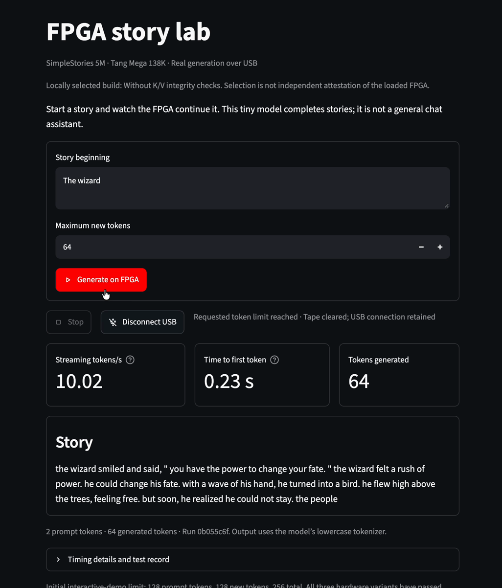
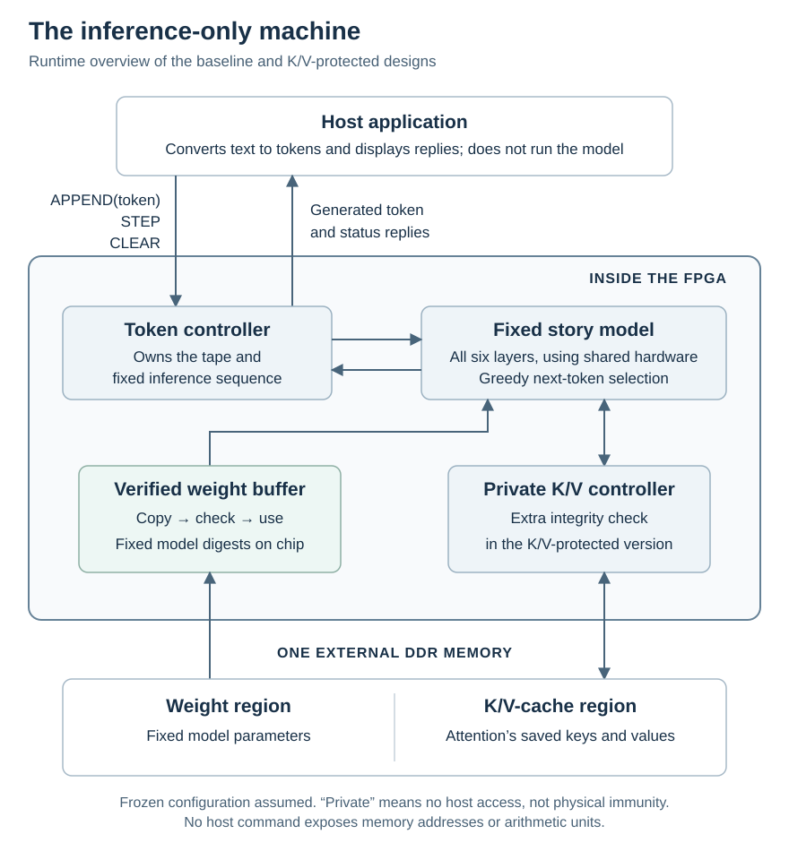

# SimpleStories-V2-5M on Tang Mega

[Project overview](../../README.md) · [Qwen on AWS F2](../qwen3-1.7b/README.md)

This is the runnable small-model demonstration: a fixed numerical approximation of **SimpleStories-V2-5M**, with 5,354,496 parameters and six transformer layers. The FPGA performs inference; a connected computer supplies text and displays replies. The release includes three hardware configurations, their source and evidence, the model image, tokenizer and a local browser application.

The prototype runs on a Sipeed Tang Mega 138K **non-Pro Dock** board package
([AliExpress listing used for this demo](https://www.aliexpress.us/item/3256807078990410.html)).
We used the **“138K Basic Package”**.
Check the selected variant: the supported setup needs the **device-C FPGA
and 128-Mbit / 16-MiB flash**; the model layout does not fit older 8-MiB flash.
Its GOWIN FPGA uses a
[22 nm manufacturing process](https://www.gowinsemi.com/en/about/detail/latest_news/76/).
Its hardware command interface offers only `APPEND`, `STEP` and `CLEAR`,
described below. This demonstration supports one fixed model, so there is
no model-selection command.

*The physical board used for the demonstration.*

## What the demonstration does

A small application running on the connected Mac provides a browser page
where the user types a prompt, requests generated text, and sees generation
speed. The application converts text to token IDs, sends commands over USB,
and converts returned token IDs back to text. **The FPGA performs the model
inference; the Mac does not run the language model that produces the replies.**

[Watch a 16-second recording of the demo](media/simplestories-demo.mp4):
the authenticated-weight baseline continues “The wizard” for 64 tokens on
the physical FPGA. The clip plays at its original speed. Its displayed rate
is for that short run; the sustained measurements below use longer continuations.

The application uses this hardware interface:

| Command | Effect |
| --- | --- |
| `APPEND(token)` | Add one input token to the tape; repeat for a prompt. |
| `STEP` | Generate one token, append it to the tape, and return it. |
| `CLEAR` | Empty the logical tape and invalidate its cached inference state. |

The restriction is enforced by the FPGA's command decoder and controller,
not by the browser application. Replacing the application does not create
a command for matrix multiplication, direct memory access, or weight updates.
Serial framing, acknowledgements and rejection of invalid commands are
transport details around the three operations. `CLEAR` resets the logical
state; it does not physically overwrite every memory cell with zeros.

*Runtime overview of the baseline and K/V-protected versions. The two DDR regions share one external
memory chip. At startup, an on-chip boot loader
copies the model from flash into DDR and verifies the boot image; that path
and the fixed on-chip coefficient ROMs are omitted here. “Private” means
inaccessible through the host interface, not immune to physical tampering.
The [memory-check diagram](../../KV-PROTECTION.md#what-kv-protection-adds) shows what
the protected version adds.*

The model is trained to continue simple stories. For example, after the
prompt “once upon a time, a little fox”, one physical FPGA result began:

> named leo found a shiny stone. the stone sparkled like the stars. leo picked it up and felt a warm glow in his heart.

The baseline streamed **8.76 tokens per second after the first token**
in a 128-token continuation from a one-token prompt. The first hardware `STEP` took about
**12.36 seconds for 128 prompt tokens** and **106.07 seconds for 512 prompt tokens**,
excluding connection setup and prompt upload. Prompt length and later context
length both matter, as detailed below. The quoted story continuation can be
reproduced from `fox128` in [reference cases](../../tests/reference-cases.json) using
the supplied tokenizer; the installation record separately checks its first
16 generated tokens.
The repository includes the tested configurations, model image and local app.
See [Run it on your board](#run-it-on-your-board).

## Three runnable versions

The baseline and K/V-protected versions use the same model and three-operation interface, and both
authenticate model weights:

- **Baseline:** without K/V integrity checks; faster on the measured long continuations.
- **K/V-protected:** the prototype that checks externally stored
  attention-cache data before use, including its location and current logical
  context. Expected digests remain in private on-chip memory.

The protected version assumes intact on-chip circuitry and does not encrypt
the cache. Its purpose is to restrict a possible route to useful training
computation through physical memory tampering, not to prevent every deliberate
malfunction. Its corruption/replay rejection has been tested in simulation;
normal inference has also been tested on the FPGA. The protected image
has passed board tests through the full 2,048-input context limit, including
boundary rejection and CLEAR/replay checks.
Neither version has complete vendor-DDR timing signoff. See
[K/V protection and the measured tradeoff](../../KV-PROTECTION.md) for the mechanism,
current images, performance and evidence boundaries.

- **Encrypted-memory:** an experimental version that also encrypts the
  external weight image and K/V. Its supplied keys are public, so it
  demonstrates the mechanism rather than protecting secrets from
  someone with this package. It requires a different flash image.

See [encrypted memory](../../ENCRYPTED-MEMORY.md) for its diagram, current
test scope, source reproduction, installation and restoration. All
three preserve the same model and public three-operation interface.

## Inference-only scope

The configured circuit exposes `APPEND`, `STEP` and `CLEAR`, with hardware-owned inference and memory addressing. All three variants authenticate the weights actually consumed. We assess the circuit with its configuration frozen, not the FPGA's ability to load another circuit.

The [shared overview](../../README.md#in-what-sense-is-it-inference-only) explains the concept. The [detailed Tang Mega assessment](../../INFERENCE-ONLY.md), [scoped formal proofs](../../FORMAL-STATUS.md), and [conditional capacity analysis](../../TRAINING-CAPACITY.md) distinguish demonstrated restrictions from remaining physical-security obligations. The encrypted-memory variant has separate evidence and public demonstration keys; it does not inherit all of the plaintext variants' proofs.

## The demonstrated design and measurements

The baseline and K/V-protected configurations use one fixed-model architecture with
private DDR memory. The measurements below use the supplied
baseline image; the baseline/protected comparison is in
[KV-PROTECTION.md](../../KV-PROTECTION.md#measured-performance).
The [technical architecture guide](../../ARCHITECTURE.md) explains its datapath,
memory organization, clock domains and implementation details, with a
[detailed hardware diagram](../../ARCHITECTURE.md#detailed-baseline-diagram).

- Board: Tang Mega 138K non-Pro Dock, 16-MiB flash; GOWIN
  `GW5AST-LV138PG484AC1/I0` (the programmer calls this device `GW5AST-138C`).
- Model: `SimpleStories/SimpleStories-V2-5M`, 5,354,496 parameters, six layers;
  fixed numerical approximation with deterministic greedy decoding.
- Selected configuration: private weight prefetch, selective attention reads,
  exact normalizer/divider shortcuts, four-round-per-cycle weight-page hashing,
  packed attention-value storage and overlapping private weight reads.
  The baseline also prepares the next hash block while checking the current one,
  with no temporary diagnostic output. Exact identities are in the technical guide.

The three supplied images have physical-board tests against the same integer
reference. [VALIDATION.md](../../VALIDATION.md) records each image's test coverage
and remaining limitations. For a one-token prompt followed by 128 generated
tokens, the cached command rates are **8.77 tokens/s for the baseline,
5.22–5.23 for K/V-protected, and 4.27 for encrypted memory**. These rates include
host/UART reply overhead but exclude gaps between commands.

The baseline's streaming rates, which also include those gaps, are:

| Workload | Prompt / output tokens | Tokens per second |
| --- | ---: | ---: |
| Story continuation | 1 / 128 | 8.76 |
| Longer story prefix | 128 / 128 | 5.35 |
| Long prompt | 512 / 4 | 2.67 |
| Full-window check (one cached STEP) | 2,047 / 2 | 0.784 |

Streaming rate excludes the first token and includes the intervening host,
USB and logging overhead. The first `STEP`, including hardware prompt
evaluation but excluding connection setup and prompt upload, took **12.36
seconds for 128 prompt tokens** and **106.07 seconds for 512 prompt tokens**.
The one-token-prompt trial was repeated for both plaintext variants; the other
rows are individual trials. These are workload-specific measurements, not
peak ratings or guarantees.

Short STEP times cluster near multiples of a **17 ms host reply-delivery
interval** in this setup. Small compute changes can therefore appear as a
one-interval jump or no change; changing the tested host serial-latency setting
did not remove the pattern. Its cause has not been established. See the
[host-timing record](../../evidence/leaf-speed/host-timing.json).
The full-window row also includes an intervening, deliberately rejected
over-limit APPEND. That cached STEP alone took 1.2589 seconds, or 0.7947
tokens/s, still including host/serial overhead.

The hardware processes prompt positions one at a time. The technical guide
explains [prompt-processing cost and possible improvements](../../ARCHITECTURE.md#prompt-processing-and-time-to-first-token).
All three supplied images have reached the full 2,048-input limit and final
output slot in board tests, including boundary rejection and CLEAR/replay.
Full-context prompt processing is slow: a 2,048-token prompt took about
22 minutes before the first baseline reply and 52 minutes with K/V protection.
These finite functional
tests do not establish complete timing signoff or correctness for every prompt.
The host UI limits prompts and outputs to 128 tokens each, 256 in total;
that limit does not establish correctness for every allowed workload.

The image ran successfully on the physical board, but outstanding timing
paths, including vendor-DDR paths, prevent complete timing signoff.
The baseline's reported inference-clock setup slack is only +0.018 ns.
Neither an image hash nor a successful source rebuild attests what another
board is currently running.

See the [baseline and protected measurements](../../evidence/read-window/board.json), the
[encrypted measurements](../../evidence/speed-2026-10-02/board.json), the
[technical guide](../../ARCHITECTURE.md), and the [host guide](../../host-app/README.md).

### Performance cost of weight authentication

A matched physical-board experiment compared the baseline with a diagnostic
build that skips **runtime** weight-page authentication. Both retained startup
authentication, the same model, arithmetic, 25 MHz clock and cache organization;
neither included K/V protection or encryption.

| Prompt / generated tokens | Authentication on | Runtime checking off | Extra time per cached token with authentication |
| --- | ---: | ---: | ---: |
| 1 / 128 | 8.77 tokens/s | 9.74 tokens/s | 11.1% |
| 128 / 128 | 5.36 tokens/s | 5.72 tokens/s | 6.7% |

These are the final matched repetition's command rates, excluding the first
output. Other repetitions broadly agree, except for one short-prompt baseline
run with unexplained delays; the [complete results and method](../../ARCHITECTURE.md#measuring-the-cost-of-weight-authentication)
retain that run. Authentication therefore has a modest measured cost on these
workloads: removing it alone does not make this circuit dramatically faster.
This is not a universal overhead or the speed limit of a redesigned,
unauthenticated accelerator. The diagnostic is a comparison experiment, not a
fourth protected configuration. Sanitized UART transcripts, the source change
and an offline checker are included.

## Run it on your board

The runnable release includes **three prebuilt inference configurations**, a
separate backup-reader configuration, the fixed model image, tokenizer and
browser app. You need the matching Tang Mega 138K non-Pro/device-C board
with 128-Mbit / 16-MiB flash (tested JEDEC ID `0B4018`). Older 64-Mbit /
8-MiB boards cannot hold the model at the required flash offset. The tested
workflow uses Apple Silicon macOS, Python 3.12, GOWIN's separately downloaded
standalone Programmer and openFPGALoader for factory-backup restoration.
Other operating systems are unvalidated; the pinned programmer hashes are
for the macOS builds. The vendor download may require a free account.
**Running the demo does not require compiling the hardware or a
paid FPGA development license.**

Start with [PROGRAMMING.md](../../PROGRAMMING.md): check files and board identity,
preserve the factory demo, install the model, verify the complete flash, then
load the inference circuit. The model-install step erases the factory flash;
do not skip its backup/recovery instructions. Configuration is SRAM-only and
must be reloaded after power-off; the model stays in flash. Plan about
1.5 hours for first-time backup, installation and independent verification.

For the third configuration, follow the variant-specific
[encrypted-memory instructions](../../ENCRYPTED-MEMORY.md#install-or-restore) instead;
its flash payload is not interchangeable with the plaintext model image.

Then follow [host-app/README.md](../../host-app/README.md) to qualify your loaded board
and start the local browser app. The [validation record](../../VALIDATION.md) states
what was checked and the remaining timing, context and proof limitations.

For optional source rebuilding, exact vendor dependencies and download steps
are in [VENDOR-SETUP.md](../../VENDOR-SETUP.md). [REPRODUCE.md](../../REPRODUCE.md) explains
model reconstruction, numerical references, simulations and scoped proofs.
The vendor installers and encrypted source inputs are separate downloads;
private user logs, factory backups and superseded designs are not included.

## Source guide

The paths below are relative to the repository root.

- [INFERENCE-ONLY.md](../../INFERENCE-ONLY.md): the paper-facing architectural assessment.
- [TRAINING-CAPACITY.md](../../TRAINING-CAPACITY.md): conditional quantitative estimates and calculator.
- [ARCHITECTURE-DEPENDENT-CAPACITY.md](../../ARCHITECTURE-DEPENDENT-CAPACITY.md): how context, batching and model architecture affect those estimates, including Llama 405B.
- [ARCHITECTURE.md](../../ARCHITECTURE.md): detailed RTL, memory and clock organization.
- [ENCRYPTED-MEMORY.md](../../ENCRYPTED-MEMORY.md): third experimental configuration and its distinct evidence/installation scope.
- `prebuilt/`, `assets/`: selected FPGA configurations, build receipts and model image.
- `hardware/`: the selected custom RTL, constraints, ROM data and build recipe.
- `reference/`: pinned upstream asset identities, quantizer and integer model.
- `formal/`: abstract Lean specification and scoped RTL proofs; see
  [FORMAL-STATUS.md](../../FORMAL-STATUS.md) before interpreting their results.
- `simulation/model/`: [real-model RTL and altered-weight rejection tests](../../simulation/model/README.md),
  using the unchanged production datapath and real SHA checks.
- `host-app/`: local text interface, fixed serial protocol and offline tests.
- `tools/`, `tests/`, `evidence/`: reproduction checks, reference cases and
  curated identities/measurements; see the [evidence guide](../../evidence/README.md)
  for the scope and source identities of the records.
- `maintenance/flash-reader/`: a separately loaded read-only backup helper,
  **not part of the inference circuit or a fourth inference command**.

Project-owned code, documentation and the photograph are Apache-2.0;
model assets use the upstream MIT declaration and third-party notices are
preserved. See [LICENSE](../../LICENSE), [NOTICE](../../NOTICE) and [LICENSING.md](../../LICENSING.md).
