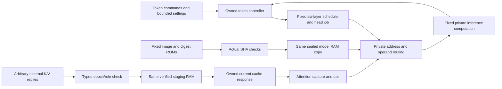

# Authentication and restricted access in the current RTL

These proofs support the inference-only designation of the four current
SimpleStories-V2-5M images. They establish implementation facts about accepting
the fixed model, preserving the checked copy through use, and restricting access
to computation and intermediate state. They do not prove that every conceivable
training strategy using the device is impractical.

## What is established

| Implementation fact | Evidence and boundary |
| --- | --- |
| Boot success requires the complete ordered image readback and matching fixed digest | Actual authentication-to-LOCK composition: 45 assertions per configuration, both solvers. Native image length, one boot BEGIN per hard reset, byte order and padding are checked. Full native-size LOCK reachability is exercised by the board campaign, not supplied as a formal witness. |
| The actual SHA engines implement SHA-256 compression and preserve the required chaining state | Separate one-round, two-round and encrypted owner-held engines are checked against a FIPS-based reference. At least one solver completes unbounded induction for each engine; the other solver's incomplete phases remain recorded. Native DSP arithmetic is checked against the pinned vendor functional model. Hash resistance is an assumption, not an arithmetic theorem. |
| Model data used by the private service comes from the checked RAM copy | Actual fixed digest/metadata ROM selection, complete page fill/hash/seal, native RAM ownership and queued consumer routing are composed. Baseline/seeded/protected bank scopes retain the full RAM and SHA; the encrypted scope retains all four RAMs and the native two-engine SHA pool. No unchecked refetch substitutes for the sealed copy. Private decryption outputs remain arbitrary in the encrypted bank theorem. |
| Arithmetic is reached through fixed private scheduling and operand/address paths | The actual six-layer sequence (22 assertions), semantic datapath access logic (53), group/metadata reader (23), and semantic lookup (9) pass both solvers' bases, unbounded induction and covers. Whole numerical-child replies remain arbitrary in the datapath proof; all reachable reader children are retained in the address proofs. |
| Protected K/V verification reaches the copy captured and used by attention | Both protected configurations have complete 221-assertion native history proofs and 357-assertion current guard/cache proofs, with both solvers. Actual typed hash framing and chaining (43 assertions per configuration) are joined to the proved SHA engines. Separate 34-assertion attention scopes prove owned capture and operand use. Actual clock/reset/CLEAR, fault, identity and data connections are checked. |

Counts overlap and must not be added. Component proofs quantify over their
declared arbitrary private inputs; source-bound connection checks join them.
This is a composition of scoped safety facts, not one monolithic proof of the
transformer's numerical next-token function.



The K/V branch applies to the K/V-protected and encrypted-memory configurations.
The baseline and seeded configurations do not inherit integrity against an
external-memory attacker. Encryption confidentiality and the AES/SIV algorithms
are not established by this package; unrestricted decryption replies make the
stated checked-copy safety result independent of those numerical promises.

## Why this supports inference-only operation

The [write-exclusion theorem](../implementation-assurance/README.md) prevents
the custom RTL from issuing model-region writes after runtime LOCK until the
common hard reset. Authentication checks restrict which image can gain LOCK and
which model pages can be consumed. Fixed scheduling and private operand routes
remove the ordinary programmable tensor/arithmetic interface used for training.
Protected K/V checks additionally restrict attempts to supply chosen internal
operands by replacing external cache contents.

For protected K/V, the formal facts are exact hashing, trusted tag publication
and comparison, identity/epoch ownership, and use of the same verified copy.
Concluding that an attacker cannot substitute different bytes additionally uses
SHA-256 collision/second-preimage resistance and trusted on-chip state. The
solvers do not prove cryptographic hardness. Likewise, these facts do not bound
the usefulness of every algorithm that interacts only through tokens.

## Assumptions and limits

The scope is two-state synchronous digital RTL with the checked reset and
source connections. The configuration, fixed ROMs and on-chip control/tag state
are trusted. The native SHA DSP leaves use the pinned vendor digital functional
model as their specification; this does not certify the physical primitive.
External replies, payloads and backpressure are arbitrary at the stated proof
boundaries. No eventual completion is promised under indefinite stalls.

The package does not establish full numerical transformer correctness,
unconditional cryptographic security, physical fault/tamper resistance, physical
RAM erasure, vendor DDR persistence/order, analog CDC/reset behavior, or
RTL-to-mapped-bitstream equivalence. It supplies no certified residual training
factor. [FORMAL-STATUS.md](../../FORMAL-STATUS.md) and
[INFERENCE-ONLY.md](../../INFERENCE-ONLY.md) explain the relationship to the
architectural claim.

## Check recorded evidence

From `demos/simplestories-v2-5m/`:

```sh
python3.12 -I -S -B formal/authentication-access/check_recorded.py
```

This checks 22 source-audited component receipts, bounded decompression and all
recorded byte identities, original solver outcomes, and current native
source/image bindings. It runs no compiler, solver or FPGA. The selected packet
retains 118 evidence directories and exact source fixtures, with supporting
derivations, counterexamples and original partial outcomes. The deterministic
object store represents about 6.09 GB of raw evidence in about 286 MB.

The source builders and auditors are preserved under `source-tools/` and inside
the evidence. Their original workspace paths remain provenance in unmodified
receipts; the frozen queries can be replayed from another repository location.
The source/query audits checked instrumentation reversal, non-driving observers,
actual dimensions, exact local re-elaboration and query regeneration. Replaying
saved solver replies was used only to check query generation; it is not a new
solver proof.

## Run a fresh solver query

This command runs a real solver on an exact selected query and writes a separate
result; it preserves every original receipt:

```sh
python3.12 -I -S -B formal/authentication-access/replay.py \
  --run datapath-access-r3 --query z3-induction.smt2 --solver z3 \
  --out /tmp/simplestories-access-induction
```

For a semantic fault control, use `--run datapath-access-mutant-head-r1
--query z3-bmc.smt2`: its expected result is a real reset-reachable counterexample.
A successful replay covers the selected query, not every component theorem or a
new hardware qualification. Full source builders, models, monitor sources and
their exact compiler recipes remain available in the packet for inspection and
separate re-elaboration. Three licensed vendor source members are omitted;
their original byte hashes are explicit, and fresh elaboration of those native
DSP leaf models requires the matching installed Gowin simlib. Recorded SMT
models, queries and results are distributed.

## Solver coverage and sensitivity

Every advertised unbounded fact has a completed solver result and a satisfiable
base. Important controls alter actual authentication, digest selection, RAM
fill, bank/response ownership, hash round constants and schedule taps, typed K/V
headers, byte order, epoch/address logic, CLEAR/fault handling and operand/job
selection. Real bounded counterexamples detect these violations.

Some secondary searches and coverage attempts timed out. In particular, compact
SHA induction completes in cvc5, native two-round SHA induction completes in Z3,
and the encrypted lifecycle and service joins use separately audited ordered
derivations. The long skipped-stage control has a real 262-state Z3
counterexample; cvc5 search and complete-witness attempts remain unresolved.
Original failed aggregate flags are retained when later independently audited
phases complete the fact. Unknown results are never counted as proved. The
existing connected token-control theorems retain their separate cvc5 limits,
including the seeded controller's two unresolved CRC conclusions.

The hardware images, numerical model, host, clock settings and benchmark
records are unchanged by this evidence release.
