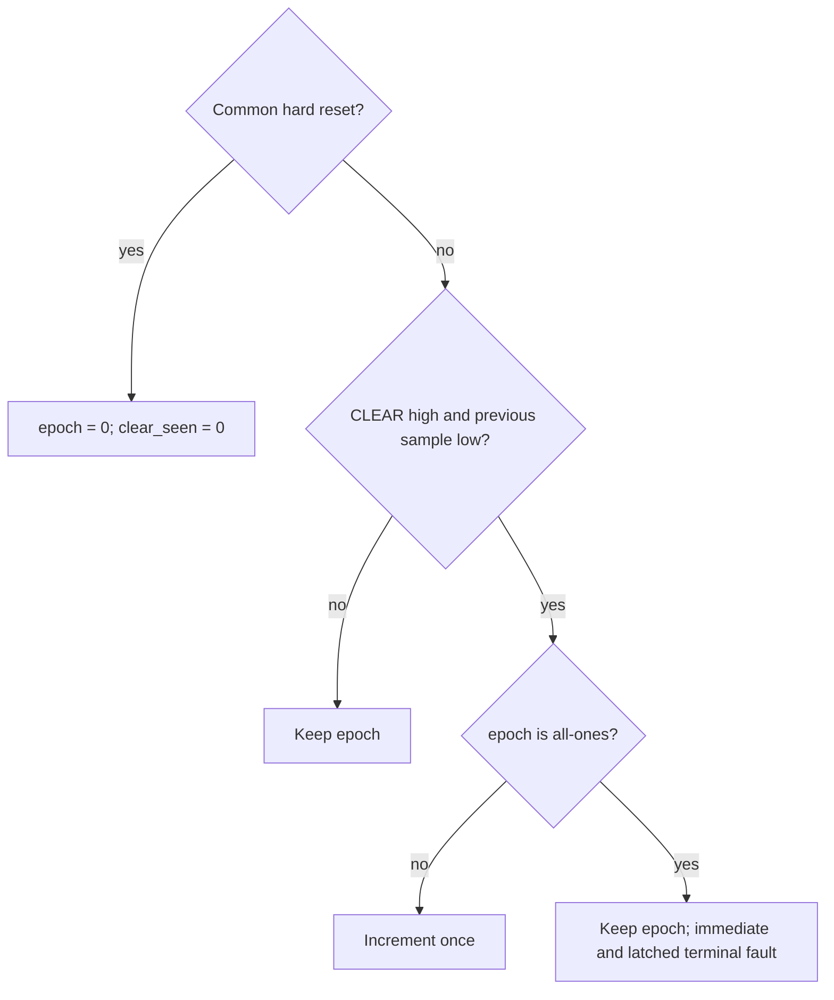

# CLEAR epoch advancement on the actual protected-K/V guard

**Established scalar result.** Between common hard resets, every reset-released
nonterminal state of the selected plaintext K/V-protected SimpleStories RTL has
a 64-bit epoch equal to the mathematical count of newly sampled CLEAR events.
That count is in [0,2^64). Held CLEAR does not count repeatedly. A fresh CLEAR
below the maximum advances once. A fresh CLEAR at all-ones retains that epoch
and causes an immediate terminal fault, latched into the next state.

This is an unbounded source-level induction result for one counter protocol.
Full read integrity, model-derived operands, physical reset/timing and
implementation mapping remain separate. Epoch zero is reused after common hard
reset; the result does not claim global epoch uniqueness across resets.

## Exact property

Let g be r-generation in the unchanged independent legitimate store. The exact
epoch-correspondence predicate is:

```text
reset_n && !terminal_now
  => 0 <= g < 2^64 && epoch_q = int_to_bv64(g)
```

The proved joint invariant J adds:

```text
reset_n => clear_seen_q = r-clear-seen
```

The reference count depends only on actual reset/CLEAR samples. No DDR data,
hash result or desired private reply defines it. Private requests, lower data,
readiness, completions, faults and other native state remain arbitrary under
the actual complete native transition.



This diagram describes counter/exhaustion decisions; other fault causes remain
arbitrary. Held/no-new CLEAR at max epoch can remain healthy. In terminal states
the theorem makes no range promise about the mathematical generation.

## Engine-checked argument

1. Source providers on the unchanged full guard/pagehash/SHA establish reset,
   exact counter/sample updates, terminal-to-next-fault and exhaustion behavior.
   The unchanged legitimate-next definition supplies the reference update.
2. A source-independent arithmetic provider uses arbitrary Int g and 64-bit e.
   Under the original range/encoding and non-max premises, g+1 stays in range
   and int_to_bv64(g+1)=bvadd(e,1). cvc5 checks this exact formula using its
   bitvector-to-integer strategy. No axiom or reduced width is imported.
3. Sticky fault derives a healthy predecessor from a healthy successor.
   Checked activation queries supply every arithmetic premise. A guarded
   application closes J preservation, and its actual reset base closes too.
   Checked bindings connect J to the read-integrity predecessor and its epoch goal,
   all reset/no-new/fresh cases and their exhaustive partition.

This acyclic lemma graph retains the actual transition and full RAM geometry.
It uses no cryptographic/new environmental premise or assumed successor J.

## Evidence and verification

THEOREM.smt2 contains the predicates; epoch-original is AST-identical to the
epoch clause used by the read-integrity proof. Exact SMT-LIB2 obligations are in
the extracted project/obligations/ directory. Z3 checks source/composition; cvc5
checks the required 64-bit arithmetic. PROOF-GRAPH.json and the extracted graph
pin the selected queries, receipts and joins.

run.py checks recorded answers, formula/source hashes, sorts, substitutions and
graph connections. It is an orchestrator, not a proof assistant. Its default
mode recompiles the native models and freshly executes every selected solver
query; --recorded-only validates the saved evidence without launching tools.

Both shadow RTL controls fail the exact epoch predicate while sampling equality
still holds: omitted increment and suppressed exhaustion fault. The ordinary
control has a short native reset-rooted prefix; exhaustion is an arbitrary-state
boundary witness. Original-source rebound passes. Fresh independent plan and
composition reviews accept this scalar scope.
