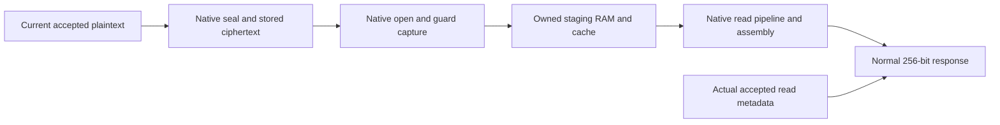

# Normal returned K/V words: proof and replay

[Formal status](../../FORMAL-STATUS.md) · [Validation](../../VALIDATION.md)

For the current encrypted-memory SimpleStories design, a normal live read
response from the integrity guard returns the complete **256-bit current
committed plaintext word selected by its actual accepted layer, position, head
and word index**, under the stated reliable digital-memory and native
function/primitive contracts. Current request wires may change while busy.

This establishes functional data-path behavior at that boundary and supports
the inference-only state-ownership argument. It does not complete the
device-wide post-CLEAR session-isolation theorem or whole-model numerical
correctness. The four designs retain their separately stated proof scopes.

## Checked argument



The source-bound component chain retains each execution's own epoch, descriptor,
plaintext, ciphertext and native call history. The accepted native cryptographic
function is fixed by its separately checked implementation contract; a standard
AES numerical-conformance or distribution theorem is not required or claimed.
The reliable row-memory contract stores actual lower writes and snapshots
actual admitted reads; it is not a physical-DDR refinement theorem.

Unbounded ownership/value proofs connect the actual producers and retained RAMs.
Twenty-two new source-graph queries check accepted metadata and every response
chunk. Temporal graph support establishes that the arbitrary observation point
cannot affect native execution, accepted metadata or current plaintext history.
Eight chunk instances therefore concern the same hardware word. Five finite
lifting-rule queries include nonempty consistency and controls that omit a
chunk or either independence condition. These counts are not additive coverage.

The full native guard, cipher, AES, configured read-only S-box contract, page
hash and SHA also execute a finite two-session example: 72 upper writes,
72 full normal reads, 56 cache hits, 80 lower writes, 161 lower read snapshots
and one canceled zero read. Old payloads and pending physical work survive
busy CLEAR; the epoch advances once and different new data is written without
another hard reset or extra idle CLEAR. Actual source mutations exercise a
hash-faulting staging read and an output-only staging read that returns a wrong
normal word with its fault bit zero. Independent trace arithmetic/memory checks
and scope-refusal fixtures qualify these results.

## Reproduce from this repository

Python 3.12 and its standard library suffice for recorded checks:

```sh
cd demos/simplestories-v2-5m
python -I -S -B formal/kv-return/replay.py --packet evidence/kv-return --recorded-only
python -I -S -B -m unittest discover -s formal/kv-return -p 'test_*.py' -v
```

For fresh source elaboration, 27 sequential Z3 queries and all three native
executions, also install Yosys, Z3, Icarus Verilog and `vvp`:

```sh
python -I -S -B formal/kv-return/replay.py --packet evidence/kv-return --out /tmp/kv-return-replay
```

The output directory must not already exist. Exact graph/IL/SMT reproduction
uses the recorded Yosys 0.68+post commit
`c12172fbae8af5e20f6fb52e3d4e92d56ed587b6`. Z3 runs one query at a time with a
1 GiB memory limit. The replayer reads packet objects and a fresh output
directory; recorded workspace paths are resolved through the index.

The [packet index](../../evidence/kv-return/INDEX.json) supplies the complete
closed evidence dependency set and the 27 selected new query recipes.
[REPLAY.json](../../evidence/kv-return/REPLAY.json) records fresh outcomes and
the exact replayer hash. Recorded mode verifies bytes, nested manifests,
query reconstruction and the named replay receipt; it executes no solver.
Earlier imported source/proof/query/reply records are supplied, including
incomplete outcomes and controls, but this selected fresh replay does not rerun
every imported antecedent solver query. The indexed qualification receipt
states all assumptions and false completion flags. Raw receipts keep their
recorded bytes and path annotations.

## Remaining boundaries

Complete trusted-tag/hash and fault correspondence; public UART CLEAR/drain and
next accepted work; actual transport/vendor-memory refinement; common ownership
through the core and services; model-cache/numerical/token/timing composition;
and exhaustive mutable-state signoff across all four designs remain required
for complete session isolation. Physical erasure, standard-AES conformance,
cryptographic security with public demonstration keys, mapped-image equivalence
and a residual training-capacity bound are not established here.
