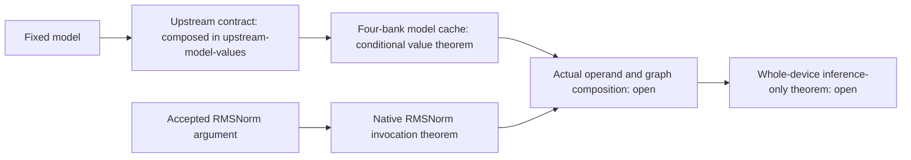

# Native component values for the baseline SimpleStories design

The [composed model-read package](../upstream-model-values/README.md) supplies
the cache's raw-reply premise through the actual baseline transport and
wrappers, under its stated startup, metadata and vendor-storage boundaries.
The cache theorem here remains the reusable conditional component lemma.


Two completed component results strengthen the connection between the fixed
inference graph and the values its implementation produces. They are separate
from the main inference-only theorem, which remains open.

| Result | Established fact | Explicit boundary |
| --- | --- | --- |
| [RMSNorm invocation confinement](THEOREM.md) | Each successful result belongs to the current accepted vector and agrees with a fresh invocation of the frozen native finite-width operator, despite prior work, retained payloads, stalls and CLEAR. DONE requires all 256 result handshakes. | Actual caller operand provenance and an independent mathematical RMSNorm specification are not proved. The configured stateless DSP correspondence remains a platform premise. |
| [Production model-cache word identity](model-operands/THEOREM.md) | The actual four-bank cache service preserves request ownership/order and returns the requested immutable model word, including held responses and page replacement. | Conditional on ordered correct raw DDR replies, or failure, at the private raw-read seam. The custom upstream premise is discharged in the [composed model-read proof](../upstream-model-values/README.md); downstream arithmetic consumption remains open. |

RMSNorm retains the native vector/work RAMs, coefficient ROM, multiplier,
square root, rounded divider and shift pipeline. The cache proof retains the
actual four banks, full FIFOs, metadata ROM, digest ROM and SHA subtree.
Production dimensions and watchdogs are unchanged. No internal numerical
producer is replaced by arbitrary correct replies. These claims apply to the
named baseline source; they do not automatically qualify the other three
SimpleStories configurations.

The RMSNorm proof has 26 top-level rules and 119 exact engine queries
(118 UNSAT plus one SAT nonvacuity query). The cache proof has 17 UNSAT queries
across five acyclic plans. Counts describe different obligations and are not
an aggregate count of independent inference-only guarantees.

## Relationship to inference-only operation

Model-write exclusion prevents changing the resident model. Restricted
controllers and address routes constrain which computations can be requested.
These value results address a further requirement: a permitted operation must
actually produce values from its current fixed operands, rather than from
unrelated retained computation. The cache result supplies a conditional
fixed-model operand path. Composing these facts with the other arithmetic,
attention/K/V and command-controller results is still necessary to prove the
whole-device property for arbitrary command sequences.



## Reproduction

From the repository root, check the complete recorded packet without external
formal tools:

```sh
python3.12 -B demos/simplestories-v2-5m/formal/native-component-values/run.py --recorded-only
```

For fresh source compilation, all exact solver queries, finite operating runs
and actual-only numerical defect controls:

```sh
python3.12 -B demos/simplestories-v2-5m/formal/native-component-values/run.py \
  --out /tmp/simplestories-native-values
```

Use Python 3.12, Yosys 0.68+post (`c12172fbae8af5e20f6fb52e3d4e92d56ed587b6`),
Z3 4.14.1 and Icarus Verilog 13.0.
The exact Yosys SMT output is checked; other compiler versions can legitimately
produce a different encoding and are rejected pending review. At most eight
4-GiB solver jobs run concurrently, each capped at 120 seconds. A timeout or
unknown is a failed reproduction. The output directory must not exist.
The release inputs stay unchanged; fresh results go under `--out`.

Python is orchestration. Engine-checked SMT-LIB transition systems and proof
obligations establish the component results; running Python's compiler alone
does not verify them. The readable statements, declarative plans, native
SystemVerilog, compiler recipes, generated SMT models, exact compressed queries
and raw engine replies are all included. The portable path adapters preserve
the exact query hashes used to qualify these results.

Finite controls cover all 13 RMSNorm coefficient roles (3,328 row comparisons),
post-CLEAR reuse, and stale-state/wrong-operand defects. Cache controls compare
251 bank values and 12 actual fixed-model service requests, with wrong-word and
stale-read defects detected. Independent finite checks bind all 3,328 coefficient
ROM entries, 2,328 metadata words and 1,774 page digests to the named model image.
These simulations and artifact comparisons supplement the unbounded rules.

This packet establishes no full transformer numerical specification, universal
SHA-standard theorem, adversarial physical-memory guarantee, liveness under
unbounded stalls, physical primitive guarantee, or mapped-bitstream theorem.
