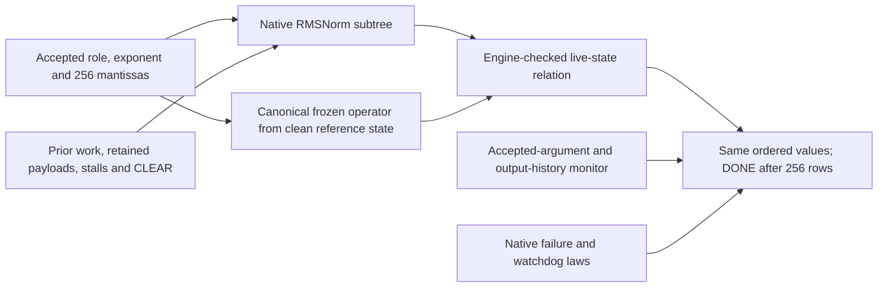

# RMSNorm invocation confinement: statement and proof structure

This is the completed baseline component theorem. Completion is reported in
`QUALIFICATION.json`; a saved specification or passing helper is not completion.
It is separate from the whole-device inference-only theorem.

## Claim

Fix the baseline RMSNorm source, parameters and immutable coefficient bytes in
`SOURCES.json`. Let **F(role, exponent, vector)** be the ordered result stream
and termination outcome of that frozen native operator, evaluated from reset
controls and zero resetless reference payloads. Its descriptor and 256 input
beats are supplied without stalls, input rows are 0 through 255, and result/done
ready are true. Unused reference input fields are zero. Model lock is held and
reference external fault/CLEAR are false. The role determines one of the 13
coefficient banks. A native range/watchdog fault rejects the invocation; no done
by the native watchdog plus 512 clocks is rejection. The stream includes any
results preceding that outcome.

For every actual two-state native execution starting from the common hard
reset, allow arbitrary component input attempts, prior work, retained payloads,
lock changes, external faults, CLEAR and input/output stalls. Then:

1. Every asserted actual result has a currently admitted invocation with a
   complete, legal 256-word argument vector. The row/value/exponent/last tuple
   equals the corresponding result of F at the current output ordinal. A held
   unaccepted result retains that ordinal. A later fault cannot excuse an
   earlier wrong value.
2. Actual DONE requires all 256 result handshakes in order and canonical DONE.
   The role, exponent and vector are the accepted arguments of this invocation,
   rather than old RAM contents or changing unused input pins.
3. Actual CLEAR revokes current output validity and discards the invocation.
   Old physical payloads need not be erased. A fresh invocation has the same F
   meaning after CLEAR or ordinary prior completion, with no extra DUT reset.
4. A local component fault suppresses result/DONE and persists until actual
   CLEAR or hard reset. A safe failure may prevent completion; no timing or
   equal-fault-outcome guarantee is required.

This is **correspondence to the frozen finite-width operator**, not a proof of
mathematical RMSNorm, agreement with an independent numerical oracle, or
successful completion for every legal input. The whole-device token theorem
also needs actual caller operands, workflow, model consumption and memory/cache
meaning. Those are not discharged by this component theorem.

## Why this supports inference-only verification

A controller result that merely limits which operation may start leaves open
what numerical producer supplies its answer. This theorem closes that producer
boundary for RMSNorm: successful values have the meaning of one fixed operator
on the current accepted operands. Retained computation or private scratch
cannot silently supply a different computation's result. The main graph still
has to establish that RMSNorm is called only at its prescribed stages with the
correct model-derived operands. This is a reusable component of that argument,
not a proof that arbitrary UART histories already refine the whole model.

## The implementation being related

The actual and canonical sides retain the real 256×16 vector RAM, synchronous
reads, 13-bank coefficient ROM, stateless multiplier, 23-iteration square root,
28-cycle rounded divider, 682×58 normalizer workspace and shift pipeline.
Production widths and 2,000,000-cycle watchdogs are unchanged.

The arithmetic path is squared-vector accumulation, mean-square/epsilon,
integer square root, rounded division and clamping, role-selected coefficient
and scale products, then vector normalization and rounded shifting. These
specific reviewed RTL operators define F; it is not an opaque function selected
to fit observed outputs.

## Proof argument and engine checks

`project/native.smt2` is compiled from the frozen native subtree. `product.smt2`
contains its actual/reference simulation relation; `history.smt2` defines a
read-only monitor of accepted arguments and output ordinals. `check.py`
submits standalone SMT-LIB queries to Z3 and preserves raw engine replies.

- Reset and CLEAR establish the relation from arbitrary old mutable payloads.
  Phase-dependent liveness avoids assuming equal unused scratch or stale helper
  replies. Actual native producer transitions establish the equal live values.
- The product relation is inductively preserved. Neutral external waits pause
  only the reference clock; all productive helper cycles remain. Removing those
  stutters yields the prescribed ordinary native canonical evaluation.
- A separate entry lemma starts a fresh zero-payload reference at ordinary
  actual admission. The DUT is not reset. Thus the argument applies to repeated
  calls as well as the first call after CLEAR.
- The accepted-history monitor records the current role/exponent and each
  legal captured word. Its owned prefix agrees with actual RAM. It checks
  capture completeness, output row/last order and DONE after ordinal 256.
  It is a functional observer and supplies no signals to the DUT.
- Descriptor/input event correspondence connects that history to canonical
  input events. Unused actual pins remain independent of the reference. Faults
  on ending edges are included; persistence and output suppression prevent a
  discarded invocation from later resuming without CLEAR.
- Native counter-update, failure-boundary and exit laws combine with a checked
  32-bit ranking fact. This justifies the finite canonical horizon, without
  shrinking production counters or unrolling two million cycles.

Parent-state case splits cover every value of the actual native 5-bit sort.
CLEAR and already-failed cases use separately checked initialization/failure
lemmas. This is one invariant proof divided into engine queries, not a set of
new interfaces with arbitrary numerical replies. Imported facts are the checked
implications of earlier nodes in an acyclic dependency graph.

A full-vector post-CLEAR simulation passed for all 13 roles, comparing 3,328
actual results with fresh-reference results under stalls. An actual-only stale
row defect and an incorrect divider operand are both detected by numerical
mismatch, with the reference unchanged. These transcripts are finite operating
and defect-control evidence; the induction checks establish the unbounded part.

## Explicit premises and limits

The digital model uses the trusted synchronous clock and common hard reset,
two-state RTL, the pinned immutable ROM bytes and production parameters. The
configured vendor bypass/no-feedback DSP is assumed to implement the retained
behavioral signed multiply. Vendor primitive internals, analog behavior and
mapped-bitstream equivalence are outside this result. Actual caller instance
ports and default parameters are source-bound; parent operand provenance is a
separate main-theorem obligation.

The local component permits CLEAR after its fault. This is not the public root
Terminal policy, which has its own reset/containment theorem. The result makes
no training-capacity estimate and no timing or fault-cause noninterference claim.

## Reproduction and review

Use the [portable entry point](README.md#reproduction) to validate recorded
evidence or freshly compile and replay every exact engine query. `SPEC.md`,
`SOURCES.json`, `PRODUCT.json` and `HISTORY.json` identify the statement and
source/formula identities. Compressed queries and raw replies are in `queries/`.
`OPERATING-EVIDENCE.json` records checked finite transcripts.

The entry checks all required rules, complete case coverage, source/formula
identity and operating/defect evidence. Python compilation alone does not verify
them. A successful component entry does not complete the main baseline theorem.
