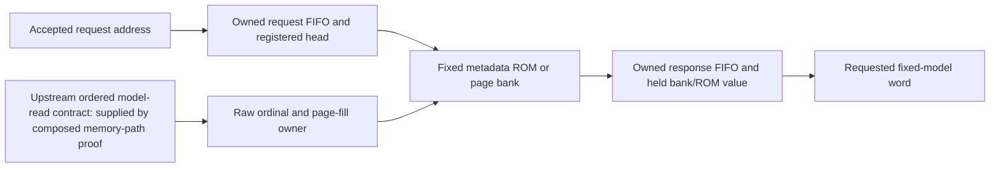

# Fixed-model words through the production cache service

The [composed baseline memory-path proof](../../upstream-model-values/README.md)
discharges this component's raw-read premise through the custom RTL. Its
vendor-storage, trusted startup-image and static metadata boundaries remain
explicit; the whole-device inference-only theorem remains open.

This is a **conditional component theorem**, separate from the whole-device
inference-only theorem. Current results are recorded in `RESULT.json`.

## Claim and explicit boundary

Fix an immutable 256-bit word image M, the production service RTL and its
parameters: four banks, 19-bit addresses, 227,062 image words, 32 outstanding
raw reads, and the source's unchanged FIFO depths, RAM sizes and watchdog.
The local metadata ROM must decode to the corresponding words of M.

Assume the upstream raw-read path returns the word of M for the corresponding
accepted raw read, in order, or reports failure. Then, from common hard reset,
the service's successful return stream preserves the accepted request order
and returns the requested word of M. Held valid returns have the same value.
Invalid attempts, stalls, cancellation, page replacement and safe failure are
represented; a later fault cannot excuse an earlier wrong returned value.

The actual public wrapper ties the service's cancellation input to zero.
Public CLEAR therefore does not reset this service or its pending fills.
The component proof allows cancellation as well; it does not claim a public
UART CLEAR theorem. Fixed-model pages may remain cached, with their value
meaning preserved rather than erased in a hypothetical reference.

The raw-read premise is **not discharged here**. The actual model CDC, shared
model/K/V backend, application adapter, boot/handoff and vendor storage contract
must establish it in the main proof. In the formal step predicate
`upstream-word`, an accepted raw return has value
`M[{current-fill-page, returned-word-ordinal}]`. The checked raw ownership laws
connect those page/ordinal fields to the accepted raw read sequence and actual
RAM write. This does not assume correct data at the downstream group-reader or
arithmetic-consumer port.

## Readable implementation relation

Three functional, read-only monitors and one value invariant describe this path:

- `RequestOrigin` records accepted addresses in a bounded history ring, with
  independent admitted/dispatched counters. The actual 64-entry request FIFO
  and registered head agree with its complete owned prefix. Dispatch takes the
  oldest undispached address; a published address remains in the model region.
- `RawOrigin` records the real page-allocation event and accepted raw read and
  return ordinals. It does not reset on service cancellation. Every accepted
  return writes the selected actual bank RAM at that page/ordinal, including
  the fault-detection edge. Production outstanding bounds remain unchanged.
- `ServiceOrigin` watches an arbitrary one of all 32 response FIFO slots. It
  records the address and actual bank/ROM word at dispatch. Five class-slot
  fields track the four bank responses and metadata response. Queue membership,
  class ownership and held native values agree until the corresponding return
  retires; a refill cannot replace a held bank response's page or value.
- For an arbitrary model word u, each bank's initialized fill prefix and sealed
  contents at u equal M[u] when that bank holds u's page. Unwritten resetless
  payload remains unconstrained. The final partial page's tail cannot supply a
  legal model word. A watched response has a legal accepted address, and its
  captured value equals M[u] when that address is u.

The joint relation in `model-origin.smt2` includes all three monitors and this
model-value invariant. Reset establishes it despite arbitrary old payload.
The native transition preserves it under the explicit upstream contract.
The output consequence establishes the model word for every target address
and response slot. The monitors never drive the circuit. Their recurrences,
the actual FIFO pointer/count laws and the recorded address copies give the
ordered request/dispatch/return interpretation; they do not assume equal
internal replies or use an opaque whole-program function.

The common checker imports only the exact proved implications of preceding
plans. It verifies their source/formula identities, variable context, exact
standalone queries and raw engine replies. The dependency graph is acyclic.
New values are produced by the actual native RAM/ROM and SHA subtree; no child
output is replaced by a free numerical reply.

## Model instantiation and operating evidence

The named image is SHA-256
`cad8d015db37a3603e340edfc0009f36d6b12de2bc789d60687011fc700cc3b0`.
The independent finite table check binds all 2,328 expanded metadata words and
1,774 expected page digests to it. A native service experiment using that image
passed cache hits, replacement, metadata words and the last partial page under
request/return stalls. Its faithful memory model terminates at the private raw
seam; it is operating evidence, not proof of the omitted custom upstream path.

The native single-bank experiment compared 251 returned/held values, including
full fill, partial-page fill, replacement, cancellation and held responses.
Actual-only wrong-word and stale-read defects both produced incorrect numeric
values while the bank was verified and fault-free. These are meaningful finite
controls alongside the unbounded induction checks.

## Limits and reproduction

This theorem supplies fixed-model word identity through this service under its
stated upstream contract. It does not establish public command policy, correct
group descriptors, coefficient-lane unpacking, arithmetic consumption, attention
over legitimate K/V, the main graph invariant or bitstream equivalence.

The actual SHA implementation is retained as a gate on page readability.
Universal SHA-standard correspondence and authentication against adversarial
physical DDR are not proved by this value theorem. The reviewed unprotected
baseline excludes adversarial physical DDR modification. No stronger protected
configuration claim is implied.

Use the [portable reproduction entry](../README.md#reproduction) for fresh
source compilation, all exact solver obligations and operating/defect controls.
The shared rule checker is `../native_induction.py`; the declarative plans and
`*-origin.smt2` files are the formal specification and engine input. Python
compilation alone is not verification. The whole-device theorem remains open.
