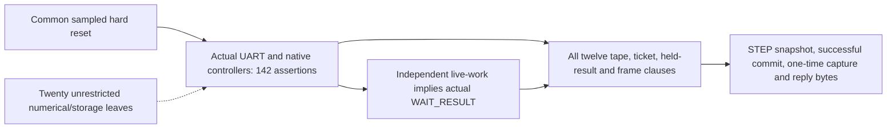

# What an accepted STEP may commit and publish

If CLEAR is accepted between candidate commit and bridge reply capture, the
committed candidate loses publication authority. In the operating witness,
candidate 23 is committed, then cancelled without publication; a newly accepted
STEP supplies candidate 17, whose captured frame remains fixed through a later
fault. An **opaque candidate** means an arbitrary token supplied at the
numerical core boundary. Its current-STEP numerical provenance remains open.

Fix the named baseline RTL, its parameters and the digital interpretation
below. For arbitrary UART inputs, backpressure and behavior at the explicit
numerical/storage cuts, the following safety properties hold from common reset:

1. Actual decoder and adapter handshakes determine accepted APPEND, STEP and
   CLEAR. Malformed, busy or ignored bytes do not invent an accepted STEP.
2. An accepted STEP snapshots the current valid tape and obtains a
   fresh logical ticket. In a healthy active machine, the actual valid tape
   prefix follows accepted APPEND values and successfully committed candidates
   since accepted CLEAR. Retained RAM payloads need not be erased.
3. A successful shell commit appends one accepted candidate under that STEP's
   current control lease. At most one successful commit and token-message
   capture belong to that ticket. A held candidate cannot be replaced before
   capture except by the specified cancellation, fault or reset behavior.
4. Bridge capture fixes the token reply. Each accepted serializer byte matches
   its position in the frame `5A`, `81`, token low, token high and CRC-8, even
   if a fault occurs afterward. This safety claim does not require completion.
5. Accepted CLEAR revokes prior work and held-result authority. Controller
   drain and any newly accepted work stay on the same execution without an
   extra reset; newly accepted work must follow actual controller drain.
   This implies neither progress under arbitrary stalls nor physical quiescence
   of cut services.

Publication means the actual bridge token-message capture. Later serializer
bytes belong to that captured message. CLEAR bytes during SEND/DRAIN are
ignored by the interface and therefore are not accepted cancellation. A token
result arriving with the final CLEAR packet byte has the existing result
priority. Only common hard reset may truncate a captured frame. Physical UART
pin timing/refinement is a separate obligation.

Successful commit includes actual local reset and branch/fault priorities.
Raw `generated_commit` may cause a speculative physical tape write on a
cancelled/faulted edge; such a write gains no valid-prefix or publication
authority. Detecting a fault does not prove its cause or timing authorized.

## Why this is an unbounded joined result

The complete native assertion conjunction has reset/base-window and joint
three-step preservation proofs. A separate reset/one-step induction establishes
the phase provider without any history-invariant premise. The twelve history
clauses then have reset/base-window and complete joint preservation proofs on
that same native/ghost trace. Four endpoint implications consume those closed
facts. No failed conjunct subset supplies induction hypotheses.

The history is a total nondriving function of actual accepted commands, actual
successful commit, capture, CLEAR and fault/reset events. The fixed arbitrary
tape address covers all 2,049 native entries. Message history is separate from
work and held-result history so a later fault cannot replace a captured frame.
The actual bridge WAIT_RESULT encoding is 2; the independent protocol
reference's different encoding is not substituted for it.

The [SMT-LIB predicate](STATEMENT.smt2),
[phase provider](PHASE-SUPPORT.smt2) and
[dependency graph](CONTRACT-GRAPH.json) state the formal argument. The replay
loads each exact native transition model before these definitions and checks
the listed reset and preservation implications. Eighteen selected outcomes are
fourteen UNSAT and four expected SAT contexts or source-defect checks. Separate
operating evidence observes reset, busy CLEAR, drain, fresh work and the actual
reply through a later fault.

## Assumptions and remaining boundaries

One native transition represents a common core rising edge. Startup has two
sampled low reset states; actual machine-release and local shell reset remain.
UART counters, RX/TX, bridge, adapter, controllers and the full token tape are
retained. This is two-state source-level digital safety, rather than analog
reset, metastability, independent physical clock or RTL-to-netlist equivalence.

Twenty numerical/storage leaf instances and 137 output ports remain explicit
unrestricted inputs. No legal-caller, correct numerical reply, honest DDR or
future-health premise is added. The source map identifies the actual production
bytes and the instrumentation/cut differences. The operating witness supplies
explicit protocol stimuli at those interfaces; it supplies no universal
correct-reply contract.

This supports the inference-only claim by tying accepted public operations,
mutable logical context and token publication to current command authority,
including revocation by CLEAR. **The committed candidate remains opaque.**
Membership in this STEP's actual head-row stream and argmax correctness still
need a provider join. Establishing that those logits equal the prescribed model
is another numerical theorem. The full fixed-model graph, authentication through
use, private-effect and fault/status/timing authorization, physical drain,
other configurations and the whole-device inference-only theorem remain open.
