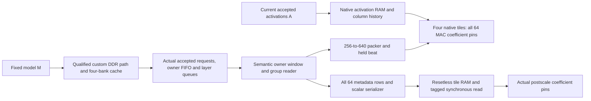

# Baseline Q-projection operand provenance

Qualification is reported by `QUALIFICATION.json`. This statement concerns the
baseline SimpleStories Q projection, for all six layers, four groups, 256 input
columns and 64 coefficient lanes per group. It is a component of the intended
inference-only theorem. It does not establish that whole-device theorem.

Let **M** be the fixed model image at runtime entry, and **A** the 256 activation
values accepted by the current native projection-job invocation. Following the
common hard reset, for arbitrary subsequent inputs and backpressure, whenever a
healthy, live Q computation consumes an operand:

1. Each of the four tiles accepts the correct 160-bit portion of the current
   640-bit model beat. At an enabled native MAC multiplication, every coefficient
   pin contains its corresponding signed 10-bit model coefficient, and its
   activation pin contains **A[c]** for that coefficient's column **c**. First and
   last tags identify columns 0 and 255.
2. The current group's 64 row multipliers and exponents originate from its
   model metadata. They remain associated with the correct rows through scalar
   serialization, resetless tile storage, synchronous read and the valid-tagged
   postscale pipeline. Both actual postscale multiplier coefficient pins
   contain the current row's model multiplier. The associated source exponent
   is the representable signed sum `activation_exponent + row_exponent - 15`.
3. These statements use the actual accepted cache API requests, owner FIFO,
   layer request/response queues, semantic owner window, group reader, packer,
   beat register, tile RAMs and native operand registers. They do not assume a
   desired data word at the private response port below the cache.

The coefficient layout has Q group base word `28580*layer + 640*group`. Two
640-bit beats occupy five consecutive 256-bit words: the even beat is
`{word2[127:0], word1, word0}` and the odd beat is
`{word4, word3, word2[255:128]}`. Every bit is covered by the 64 constant 10-bit
slice obligations and their checked full-width join. Metadata group base is
`211920 + 304*layer + 8*group`; each word contains eight 32-bit row records,
whose low byte is the signed exponent and next 16 bits the multiplier.

The upstream model-value theorem retains its explicit external boundaries:
vendor/application storage behavior; the trusted model-image write-fold
identity at runtime entry; static metadata-ROM/model binding; and the named
digital RTL, source, clock and reset semantics. Boot authentication/loading is
not proved by this component. The existing published upstream composition is
reused within its recorded scope.

The projection subtree is uncut native RTL. Nineteen other numerical leaves in
the parent control model remain unrestricted. A checked transition weakening
omits only the updates of the 128 native MAC product/accumulator registers; it
retains control, payload registers, memories and operand wiring. This can
establish operand provenance, but supplies no MAC arithmetic correctness result.

Histories are total SMT functions of actual accepted events, not HDL added to
drive the circuit. Resetless payload starts arbitrary and is claimed only under
its current ownership phase or valid tag. CLEAR may drain prior outstanding
reads; fresh invocation histories do not treat those reads as new operands.

This result supports the inference-only restriction by connecting arithmetic
operand use to fixed model coefficients and current accepted arguments. It
closes one source of uncertainty between a fixed-weight memory theorem and the
actual arithmetic inputs. It does not yet prove the numerical Q result, the
normative meaning of the upstream RMSNorm activation stream, every arithmetic
operation's authorization, attention/K/V behavior, the full computation graph,
arbitrary-command confinement for the complete device, or the protected and
seeded variants.
