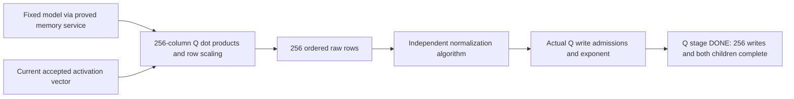

# Baseline SimpleStories Q operator

The claim below is discharged by the source-bound trace argument. The enclosing
package's qualification and reproduction receipts specify its exact replay scope.

For every execution of the named baseline RTL after the common hard reset, the
following statements hold for an accepted Q invocation, its accepted activation
vector and its fixed-model coefficients/metadata. They include arbitrary stalls,
CLEAR, later invocations and the named interruptions below.

1. Every held raw Q result and every transferred raw result has the exact integer
   dot product, row multiplier and exponent specified in `SPECIFICATION.md`.
   Transferred coordinates form the ordered prefix 0 through 255; LAST occurs
   exactly at 255. Raw DONE requires the complete 256-result prefix.
2. The actual normalizer refines the independent finite algorithm in
   `NORMALIZATION.md`. Its numeric state is determined by the
   accepted raw vector. Selection, checked shifting, ties-to-even rounding,
   retries, zero-vector behavior and arithmetic rejection follow that algorithm.
3. Every actual Q-store write admission has the current invocation's coordinate
   and normalized mantissa. The actual exponent register receives the same
   candidate exponent, unless reset has priority. Q stage DONE requires all
   256 ordered write admissions and actual completion of both children.
4. CLEAR revokes current invocation/value authority. Physical exponent contents
   may survive CLEAR; a later invocation cannot acquire their old authority.
   Hard reset sets that actual register to zero. This does not assert erasure
   of every private RAM bit.
5. A first normalizer fault is a named source interruption or an independently
   specified numeric rejection. With no named interruption, rejection preserves
   the already-emitted prefix and emits no additional value or DONE.

A later fault or cancellation cannot excuse an earlier wrong live value. The
proof includes a live value on the first failing edge; it does not assume that
all observed outputs occur before every possible root fault.

The proof connects these boxes on one actual execution trace. Histories record
accepted events and numerical inputs; they are not a second circuit driving
correct answers. The reset bases, first-step bootstrap, regular induction,
source-instance applications and endpoint implications are checked in
`trace_closure.py`; the actual engine obligations are SMT-LIB generated from
native RTL plus the component invariant definitions. `q_main.py` supplies the
six normalized/effect endpoint statements. `raw_contract.py` and
`normalizer_faults.py` supply the raw and rejection statements.

The four retained memory/model boundaries are vendor application storage
behavior, runtime-entry model-image write-fold identity, static metadata-ROM/model
binding, and named digital RTL/source/clock/reset semantics. Source-level
identical-module instantiation, the native frontend, standard word semantics and
the configured digital DSP recurrence are explicit trusted boundaries. This
is not a proof of physical DSP behavior or RTL-to-bitstream equivalence.

Named interruptions include the actual source protocol/descriptor/lock/upstream
fault conditions and the actual default watchdog. They may truncate a correct
prefix. This theorem does not establish that every interruption is authorized
by the whole-device architecture, that timing is independent of history, or
that successful completion is guaranteed.

This is a functionality and value-ownership result supporting the later
inference-only proof: it shows that the implemented Q service computes its
specified fixed-model operator. The whole-device restriction also needs to show
that arbitrary external commands can invoke only the permitted graph and
operations. Caller RMSNorm/whole-graph composition, other operators, retained
Q-RAM contents/readback, other configurations and the whole-device inference-only
theorem remain outside this component result.
