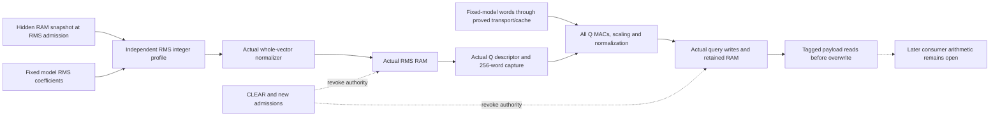

# RMSNorm-to-Q numerical segment

For the named baseline SimpleStories sources, fix one legal digital execution
from common reset under the four contracts below. The proof fixes the complete
hidden vector, exponent, layer, position and RMS role at the actual RMS stage
admission. It proves that successful RMS and Q effects use that invocation's
independently specified numerical computation, then preserves that certificate
through retained query RAM and its synchronous reads.

The input vector is chosen at admission, before its consumed values or outputs
are observed. Actual hidden/RMS/query RAM and native RMS/normalizer/Q producers
remain in the source context. The full Q geometry has 64 MAC lanes, four groups,
256 input columns and 256 output rows, for all six layers. Fourteen unrelated
numerical leaves remain unrestricted; this is a segment theorem.

## Established behavior

1. **Independent RMS meaning.** The actual square fold equals the sum of the
   256 accepted signed squares. The finite-width mean is nearest-even rounding
   of that sum divided by 256. The exponent-dependent epsilon, positive
   radicand, floor integer square root, bounded signed nearest-even division,
   clamp, fixed-model coefficient/scaling and source exponent match the
   independently defined profile. The actual helper instances implement those
   mathematical operations. All 3,328 consumed RMS ROM words match an
   independent decoder of the pinned model.
2. **One normalization and input frame.** The actual normalizer refines a pure
   whole-vector algorithm on those RMS records. Ordered RMS writes store one
   program frame with one exponent. Reset/CLEAR/new admissions and sticky faults
   prevent a cancelled or restarted frame from completing another prefix. The
   following real Q descriptor fixes that complete reference and exponent;
   every accepted Q activation is its ordered word. The accepted history and
   precise QA completion snapshot establish equality on coordinates 0…255.
   Unused retained BV10 addresses are unconstrained. QA persists through child
   DONE; no later zeroed QInput is substituted as the argument.
3. **Complete Q computation.** The pinned qualified Q theorem supplies exact
   fixed-model dot products/scaling, the independent normalizer, ordered actual
   Q write admissions, the exponent register and full stage completion. Its
   source trace is specialized to the restored real parent. The full numerical
   certificate is retained; a smaller scalar consequence only discharges the
   physical write/data/address adapter.
4. **Retained numerical payloads.** Every valid query row whose last writer was
   Q has the independent result of its producing invocation. Its saved record
   retains the numerical/program/input certificate, row, exponent, generation,
   layer and position. An enabled synchronous read samples that pre-write
   record, including simultaneous read/write of the same address. Other query
   writes, including Q-RoPE, revoke the overwritten row's unrotated-Q authority;
   CLEAR and new Q admissions revoke the stated row/read authority. No clean
   resetless RAM contents are assumed.

The guarantee is value, prefix, ownership and successful-completion behavior.
Named interruptions can truncate a correct prefix. It is not a termination,
latency, complete fault-authorization or arbitrary-command theorem.

## How the composition is checked

The common-trace checker initializes every invariant from the same actual reset,
closes each provider before using it, and checks the complete next-state tuple.
Numerical helper replies, desired outputs and desired admission origins are not
environment assumptions.

The preserved-record predicate `P_tau` fixes the actual source trace and its
certified observer histories **outside** the storage induction. Records save
real RMS/Q/normalizer admission indices and their producing edge. Those indices
come from concrete read-only histories with checked base/recurrence/getter,
source-constructor and sampled-payload rules. Their readouts establish real
prior admissions and intervals without revocation or readmission. Q generation
and position use actual source hold rules; nonzero normalizer metadata provides
its actual admission witness. No ordering between the projection and normalizer
admissions is imposed, and numerical generation and epoch fields are not equated
as identities.

The checker expands every clause of `P_tau` at the explicit fresh constructor,
including all 256 Q raw-record instances, and closes it from the RMS frame,
accepted-input, Q numerical and source-owner certificates. A parametric
store/select induction then carries that full immutable certificate to each
valid row and pre-write read. It never refers to a later current RMS buffer or
a bare unbound NormAlgorithm state. The readable SMT statement exposes the
constructed origin histories and preserved-record predicate; the source-bound
project checks their implementation and proof applications.

The explicit logical rules are ordinary induction on clock/digit/finite row
indices, typed equality and function specialization, standard SMT word
interpretation, and identical-source hierarchical module/trace specialization.
Function-definition forgetting is used only as an UNSAT strengthening in named
joins; every original theory is typechecked, and the exact original and
strengthened engine inputs are retained/reconstructed. No raw whole-segment
UNSAT receipt is invented.

## Contracts and limits

The four inherited contracts are:

- Vendor application storage behavior.
- Runtime-entry model-image write-fold identity.
- Static metadata-ROM/model binding.
- Named digital RTL/source/clock/reset semantics, including the configured
  behavioral DSP interpretation.

The model image is SHA-256
`cad8d015db37a3603e340edfc0009f36d6b12de2bc789d60687011fc700cc3b0`.
Translation/solver trust, the stated source-specialization and induction rules,
and physical mapped-DSP/bitstream correspondence are explicit boundaries.
The latter physical correspondence is not proved here.

Incoming activation meaning before RMS stage entry, accepted public commands,
the rest of the numerical graph, Q-RoPE arithmetic and later consumer
correspondence, full post-CLEAR token-output isolation, timing/fault cause
rules, other configurations and the whole-device inference-only theorem remain
open. Readback covers payload mantissas and the saved producing exponent and
reference; it does not claim a later global query-exponent register still
belongs to every retained row.

## Contribution to inference-only verification

This is a functional-correctness and provenance result. It replaces a numerical
producer boundary with actual fixed-model computation and carries its meaning
through private storage. Combined with the separate fixed-model write and
access restrictions, it supplies a stronger contract for the eventual
command-to-graph inference-only composition. It does not itself establish that
all public commands can cause only the permitted complete inference operations.
