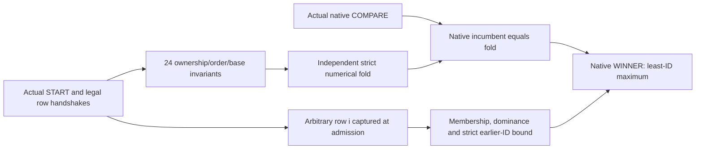

# Native selector winner over its admitted rows

The published SimpleStories greedy selector returns the least ID attaining the maximum of the 4,019 rows legally admitted in its current healthy invocation. The result concerns the selector unit, beginning at its actual START handshake. It does not establish that a parent STEP owns that invocation or that its input rows are the prescribed model's logits.

## Statement

Consider a sampled, two-state execution of the pinned selector and comparator. An invocation begins at an actual `start_valid_i && start_ready_o` handshake. Its row list consists of actual `row_valid_i && row_ready_o` handshakes satisfying the native `row_legal` predicate. Reset, CLEAR, model-lock loss, upstream/sticky failure or an invalid row handshake cancels the observed invocation. Successful winner retirement ends it.

Suppose this invocation remains active and reaches a healthy WINNER state. Then it has admitted and consumed exactly 4,019 rows, with IDs 0 through 4018. Write their captured payloads and exponents as `(a_i,e_i)`, where `a_i` is signed 50-bit and `e_i` signed 8-bit. Let `b=e_0`. The native winner is an ID `j` and payload/exponent `(a,e)` satisfying:

```text
0 <= j < 4019
(a,e) = (a_j,e_j)
for every i in [0,4018]:  a_i * 2^e_i <= a_j * 2^e_j
for every i < j:          a_i * 2^e_i <  a_j * 2^e_j
```

Thus the selected value belongs to an actual admitted row, dominates every admitted row, and has no earlier tied ID. The winner-valid signal and all three output fields remain stable under winner backpressure while the invocation stays healthy. Cancellation may revoke a pending row or winner; eventual delivery of further input rows or winner acceptance is not assumed.

“Healthy WINNER” includes membership in this invocation, not merely a raw state encoding before any accepted START. The source state is arbitrary and defined initially; the observer is initially inactive. A parent startup/STEP/publication theorem needs its own reset and work-identity connections.

## Exact score representation

Native legal admission restricts every exponent to `b`, `b-1` or `b-2`, using widened signed comparisons. Define

```text
N_b(a,e) = a * 2^(2-(b-e)).
```

The three cases are fixed shifts by 2, 1 and 0. Every signed 50-bit payload fits exactly in the signed 52-bit result, including both extrema. Moreover `a*2^e = N_b(a,e)*2^(b-2)`, so comparison of these integers gives the same ordering and ties. The proof uses this independent common-base representation rather than the production comparator's pairwise tree as its specification. Illegal exponents cannot use the normalizer's default case in the proved active/owned scopes.

## Checked joins



All 58 assertions are checked together against the actual native RTL by an unbounded induction proof. The components below are not assumed-correct reply cuts.

**Admission to consumption.** The retained 24 invariants relate the counts `A` and `C` of actual legal admissions and normal COMPARE events: `0<=C<=A<=4019`, with `A-C` equal to the single pending-owner bit. The pending owner exists exactly in COMPARE. Its ID, payload and exponent equal the input row captured on admission; admitted and consumed IDs follow the counts. WINNER requires `A=C=4019`. The first row's exponent is retained as a common base through the active invocation.

**First-row seed.** A reference incumbent is invalid exactly when `C=0`, as is the native incumbent. The first normal COMPARE therefore seeds both with the owned row 0. The reference uses the exponent captured at row-0 admission, so its first score is `4*a_0` even though the native base register is not updated until that COMPARE. This avoids using the native pre-seed base as a numerical premise.

**Native numerical update.** The existing independent COMPARE check is retained as four assertions. A new reference fold reads the admitted-row shadow and replaces its incumbent only when the exact normalized score is strictly greater. Invariants equate the native and reference ID, payload and exponent for every nonempty consumed prefix, preserve valid exponent banks, and equate the reference score with its stored payload's normalization. They also bind the healthy WINNER ports to that incumbent. The selector uses row 0 as a seed followed by 4,018 comparisons.

**Arbitrary earlier row.** One nondriving 12-bit `$anyconst` chooses `i`. It is defined, constant and otherwise unconstrained: all 4,096 values remain possible, with no range or value assumption. The watcher captures payload/exponent from the actual input handshake at ID `i`. The proof establishes that it has been seen exactly when `i<A`, and consumed exactly when `i<C`. Its pending instance matches the owned shadow before consumption. Every consumed watched score is at most the reference incumbent; if `i` precedes the incumbent ID it is strictly smaller.

**Winner membership.** The incumbent ID is less than `C`. When the arbitrary chosen ID equals that ID, the proof requires its consumed flag and exact captured payload/exponent to match the incumbent. The native circuit does not depend on the watcher choice. Consequently the universally quantified watcher can be instantiated with the winner ID on the same native trace, proving actual admitted-list membership rather than merely a bounded ID.

**Backpressure.** Four additional assertions remember the native winner fields on a healthy unaccepted WINNER cycle and require the same valid state and fields at the next healthy sample. These cover arbitrarily long holds by induction. They concern this unit's winner interface, not UART delivery.

## Source and proof model

The production reference is public commit `159528e36d46fc803326758b160aa5e84aebd72b`. `SOURCE.json` pins the selector, comparator and published resource guard. The selector body is unchanged: deleting the appended read-only monitors restores the exact pinned bytes. The original comparator is unchanged in the theorem. The preserved ownership and COMPARE monitors have their original byte identities.

The native proof has 58 assertion cells, zero assumption cells and one 12-bit arbitrary-constant cell. The original module ports are unchanged. Definedness of that nondriving choice is explicit; it is not a legal-input-schedule assumption. No watched value is fixed in the theorem, and no assertion result or native incumbent is used as an oracle for the reference fold.

The replay checks that the arbitrary choice is outside the dependency cone of every original functional output. It also checks all 166 original source-storage bits against every initialization attribute in the generated model; none has an initial value forced by the observer.

Yosys uses `SYNTHESIS`, `async2sync` and `dffunmap`, with defined inputs/source state and the observer's declared initialization. It proves initial cases and an inductive step at length 2. This is an unbounded safety result, not a two-row bound. Physical reset release, mapped-image correspondence, timing and analog effects are outside the model.

The statement does not supply model-logit provenance, parent STEP ownership, public reply/frame composition, a whole-model numerical theorem, or a residual training-capacity certificate. No private parent proof packet or model weights are required to replay this selector result.
