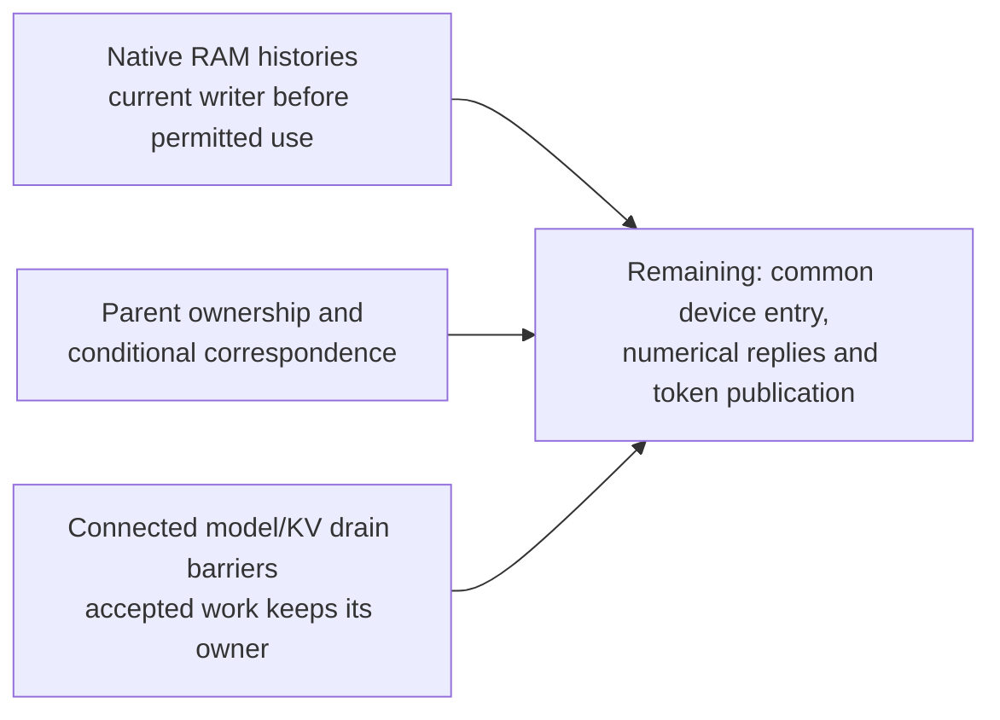

# Working-memory ownership and CLEAR

These source-bound results apply to the four current SimpleStories-V2-5M
images. They strengthen the argument that mutable memory serves initialized
inference workspace: current data must own a location before permitted use,
and accepted memory work must retain its owner while CLEAR drains it.
The images, numerical model, clock settings and benchmark records are unchanged.

**This is a collection of completed component guarantees. Full device session
isolation through every subsequent token is not yet established.**

## Established boundaries

| Boundary | What is established | Remaining boundary |
| --- | --- | --- |
| Native working RAM and transient state | Full-size RAM histories and conditional two-execution relations permit independent old payloads. Caller ownership precedes the checked reads, arithmetic admissions and result lanes. | Parent/numerical/RAM contracts still need complete temporal composition. Registered parallel projection MACs retain the checked vendor recurrence premise. |
| Model-read core | The actual shell, semantic model readers, four two-entry queues and owner arbiter retain accepted-word/role history through CLEAR. At their common healthy tracking epoch, core busy-low implies no owed or presented model read. Both shell source classes have complete 224-assertion certificates and three reached core covers. | Four shell RAM read values are unrestricted in this protocol scope, with actual capture clocks/enables retained. Separate full-RAM history proofs apply. Numerical services, typed K/V and outer transport remain boundaries of this core proof. |
| Typed K/V cancellation | Both native cache architectures retain accepted reads/writes until actual retirement. Healthy idle owes no typed work. CLEAR revokes six committed prefixes and pending authority, and invalidates the baseline cache. Cancelled attention completions expose only a fault marker and zero vectors/exponents. | This does not by itself establish current tensor values or the outer transport/device barrier. |
| K/V staging | Both architectures require complete current staging initialization before the checked staging uses. Every actual symbolic coordinate equals its current legal writer; exponent metadata has current descriptor provenance. | Attention response assembly/publication still needs session correspondence. |
| Baseline/seeded committed cache and typed writes | All nine current data/metadata returns precede cache validity; actual cached words equal their current fill writers. The native staging RAM read/prefetch/pack path emits typed payload coordinates and exponents from current legal stage inputs. | Current external reply behavior is fixed for session correspondence; these two images gain no external-memory integrity guarantee. |
| Connected semantic model/K/V protocols | All thirty actual cache outputs are restored alongside the full projection/group and lookup readers. Healthy active semantic idle implies no owed or presented model or typed K/V request. The two classes complete 96 and 95 assertions, respectively, with three reached barrier covers each. | The common core/shell/outer epoch join and numerical/token-publication composition remain open. |

These facts have their recorded entry and health conditions. Protocol tracking
can begin at a logically empty accepted-work boundary with already captured
current tensors or pre-request control. Empty-at-CLEAR is not assumed: accepted
work may be present when the real CLEAR arrives and must drain afterward.
These are safety results; indefinite provider stalls need not terminate.

The RAM and staging scopes use logical CLEAR without requiring a physical
reset to erase old payloads. CLEAR invalidates authority rather than zeroing
every memory cell. The four current images have separate source/image bindings;
matching bytes record provenance, not RTL-to-mapped-image equivalence.

## How this supports inference-only operation

The [write-exclusion result](../implementation-assurance/README.md) restricts
updates to stored model parameters. The [authentication/access results](../authentication-access/README.md)
bind permitted model bytes and private operand routes. This package addresses
another part of the argument: mutable working memory must obtain current
computational data and cannot be treated as an unrestricted persistent operand
store at the checked boundaries. Queue ownership also prevents an old response
from being silently assigned to a later operation during cancellation.



The arrows identify composition obligations. They do not assert a completed
whole-device theorem. Complete mutable-state signoff, protected guard/outer
session composition and correspondence through attention/token publication
remain outstanding. The native memory inventory is a coverage roster; the
presence of a module proof is not automatic signoff for each of its memories.
Physical erasure, vendor DDR persistence/order, physical CDC/reset behavior,
full numerical transformer correctness and mapped-bitstream equivalence are
outside these results. This package establishes no training-capacity bound.

## Check the recorded packet

Run from `demos/simplestories-v2-5m/`:

```sh
python3.12 -I -S -B formal/session-isolation/check_recorded.py
python3.12 -I -S -B -m unittest discover -s formal/session-isolation -p 'test_*.py' -v
```

The checker uses no solver, compiler or FPGA. It verifies bounded decompression,
exact source/model/query/reply identities, four current native image bindings,
82 selected completed component records, thirteen real corruption controls,
source-audit input pins and exact partition-query reconstruction. Counts overlap
and are not a coverage score. Original partial aggregate results and secondary
timeouts remain visible; no unknown conclusion is counted as proved.

The packet preserves frozen source builders/auditors under `source-tools/` and
exact run inputs/compiler recipes/models/queries in the compressed object store.
Original absolute paths remain provenance; the checker maps them without
requiring that workspace or writing to it. The recorded check does not execute
source auditors or repeat their compiler/encoding work. Fresh RTL elaboration is
a separate use of the preserved inputs and recipes, including their original
asset paths and explicit primitive premises.

## Run a fresh solver query

This runs a real solver on an exact frozen query in a separate output directory:

```sh
python3.12 -I -S -B formal/session-isolation/replay.py \
  --run connected-kv-drain-protected-r1 --query z3-induction.smt2 \
  --solver z3 --out /tmp/simplestories-kv-drain-induction
```

For a real skipped RAM-writer counterexample, use
`--run kv-staging-drop-lane-mutant-r1 --query z3-bmc.smt2`. Replays preserve
original receipts and reject unresolved query expectations. A successful replay
covers that query, not every component, a new image or a whole-device theorem.

## Full native behavioral exercise

Both K/V architectures also run two sessions with different tensor data and
ordinary CLEAR between them. Each checks four complete 128-coordinate stages,
72 typed writes, 24 pending and twelve committed responses, both semantic heads,
FULL/K-only/V-only requests, typed-memory stalls and baseline shared-kind-row
cache hits. Actual old RAM payload retention across CLEAR is checked.

The native typed-memory provider returns previously written words at their
typed addresses. The simulation uses an initial boot reset and no reset between
sessions. It is a behavioral supplement, not a formal physical-memory theorem.
Short formal staging covers exercise fresh admission and a coordinate write;
they do not claim all 128 coordinates are uploaded within those cover depths.
