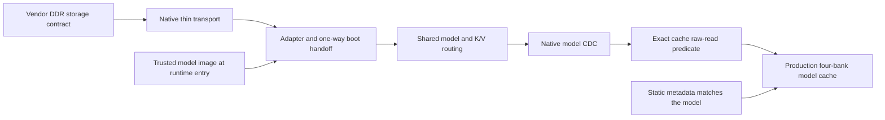

# Fixed-model reads through the baseline memory path

This package connects the current baseline's physical DDR transport, runtime
wrappers and model CDC to the production four-bank cache's model-word proof.
The cache's correct raw-reply premise is discharged through those custom RTL
modules. The explicit remaining boundaries are vendor storage behavior, the
trusted model image at runtime entry, and its static metadata-ROM binding.

The [theorem and proof argument](THEOREM.md) state the guarantee and those
boundaries precisely. This is a functional model-value result supporting
inference-only confinement. It is not the whole-device inference-only theorem.
It applies to the named baseline sources, not automatically to the other
SimpleStories configurations.



The physical independent-clock crossing, complete payload FIFOs, read-owner
rings, reset releases, RAMs, watchdogs and fault paths remain in the native
models. The boot module's original output bundle is an explicit boundary;
this package does not prove that boot authenticates or loads the intended
image. Successful reads are connected to the actual preceding-write history,
not to an assumed correct private reply. Queued boot commands are covered by
that correspondence; no empty-command-queue assumption is made at runtime entry.

## Reproduction

From the repository root, check the recorded packet and current source bindings:

```sh
python3.12 -I -S -B demos/simplestories-v2-5m/formal/upstream-model-values/run.py --recorded-only
```

For fresh native compilation, every solver query and the operating/defect controls:

```sh
python3.12 -I -S -B demos/simplestories-v2-5m/formal/upstream-model-values/run.py --out /tmp/simplestories-upstream-values --workers 8
```

Use a new output directory. The exact tool versions are in
[TOOLCHAIN.json](TOOLCHAIN.json); Yosys, Z3 and Icarus Verilog must be on PATH.
Each solver process has a 4-GiB limit and a 300-second limit. Unknown or timeout
fails the replay. Inputs and individual results are saved before and after each
query; the process ledger identifies only this run's jobs. No board is required.

The recorded argument contains 1,411 exact queries. It includes native reset
and induction checks, native seam/history joins, logical selector elimination,
reset-reachable read witnesses and controls demonstrating the need for value
and slot-coverage evidence. SAT controls never supply theorem premises.

The finite native controls exercise 260 model reads, 300 K/V writes, 12 K/V
reads, three boot reads, stalls and counter reuse. Actual-only wrong-owner,
wrong-physical-word and missing-controller-fault-mask defects must be detected.
These controls supplement the unbounded arguments.

## Reading the proof

- [THEOREM.md](THEOREM.md) explains the statement, inference-only relevance and assumptions.
- [CONTRACTS.json](CONTRACTS.json) gives the acyclic premise-discharge order.
- [PROOF.json](PROOF.json) contains the exact SMT rule assumptions, conclusions and dependencies.
- `properties/` contains the SMT-LIB specifications; `models/` contains source-bound native SystemVerilog, compiler recipes and compressed generated SMT.
- [SOURCE-RECIPES.json](SOURCE-RECIPES.json) reconstructs those sources from the production files and declared nondriving observations.
- [CORE-HISTORY-PROJECTION.json](CORE-HISTORY-PROJECTION.json) identifies the literal native readonly core-history block used at the cache seam.
- [RECORDED-RESULTS.json](RECORDED-RESULTS.json) binds each exact regenerated query to its recorded engine reply.

The Python entry point checks provenance and the proof graph and invokes the
engines. Python compilation alone establishes no hardware property. Native RTL
induction, checked seam lemmas, source erasure/instantiation and explicit
universal selector rules form the compositional argument; this is not a
single flattened whole-chip proof.
