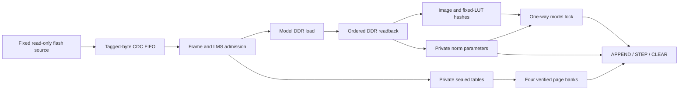

# Tang S-AWIC hardware

## Admission and ownership

The core and all admission storage operate at 25 MHz. The read-only SPI source operates in the native 12.5 MHz trusted domain. Its tagged bytes cross the native four-entry registered asynchronous FIFO. The existing thin transport joins the core to the 100 MHz vendor DDR application interface. Admission does not send large RAM arrays across clock domains.

Signature storage and the verifier's intermediate LMS hash rows use synchronous private block RAM. A ready/valid handshake prevents the verifier from consuming a signature byte before its addressed read completes. The intermediate hash port similarly qualifies the selected row before SHA consumption. These ports are internal; package data cannot select arbitrary memory addresses.

1. Reset revokes admission, model lock and runtime validity.
2. The SPI source reads the fixed signed-admission slot with opcode `0x03`. The ingress parser sends exactly the canonical frame to the LMS verifier and checks that the rest of the slot is erased `0xff` padding.
3. The admission block hashes its private payload RAM and verifies all supplied signatures from two or three distinct fixed authorities. The actual native SHA compressor performs all LMS/LMOTS hashing. Only completed admission and valid slot padding permit the separate fixed model read.
4. The boot owner writes all 227,062 model words to DDR. It then reads them back in ascending order through the actual native adapter and transport. A SHA check covers all 7,265,984 bytes against the signed image commitment.
5. The same readback supplies normalization storage, checks projection metadata against sealed signed RAM, and authenticates the fixed arithmetic-table suffix against a hardware constant.
6. Only all completed checks permit the one-way handoff to the runtime adapter. The four-bank service reads page digests and projection metadata from the private admitted tables. Each weight/LUT page is verified before use.
7. The UART token machine accepts APPEND, STEP and CLEAR under the fixed architecture. Runtime cannot rewrite admission storage or reopen boot ownership. A reset requires fresh complete admission.

## Fixed flash layout

| Region | Start | Bytes | End, exclusive |
| --- | ---: | ---: | ---: |
| Full physical model image | `0x801000` | 7,265,984 | `0xeeeec0` |
| Signed admission slot | `0xf00000` | 262,144 | `0xf40000` |

The slot contains the 115,396-byte two-signer or 116,692-byte three-signer frame, followed by `0xff` padding. There are exactly two fixed SPI transactions: admission first, then model after permission. Neither package fields nor UART traffic control SPI addresses, opcodes or lengths. Signature rejection cannot initiate model writes.

The FPGA configuration is loaded into volatile SRAM separately. The offline [prepare_flash.py](tools/prepare_flash.py) validates a package and writes the two data files and a hashed plan. It does not program a device. [check_flash.py](tools/check_flash.py) checks an independently read complete 16 MiB array against a deliberately blank layout outside those regions. It does not establish preservation of an unrecorded configuration region.

For a baseline-preserving install, [prepare_preserving_flash.py](tools/prepare_preserving_flash.py) overlays only those two fixed regions onto a complete pre-install backup. It revalidates the signed package and produces a complete raw 16 MiB candidate and hashes. `check_flash.py --baseline` checks the independent post-install readback against the same overlay, including every unchanged byte outside the update regions. The original independently captured backups remain separate recovery inputs.

## Model-dependent storage

| Data | Authenticated source | Runtime consumer |
| --- | --- | --- |
| Whole-image commitment | Signed payload, private admission registers | Ordered DDR readback checker |
| 1,774 expected page hashes | Signed payload, private sealed RAM | Native four-bank verified-page service |
| 2,328 projection metadata words | Signed payload, private sealed RAM; also compared against image readback | Existing synchronous metadata DMA |
| 3,328 RMSNorm coefficient/scale rows | Exact image readback, before model lock | Body and final-norm synchronous private ports |

The 13 RMSNorm vectors each contain 256 W10 coefficients. Transformer coefficients occupy words 211800–211919; transformer norm metadata occupies 214248–214249. Final-norm coefficients occupy 214250–214259, with metadata at 214260. The store rejects the forbidden `-512` coefficient, zero or out-of-format multipliers and nonzero padding. Its outputs are masked before lock. The active RMSNorm services use these ports, not model-compiled coefficient ROMs.

The fixed RoPE, softmax-exponential and SiLU suffix begins at word 214261 and has 409,632 bytes. Its SHA-256 is `fea751d73eb4fd28f160a4dcc4b8d1fa39c125cb05d10393ac45ad4e3e1bb76b`. The boot checker compares this suffix with the hardwired digest before model lock. This check uses the signed image and does not add a new package payload. Its runtime guarantee is limited by the page-binding gap below.

## Boot-to-runtime page binding limit

The released RTL checks the whole image and fixed-function suffix at boot, but does not compare every signed page digest with that same ordered readback. Runtime page authentication uses the separately signed page table. The boot suffix check therefore does not establish fixed runtime arithmetic tables against an approving signer threshold that also controls external DDR.

This limit applies to plain S-AWIC and S-AWIC with periodic reauthorization. Model-specific home approval does not repair this binding gap. Repaired RTL and prebuilt images require native routing, timing and board qualification before they replace the released artifacts.

## Build and security boundaries

The project retains the native board pins, clocks, physical DDR wrapper and DSP arithmetic branches. Proprietary vendor DDR/PLL source is acquired separately and checked against the enclosing demo's dependency manifest. It is not included in this source snapshot.

The [source comparison](evidence/native-source-comparison.json) identifies 74 unchanged baseline files, 12 changed files and 13 added files in the concrete project. The changes join boot ownership, sealed table ports and norm read ports through the actual hierarchy. Some copied legacy source files remain unused in the production file list; their presence is not an active fixed-weight dependency.

Simulation substitutes a raw DDR clock/calibration/storage model for the vendor PHY. The full campaign retains physical SPI pin behavior, the real FIFO, normalized adapters/transport, four runtime banks and UART. Native DSP wrappers use their existing integer-equivalent behavioral branches in simulation. These tests do not qualify analog DDR behavior, native primitive equivalence, timing or electrical margins.

The inherited SDC is diagnostic: no new false paths, clock groups or relaxed periods are used. Routed resource fit and specific timing reports must be distinguished from complete vendor-DDR timing signoff. An FPGA owner can replace the configuration; the intended fixed-circuit claim also requires a frozen FPGA configuration or an eventual ASIC and an assessed physical threat model.

SPI transfer and verification time are implementation latency. They are not a security-enforced update delay or a residual-training bound.
