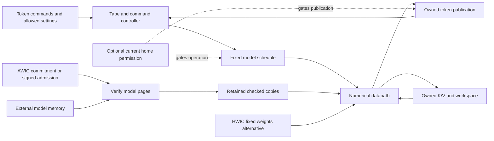

# Architecture and evidence

The hardware accepts token commands and runs a fixed language-model datapath.
It owns layer sequencing, tensor addresses, intermediate state and token
publication. Authenticated-weight designs (AWICs) check model weights against a
hardware approval policy; hardwired-weight designs (HWICs) encode the weights
in the circuit.

SimpleStories runs on Tang Mega, and the two Qwen models run on AWS F2. The
HWIC work is RTL and physical-design research. This guide starts with their
common architecture, then maps each configuration to its implementation,
evidence and reproduction instructions.

## Computation and trust boundaries

The application supplies tokens to APPEND, requests a token with STEP, and
invalidates logical context with CLEAR. Hardware owns the model schedule,
tensor addresses, intermediate operands and publication of results. Each
demonstrated FPGA design operates on one logical tape; prompt evaluation
processes positions through the fixed model.



The diagram shows how commands, weights and working state meet in the
datapath. The [evidence map](#evidence-and-open-joins) identifies which of these
connections have proofs and which still need to be composed.

The public surface also includes configuration-specific provisioning and
observations. Seeded sampling accepts settings only on an empty, idle tape.
Plain Tang S-AWIC reads a signed admission package from its private flash boot
path, installed through a separate programming workflow. Periodic
reauthorization adds UART challenge/grant traffic. Qwen includes a
restricted startup loader, status registers and a management display.
These surfaces belong in the security contract alongside token commands.

CLEAR revokes logical state authority and coordinates cancellation or draining
of accepted work. It is not RAM zeroization, a hard reset, or permission to
forget an outstanding memory transaction. External memory trust is
configuration-specific: the unprotected K/V variants do not establish correct
inference under arbitrary hostile K/V changes.

| Platform | Arithmetic contract | Clock and memory organization |
| --- | --- | --- |
| SimpleStories on Tang Mega | Fixed W10/A16/KV16 BFP-v5 operators; greedy selection or the specified seeded sampler | 25 MHz core, 100 MHz DDR application, 400 MHz memory PLL and 12.5 MHz trusted domain; boot/admission clocking is configuration-specific; external model and K/V regions |
| Qwen on AWS F2 | Fixed int8-weight, integer/FP32/BF16 operations and rounding; model-specific geometry | 100 MHz core, 125 MHz memory interface and 250 MHz host domain; HBM plus private verified-page storage |
| HWIC research | Named checkpoint preserves its selected fixed numerical contract | RTL memory services and block implementation studies; no qualified whole-chip memory, clock or token rate |

The [SimpleStories hardware guide](../demos/simplestories-v2-5m/HARDWARE.md)
and [Qwen hardware guide](../demos/qwen3-1.7b/HARDWARE.md) contain detailed
datapath diagrams and implementation boundaries. Their numerical references
specify the implemented function; agreement with that function is distinct
from measuring model-quality loss relative to the original floating-point model.

On Tang, the trusted divider supplies reset and flash-side transport. The
signed-update admission/readback hashing and LMS verifier, and the home
permission logic and timers, run in the 25 MHz core domain. The selected top
connections and constraints determine each variant's actual clock boundaries.

## Configurations

**F-AWIC** fixes the accepted model commitment in hardware. **S-AWIC** admits
compatible weights under a fixed signature policy. **HWIC** fixes the weights
in the circuit. The FPGA implementations are assessed under a frozen
configuration assumption: their bitstream or AWS FPGA image, fixed constants
and trusted on-chip state form part of the root of trust.

| Configuration | Model admission | Mutable inference memory | Implementation and evidence |
| --- | --- | --- | --- |
| SimpleStories baseline | Fixed weight commitment | External DDR K/V without integrity protection | [Hardware](../demos/simplestories-v2-5m/HARDWARE.md), [greedy qualification](../demos/simplestories-v2-5m/GREEDY-QUALIFICATION.md) |
| SimpleStories K/V protected | Fixed weight commitment | Typed K/V with trusted tags and CLEAR epoch | [K/V design](../demos/simplestories-v2-5m/KV-PROTECTION.md), [greedy qualification](../demos/simplestories-v2-5m/GREEDY-QUALIFICATION.md) |
| SimpleStories encrypted memory | Fixed plaintext commitment after decryption | K/V integrity and encrypted weight/K/V transport | [Encryption design](../demos/simplestories-v2-5m/ENCRYPTED-MEMORY.md), [greedy qualification](../demos/simplestories-v2-5m/GREEDY-QUALIFICATION.md); supplied keys are public demonstration keys |
| SimpleStories seeded sampling | Fixed weight commitment; bounded temperature and public seed settings | External DDR K/V without integrity protection | [Numerical and protocol contract](../demos/simplestories-v2-5m/STOCHASTIC-GENERATION.md), [selected qualification](../demos/simplestories-v2-5m/CURRENT-QUALIFICATION.md) |
| SimpleStories signed updates | Signed model commitment and boot-to-runtime page binding | External DDR K/V without integrity protection | [S-AWIC hardware](../demos/simplestories-v2-5m/variants/signed-update/tang/HARDWARE.md), [validation](../demos/simplestories-v2-5m/variants/signed-update/tang/VALIDATION.md) |
| SimpleStories periodic reauthorization | Signed updates plus current model-specific permission | External DDR K/V without integrity protection | [Permission mechanism](../demos/simplestories-v2-5m/variants/home-authorization/HARDWARE.md), [validation](../demos/simplestories-v2-5m/variants/home-authorization/VALIDATION.md), [routed timing review](../demos/simplestories-v2-5m/variants/home-authorization/RESET-REVIEW.md) |
| Qwen3-1.7B | Fixed weight commitment; private authenticated HBM page copies | External HBM K/V without integrity protection | [Hardware and source identity](../demos/qwen3-1.7b/HARDWARE.md), [validation](../demos/qwen3-1.7b/VALIDATION.md), [formal scope](../demos/qwen3-1.7b/FORMAL-STATUS.md) |
| Qwen3-8B | Fixed weight commitment; private checked HBM page copies | External HBM K/V without integrity protection | [Hardware and source identity](../demos/qwen3-8b/HARDWARE.md), [validation](../demos/qwen3-8b/VALIDATION.md), [formal scope](../demos/qwen3-8b/FORMAL-STATUS.md) |
| SimpleStories HWIC research | Fixed ROM baseline and separately identified spatial implementations | Private dynamic K/V requiring a physical memory implementation | [Runnable RTL checkpoint](../research/hwic/simplestories-2026-10-27/README.md), [integrated regression](../research/hwic/PROGRESS-2026-11-04.md), [memory and performance assessment](../research/hwic/PROGRESS-2026-11-05-FEASIBILITY.md) |

The separate [Qwen3-1.7B protected K/V simulation](../demos/qwen3-1.7b/variants/protected-kv-simulation/README.md)
compares the plain and authenticated stores at the attention input and checks how
each handles a corrupted K or V value. The measured F2 image uses the plain store.

The [combined SimpleStories target](../demos/simplestories-v2-5m/variants/combined-security-simulation/README.md) supplies full-datapath RTL simulation evidence, with an [eleven-case validation record](../demos/simplestories-v2-5m/variants/combined-security-simulation/VALIDATION.json).

The [Qwen3-8B board measurements](../demos/qwen3-8b/measurements.json) provide a measured baseline for the [proposed reusable-die architecture](PROPOSED-REUSABLE-AWIC.md), whose Llama 8B and 405B deployments are proposals.

The runnable HWIC ROM checkpoint and the later spatial regression are different
RTL selections. Matching test-corpus counts do not transfer qualification
between them.

The six Tang configurations are distinct built images. Signed model admission
and permission to continue running are separate mechanisms. In the
reauthorization design, withholding renewal or losing access to home base
expires permission; offline rollback prevention independent of home policy is
not supplied. Its public test keys and entropy qualification limits are stated
in the [variant guide](../demos/simplestories-v2-5m/variants/home-authorization/README.md).

## Evidence and open joins

The end-to-end objective is that accepted operations implement the prescribed
model on their authorized logical state, and that usable computation and
observations remain confined to the specified service. Determinism alone does
not establish this. Token-value safety, authorization, session isolation,
completion under service assumptions, and physical implementation are distinct
obligations. The [formal argument and dependency map](FORMAL-ARGUMENT.md)
state the target and the provider-to-consumer obligations in more detail.

Read the evidence by scope: **proved** results apply to the source and
assumptions named in their theorem; **tested** results are finite simulation or
board observations; **open** obligations are not yet established. The linked
statements specify cryptographic, configuration and vendor assumptions.

| Obligation | Established evidence | Remaining join or condition |
| --- | --- | --- |
| Fixed model and checked-copy use | **Proved in named SimpleStories scopes:** native SHA compression/chaining, admission, sealed-copy ownership and selected consumption in [authentication and access](../demos/simplestories-v2-5m/formal/authentication-access/README.md); model-write exclusion in [implementation assurance](../demos/simplestories-v2-5m/formal/implementation-assurance/README.md) | Cryptographic resistance is assumed; complete startup-to-every-numerical-consumer composition and physical correspondence remain open |
| Baseline numerical meaning | **Proved segment:** [model reads](../demos/simplestories-v2-5m/formal/upstream-model-values/THEOREM.md), [Q computation](../demos/simplestories-v2-5m/formal/q-operator/THEOREM.md), and [RMSNorm through Q and query RAM](../demos/simplestories-v2-5m/formal/rms-q-segment/THEOREM.md) | Earlier activation meaning, remaining operators, graph sequencing and final token-publication joins remain open |
| Baseline command to token message | **Proved:** Under an accepted STEP, the shell can commit one candidate. An accepted CLEAR before bridge capture cancels it. Once the bridge captures the token, it fixes all five reply bytes. [Control-ownership theorem](../demos/simplestories-v2-5m/formal/public-control-ownership/THEOREM.md) | Open: which current-STEP head rows produced the candidate, their model-logit values, UART pin delivery and guaranteed completion. The candidate is arbitrary at the numerical-core boundary. |
| Working-state ownership and CLEAR | **Proved component scopes:** [session and cancellation histories](../demos/simplestories-v2-5m/formal/session-isolation/README.md), [protected K/V checks](../demos/simplestories-v2-5m/formal/authentication-access/README.md) and [CLEAR epoch](../demos/simplestories-v2-5m/formal/kv-clear-epoch/README.md) | Accepted K/V record → checked message → numerical consumer composition remains open. Checked-copy/capture facts do not establish the writer's numerical meaning or whole-device post-CLEAR isolation |
| Signed admission and permission | **Proved components:** Tang boot-page consistency and stream assembly; home permission/reset/startup controls. **Tested:** admission and permission campaigns. [Signed-update formal status](../demos/simplestories-v2-5m/variants/signed-update/tang/FORMAL-STATUS.md), [reauthorization formal status](../demos/simplestories-v2-5m/variants/home-authorization/FORMAL-STATUS.md) and their validation records | Complete cryptographic authorization and numerical composition, production key/entropy assumptions and physical implementation remain separate |
| Qwen authentication and computation | **1.7B component results reported:** [formal status](../demos/qwen3-1.7b/FORMAL-STATUS.md) connects authentication and reader/queue properties to the token-machine model input; both models have finite reference/FPGA comparisons | The 1.7B development solver bundle is not included. Complete operand admission/use, numerical refinement and whole-device composition remain open; [8B has no supplied proof suite](../demos/qwen3-8b/FORMAL-STATUS.md) |
| Physical behavior | **Tested:** selected FPGA campaigns and native implementation reports; **HWIC research:** finite RTL and separately identified block studies | Full timing/reset/CDC, RTL-to-image equivalence and physical security are not established by component proofs or successful tokens |
| Residual training capacity | [Methodology](analysis/RESIDUAL-TRAINING-METHODOLOGY.md) separates demonstrated access, proved bounds, conditional allowances and unresolved channels | No certified residual training fraction; permitted token-oracle use and physical access require their own analysis |

The [SimpleStories formal-status guide](../demos/simplestories-v2-5m/FORMAL-STATUS.md)
is the detailed index for its proof scopes. Overlapping assertion counts are
not additive progress measures. A safety proof that permits waiting or
fail-closed termination does not establish liveness, timing noninterference,
or that every failure decision is authorized.

## Source and build authority

A supported configuration is determined by its selected top, source contents,
compile order, parameters/defines, model assets, constraints and tool inputs.
Names such as `candidate`, `probe` or a historical board number do not determine
whether a file participates in the current circuit.

For Tang, follow the selected qualification record and
[build authority](../demos/simplestories-v2-5m/REPRODUCE.md#configuration-and-build-authority)
and [source-selection check](../demos/simplestories-v2-5m/REPRODUCE.md#source-selection-check).
The native project and Tcl settings select the physical build, including top,
constraints and options. An inherited source list may describe only members
or a base subset; matching member order alone is not a complete build recipe.
The home-authorization project
also includes its authorization and entropy sources. Separately acquired
vendor inputs are pinned by the build inventory.

For Qwen, each demo's `SOURCE-INPUTS.json`, implementation inventory and
`tools/prepare_hardware.py` identify and stage its selected source build.
`hardware/build/scripts/qwen_sources.tcl` and its synthesis consumer select
the compilation order, includes, defines and top. The
[1.7B](../demos/qwen3-1.7b/HARDWARE.md#configuration-and-build-authority) and
[8B](../demos/qwen3-8b/HARDWARE.md#configuration-and-build-authority) recipes
have distinct source and qualification records. Their finite source checks
are documented for [1.7B](../demos/qwen3-1.7b/REPRODUCE.md#source-selection-check)
and [8B](../demos/qwen3-8b/REPRODUCE.md#source-selection-check).
The [model-size reuse example](MODEL-SIZE-REUSE.md) shows what can be shared.
One generator derives the model address decoder from the tensor layout. It
reproduces the released 8B RTL byte for byte. For 1.7B, an induction proof
shows that every decoder output matches the release on every cycle after reset.

For a larger Qwen model, put layer count, dimensions and weight layout in the
build profile. Choose memory banking, pipeline depth and the execution schedule
from the required weight bandwidth, K/V traffic and cycles per token at the
target clock. A weight reader can serve several schedules if its interface
specifies when verified bytes become available and when a buffer can be reused
after CLEAR.

For the HWIC checkpoint, use its
[configuration and evidence map](../research/hwic/simplestories-2026-10-27/README.md#configuration-and-evidence),
which distinguishes the public ROM baseline from the later spatial, split K/V
and attention-reuse selections.

Frozen proof bundles, source snapshots and failed experiments preserve the
meaning of earlier results. They are not alternate current build targets.
New shared modules or changed source require explicit configuration bindings
and appropriate validation; renaming files or updating hashes cannot confer
the previous image's qualification on a successor.

## Reproduce representative results

Start from a clean release with Python 3.12. These root-level commands inspect
the delivered inventory and recompute the recorded benchmark:

```sh
python3.12 -I -S -B tools/verify_release.py --strict
python3.12 -I -S -B tools/fpga_speed_benchmark.py --check
```

Strict checking rejects extra files. Keep environments and generated output
outside the release; on a working tree, follow the documented non-strict mode
instead of deleting local work.

| What to reproduce | Entry point | What the result establishes |
| --- | --- | --- |
| Recorded proof and board evidence | [SimpleStories reproduction](../demos/simplestories-v2-5m/REPRODUCE.md) and [CI](../.github/workflows/offline-checks.yml) | Integrity, recorded outcomes and the stated helper/fixture checks; a recorded-only command does not rerun a solver or FPGA |
| Tang command and memory proofs | [STEP, commit and reply ownership](../demos/simplestories-v2-5m/formal/public-control-ownership/README.md) and [K/V CLEAR epoch](../demos/simplestories-v2-5m/formal/kv-clear-epoch/LINUX-REPLAY.md) ([strict replay example](../demos/simplestories-v2-5m/formal/kv-clear-epoch/REPLAY-EXAMPLE.md)) | Fresh RTL compilation and solver checks for baseline token publication and the protected K/V epoch invariant, each on its own configuration |
| Qwen model-size reuse | [Run the address decoder comparison](MODEL-SIZE-REUSE.md#run-the-example) | Reproduce the 8B decoder source and prove that the generated 1.7B decoder matches every released module output after reset |
| Fresh RTL components | [Tang loader and Qwen command checks](RTL-CI.md) | Digital lint, elaboration and behavior of two production interfaces across eight configurations; full-chip and physical timing qualification remain separate |
| Numerical and hardware reproduction | [SimpleStories](../demos/simplestories-v2-5m/REPRODUCE.md), [Qwen 1.7B](../demos/qwen3-1.7b/REPRODUCE.md), [Qwen 8B](../demos/qwen3-8b/REPRODUCE.md) | Named reference, simulation or board checks; asset/tool and hardware prerequisites differ |
| HWIC full-model RTL | [Checkpoint replay](../research/hwic/simplestories-2026-10-27/README.md#reproduce) | Finite tensor/token comparisons against the independent reference, with a separate changed-weight rejection check |

## Engineering priorities

The current architecture preserves the public interfaces and numerical
contracts while the following work proceeds:

1. **Configuration and evidence consistency.** Keep one checked route from
   each supported configuration to its actual build and results. Consolidate
   development modules incrementally while retaining immutable release evidence.
2. **Proof composition.** Discharge the missing provider-to-consumer joins in
   the fixed-model argument; keep each assumption and open obligation visible.
3. **Physical closure.** Disposition clock-crossing and reset findings against
   actual netlists. Qwen already applies targeted Gray-bus and first-stage
   constraints; full qualification remains open. Broad exceptions can hide the
   paths that require validation.
4. **Measured scheduling improvements.** Profile compute, memory,
   authentication and stalls before widening hardware. Evaluate chunked prefill
   while preserving command semantics; batching independent tapes requires an
   explicit isolation and resource-policy design.
5. **HWIC memory feasibility.** Bind immutable weights, K/V SRAM and logic to
   compatible characterized implementations before pursuing whole-chip
   physical optimization.

The [common FPGA benchmark](benchmarks/FPGA-SPEED-BENCHMARK.md) measures
single-stream host-observed generation. The
[GPU references](benchmarks/H100-BENCHMARK.md) use their stated numerical,
batch and timing boundaries. These measurements cannot by themselves identify
the intrinsic cost of inference-only enforcement or predict a batched ASIC.
