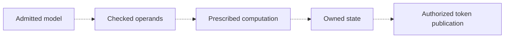

# The inference-only argument and its proof dependencies

The intended result is that the configured circuit implements its prescribed
inference service and confines usable computation and access to that service.
**The complete whole-device theorem is open.** This page connects the existing
[SimpleStories objective](../demos/simplestories-v2-5m/FORMAL-STATUS.md#verification-objective)
and [Qwen3-1.7B objective](../demos/qwen3-1.7b/FORMAL-STATUS.md#verification-objective)
to their established results and remaining connections. Results apply only to
their named configurations.

The dashed arrows mark connections that remain to be proved for the complete
device. Existing proofs connect parts of this chain: for example, checked model
reads and the baseline RMSNorm/Q computation through actual query RAM. The
dependency table below identifies each result's boundary.

## The target and its interfaces

Fix a selected configuration, its admitted model, finite-width numerical
profile, permitted settings and declared environment contract. A request is
accepted at its documented handshake/transaction boundary, not merely because
the host attempted it. On normal completion, APPEND extends the logical tape;
STEP computes and commits the specified next token; CLEAR revokes the current
logical context. Every published token must belong to a current, uncancelled
accepted STEP and equal the prescribed next-token result for its accepted tape,
model and sampling state.

This **numerical value confinement** is one part of the objective. The other
is **computation/access confinement**: relevant arithmetic admissions, operands,
state effects, private accesses and observation producers must follow the fixed
graph and service/resource algorithms. A restricted command parser alone does
not prove correct tokens; correct token examples do not exclude another program
or an unauthorized private operand path. Arithmetic and preservation proofs
support both claims, with different proof obligations.

The public surface is configuration-specific. Seeded SimpleStories adds bounded
temperature/public-seed settings while the tape is empty and idle. Signed-update
and reauthorization variants add their admission/renewal policy. Qwen includes
restricted startup loading, status registers and its documented management
display. Malformed or busy commands, backpressure, reset, cancellation and
faults require specified rejection, waiting or error behavior. Thus the complete
contract is broader than three normal inference opcodes.

The following obligations must stay distinct:

| Obligation | Required meaning |
| --- | --- |
| Numerical correctness | The implemented finite-width operators, graph, storage and selection produce the specified model result. Model-quality loss against a floating-point model is a separate measurement. |
| Computation/access restriction | Actual arithmetic and private access cannot acquire a host-chosen program, arbitrary operands or unowned effects outside the prescribed service. |
| Session/CLEAR behavior | Revoked work cannot acquire later authority; outstanding memory operations retain their owners while cancellation drains. CLEAR need not erase RAM or verified caches. |
| Authorization policy | The active model and permission belong to the selected fixed-root or signed/renewable policy. Online permission expiry is distinct from offline anti-rollback. |
| Public and status observations | Token, fault, status, management and timing-producing logic obey their stated contracts. Permitting a fail-closed stop does not by itself authorize every failure decision. |
| Progress and residual capacity | Completion needs its stated service assumptions. A certified residual training-capacity bound is not supplied by these component proofs. |

A safety result permitting stalls or absorbing fail-closed termination is not
liveness, constant time or complete observational noninterference. Retained
cache residency can affect latency. A value-confinement argument must identify
which values are published; a stronger observational claim also needs its
fault/status/timing-producing connections.

## How the component proofs fit together

A **provider** establishes a property that a later **consumer** relies on. For
example, a checked memory read provides a model word to an arithmetic operator.
Composition requires proving that the actual word, owner and invocation satisfy
the operator's assumptions on the same execution trace.

**Proved** means the linked source-bound statement holds under its named
contracts. **Reported** identifies results whose development solver bundle is
not delivered. **Open** identifies a missing connection. Simulation/board
comparisons are finite tests, not universal proof. Sources, parameters, widths,
defines, reset/clock views and selected image must match the linked inventory;
sharing a module name or numerical model is insufficient.

| Dependency and configuration | Provider guarantee / evidence | Consumer requirement and connection status |
| --- | --- | --- |
| Runtime model-write restriction — named SimpleStories custom DDR path | **Proved:** after LOCK, issued writes stay outside the model region until common hard reset, including queued boot writes. [Implementation assurance](../demos/simplestories-v2-5m/formal/implementation-assurance/README.md) | Connects to the actual custom transport boundary. It does not prove physical DRAM behavior, startup image identity or every possible FPGA/host access path. |
| Authentication and retained checked copies — named SimpleStories bank/guard scopes | **Proved:** FIPS-based native SHA compression/chaining, checked model-page ownership, selected stage/operand routing, and protected K/V copy/capture scopes. [Authentication/access](../demos/simplestories-v2-5m/formal/authentication-access/README.md) | A consumer needs the correct model/role/address, original owner and relevant message, not merely equal bits. Scoped joins are proved where stated; complete startup-to-every-consumer and original numerical K/V writer provenance remain **open**. SHA algorithm correctness is distinct from assumed hash resistance. |
| Model words through DDR/cache — baseline SimpleStories | **Proved composed segment:** native routing, transport/CDC and production model cache supply the named model words. [Model-read theorem and contracts](../demos/simplestories-v2-5m/formal/upstream-model-values/THEOREM.md) | Vendor storage, trusted runtime-entry model identity and metadata-ROM binding remain explicit conditions. This does not itself prove startup authentication/loading. |
| Numerical producer through retained query RAM — baseline SimpleStories | **Proved composed segment:** independent integer RMS meaning, whole-vector normalization, full Q operation and owned unrotated query payload/readback. [RMSNorm-to-Q statement](../demos/simplestories-v2-5m/formal/rms-q-segment/THEOREM.md) | Starts at the actual RMS stage-admission vector/exponent/role and named model-word contracts. Earlier activation meaning, other operators, remaining graph and final token publication are **open**. Other configurations need their own bindings. |
| Mutable K/V and session authority — protected SimpleStories variants | **Proved named components:** checked K/V copy/use, lifecycle histories, and plaintext guard's native 64-bit CLEAR epoch. [Status](../demos/simplestories-v2-5m/FORMAL-STATUS.md), [epoch theorem](../demos/simplestories-v2-5m/formal/kv-clear-epoch/THEOREM.md) | Original accepted K/V record → physical mask/RAM → frozen hash message/tag → verified read → actual attention/numerical frame remains an **open composed join**. Pending staged data and upper logical commit are distinct. An epoch or checked-copy theorem does not establish that whole chain. |
| Baseline command and token-message ownership — SimpleStories | **Proved composed control segment:** an accepted STEP owns its successful candidate commit, bridge capture at most once and immutable five-byte frame; accepted CLEAR cancels committed but uncaptured candidate authority. [Control-ownership theorem](../demos/simplestories-v2-5m/formal/public-control-ownership/THEOREM.md) | Common-clock, sampled-reset scope. The candidate is an arbitrary token supplied at the numerical-core boundary. Its origin in this STEP's actual head rows/logits and the prescribed model remains **open**. Per-position frame-byte safety does not prove physical UART-pin delivery or completion. |
| Other command and sampling scopes — SimpleStories | **Proved component scopes:** lifecycle, token-shell, UART and seeded settings/sampler ownership. [Formal index](../demos/simplestories-v2-5m/formal/README.md), [sampling contract](../demos/simplestories-v2-5m/STOCHASTIC-GENERATION.md) | The baseline control theorem does not establish these configurations' complete joins. Numerical provenance, cancellation and publication need matching source/parameter bindings on the same invocation. |
| Signed admission and renewable permission — selected S-AWIC variants | **Tang:** proved boot accounting (abstract hash child) and stream assembly (common arbitrary compressor replies); signed-admission composition is **open**, with finite operation tests. **Home:** proved conditional permission/reset/startup controller scopes plus finite tests. [Signed update](../demos/simplestories-v2-5m/variants/signed-update/tang/FORMAL-STATUS.md), [reauthorization](../demos/simplestories-v2-5m/variants/home-authorization/FORMAL-STATUS.md) | Verifier/key/entropy/policy premises and source selection remain explicit. Complete authorization-to-numerical execution composition and physical guarantees are **open**; public demonstration keys are not production secret provisioning. |
| Qwen3-1.7B on AWS F2 | **Reported source-bound components:** SHA/framing authentication through private model input, reader/queue/storage and control results. [Formal status](../demos/qwen3-1.7b/FORMAL-STATUS.md) | The release does not include the development solver bundle. Complete actual operand admission/use, numerical graph refinement, public/status composition and RTL-to-image equivalence remain **open**. SimpleStories proofs do not transfer. |
| Qwen3-8B and HWIC research | **Finite engineering evidence:** [8B status](../demos/qwen3-8b/FORMAL-STATUS.md), [HWIC checkpoint](../research/hwic/simplestories-2026-10-27/README.md) | No Qwen8B proof suite is supplied. Fixed ROM or tested tokens alone do not establish graph/access confinement, a physical memory implementation or a whole-device theorem. |

Each missing edge needs a same-trace correspondence: port/parameter identity,
admission ticket, descriptor, model/session generation, retained value frame,
reset/CLEAR priority, fault masking and allowed hold/drain behavior. A provider
must establish the consumer's actual premise before its effect; a later fault
cannot excuse an earlier live unauthorized effect. Acyclic checked composition
must discharge these premises, not assume that a private reply is already right.

## Trust boundary and a reproducible starting point

The root of trust includes the selected frozen circuit configuration, constants
and trusted on-chip state. FPGA reconfiguration, physical faults, vendor
primitive semantics, reset/clock implementation and mapped-image equivalence
have their stated separate boundaries. A digital proof is not physical signoff.
Cryptographic collision/second-preimage resistance is an assumption even where
SHA arithmetic is proved.

Memory contracts differ by configuration. The baseline, seeded and signed-update
variants with unprotected external K/V do not inherit the protected variants'
hostile-K/V guarantees. A theorem relying on vendor storage or runtime image
identity retains that premise until its upstream obligation is discharged.
The [residual-capacity methodology](analysis/RESIDUAL-TRAINING-METHODOLOGY.md)
is a separate analysis; no certified residual training fraction follows from
the table or from throughput measurements.

For a small fresh check, run the existing
[CLEAR epoch replay example](../demos/simplestories-v2-5m/formal/kv-clear-epoch/REPLAY-EXAMPLE.md).
It freshly recompiles three native models and executes 26 Z3/cvc5 queries,
including reset, induction, composition and defect controls. Recorded-only
validation checks saved answers and identities without rerunning a solver.
The proof statements/assertions are HDL/SMT; Python coordinates replay and
checks bindings. This supporting invariant is a reproducible part of the
argument, not a substitute for the open whole-device joins above.
