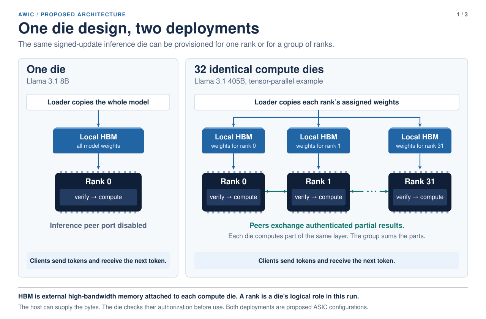
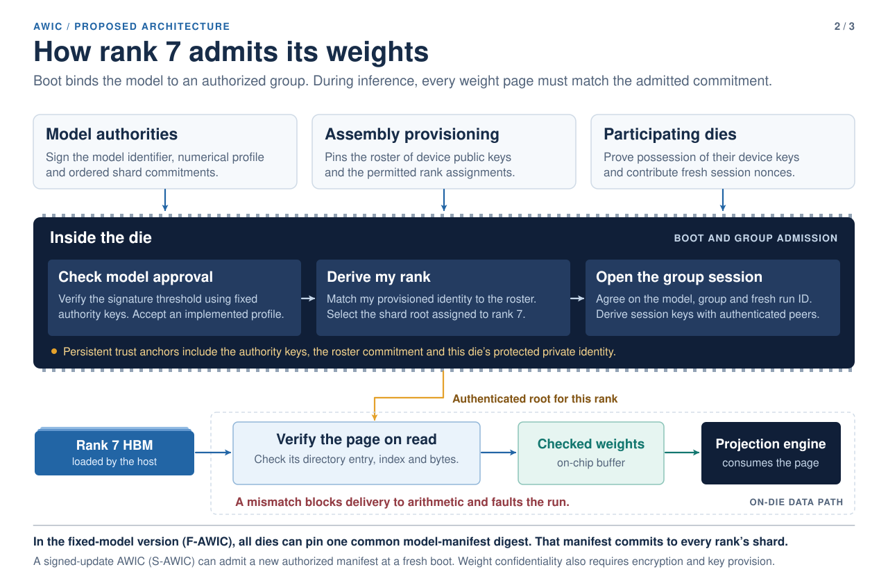
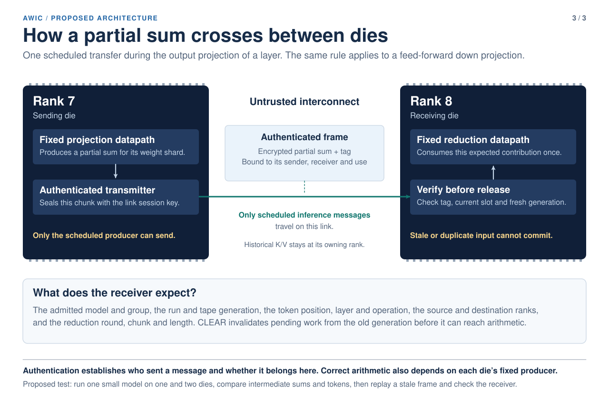

# Proposed architecture for a reusable inference die

The released Qwen3-8B design generates tokens on one FPGA and verifies model weights before the projection engine uses them. The proposed ASIC would carry that weight check into a system of identical compute dies. The examples below use a standalone Llama 3.1 8B and a partitioned Llama 3.1 405B. Both are proposed deployments. The measured FPGA runs Qwen3-8B. [Qwen3-8B board measurements](../demos/qwen3-8b/measurements.json) · [Released hardware architecture](ARCHITECTURE.md)

## Where the weights live

*Proposed deployments of one reusable die design. The 32-die group is a reference configuration; the measured baseline is Qwen3-8B on one FPGA.*

An external computer loads each die’s attached high-bandwidth memory. In the large example, each die performs part of the same layer. Some weights are replicated. The group combines partial results before continuing to the next dependent operation. Each die keeps the attention history for the heads assigned to it. The diagram follows one token stream. A batched version would serve several independent token tapes on the same approved model. A die could reuse one verified weight block across ready tapes. Each tape would retain its own position, K/V history and generation, and each peer contribution would be bound to its intended tape.

## How a die knows its role

*Proposed multi-die admission. The measured Qwen3-8B baseline checks weight pages on one FPGA; group and rank admission remain design obligations.*

In the signed-update design, a threshold of model authorities approves the model and its shard commitments. Assembly provisioning binds device identities to allowed ranks. Every active die must agree on the same model, group and fresh run before inference. The fixed-model alternative can pin a common digest that commits to the complete ordered list of shards. A die rejects a page that fails the check for its rank and address. The public SimpleStories prototype demonstrates signed model admission for a fixed geometry. Multi-die group admission remains a design obligation. [Signed-update prototype](../demos/simplestories-v2-5m/variants/signed-update/README.md)

## What can cross a die boundary

*Proposed inter-die transfer. The measured baseline is single-FPGA Qwen3-8B; authenticated peer communication is part of this proposal.*

The receiver derives the expected sender, operation and chunk from its own inference schedule. It accepts an authenticated partial sum once, in the matching run and generation. Correctness still depends on the sending endpoint producing its prescribed result and on device identities and keys surviving the physical threat model.

## What has been tested?

A hybrid simulation ran the released SimpleStories-V2-5M model on one simulated rank and on two instances of the same RTL rank. From input 378, both generated **200 → 15 → 103**, matching the FPGA capture. Splitting the matrix columns preserved all 55,041 checked row sums and every vocabulary score. The standalone rank sent and received zero peer frames. After a two-rank restart, the receiver rejected an old partial sum at the same row and sequence number before it could reach the adder. Matrix products, peer handshakes and addition ran in RTL. The software harness supplied nonlinear operations, K/V storage, session authentication and scheduling. [Reproduce the SimpleStories comparison](../research/reusable-die/simplestories-tp1-tp2/README.md)

The next system comparison is 16 versus 32 dies on the same model, prompt, output length and numerical quality. The 32-die example is a reference for that comparison. A complete 405B execution, authenticated link throughput, package power and matched accelerator performance remain open.
